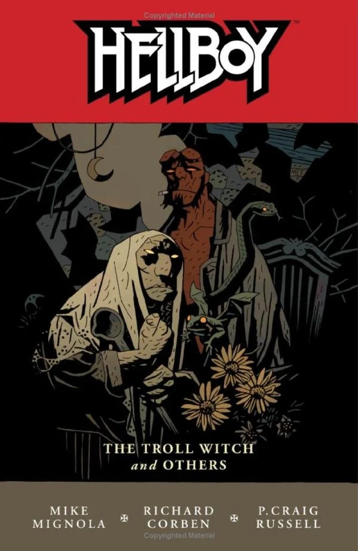

[Hellboy](/entry/Hellboy) faces off with a card playing Vampire in Prague.

## Publication History

This story was published for the first time as part of [*Hellboy – Volume 7: The Troll Witch and Others*](/entry/TPB) in October 2007.

## Synopsis

The story opens with a broad look at the many ghosts and ghouls in Prague. Prof. Gustav Kubin tells the story of "The Vampire of Prague". During the plague lived a verger who was a gambler. When so many people were dead that the man could not find a game, and so he played cards with the dead. For this he was cursed to walk the night looking for victims. If anyone can beat him at cards he will be able to die, but he will kill the losers.

Hellboy enteres the lair of the vampire. He finds the vampire and throws a large grenade at him. In the resulting explosion, the vampire grabs Hellboy and begins to choke him. The two fight across the city, until the pair crash through the glass at a marionette shop. Hellboy grabs a piece of the plate glass and beheads the vampire. As Hellboy frees himself from the marionette strings, five small cards tumble out of a puppet's sleeve. The vampire turns into a bat and flies away leaving the contents of his pockets, including five cards, behind. Hellboy checks the cards and sees that his hand beat that of the vampire. The sun rises and the vampire is destroyed.

## Story Chronology

The story takes place on August 19th 1982. This is the same year as *[The Vârcolac](/entry/The%20V%C3%A2rcolac)* and *[Abe Sapien: The Haunted Boy](/entry/The%20Haunted%20Boy)*

! colspan = 3 | [Vol. 7 The Troll Witch and Others](/entry/TPB)

**Vampire of Prague, The** **Vampire of Prague, The**