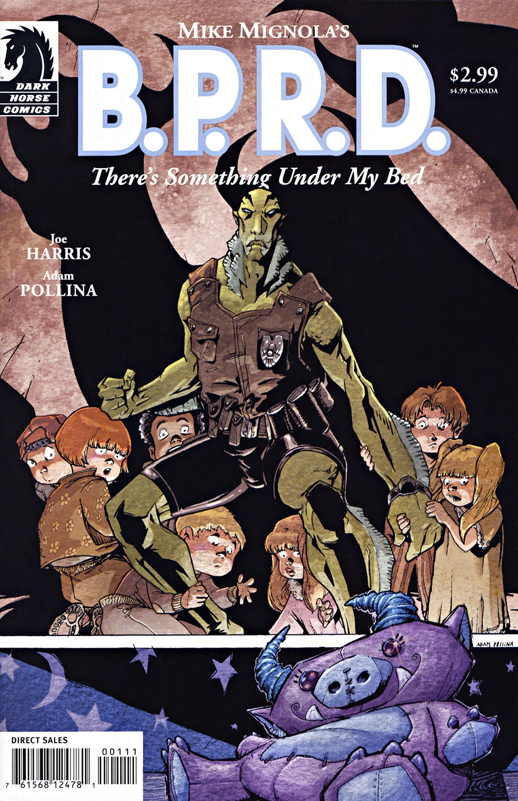

在***《床下有鬼》***（There's Something Under My Bed）中，B.P.R.D. 调查宾夕法尼亚州一座小镇上接连发生的儿童绑架案。

## 出版历史

《[空心地球](/entry/Hollow_Earth)》之后，*B.P.R.D.* 漫画将走向何方一度并不明朗。2003 年 5 月至 11 月间，每隔一个月推出一篇单篇故事，共四篇：《[威尼斯之魂](/entry/The_Soul_of_Venice)》、《[黑水之域](/entry/Dark_Waters)》、《[午夜列车](/entry/Night_Train)》和《床下有鬼》。与此同时，在"休刊"月份，黑马漫画出版了[脱离正传时间线](/entry/Hellboy_Comics)的选集《地狱男爵：怪谈》（*Hellboy: Weird Tales*）。

《床下有鬼》于 2003 年 11 月出版，后于 2004 年 8 月被收录进合订本《B.P.R.D.：威尼斯之魂及其他故事》（*[B.P.R.D.: The Soul of Venice & Other Stories](/entry/Trade_Collections)*）。

## 剧情简介

在宾夕法尼亚州的一座小镇上，一天夜里，一个小男孩正要入睡，一只怪物出现在他的床下，并带着孩子莫名其妙地消失了。这已经是镇上第四起失踪案。

回到 [B.P.R.D.](/entry/Bureau_for_Paranormal_Research_and_Defense) 总部，众人决定调查这些失踪案。[凯特·考瑞根](/entry/Kate_Corrigan)派[丽兹·舍曼](/entry/Elizabeth_Sherman)、[亚伯·塞皮恩](/entry/Abe_Sapien)、[罗杰](/entry/Roger)和[约翰·克劳斯](/entry/Johann_Kraus)前往下一个可能受害的孩子家中，设法阻止绑架。亚伯躲进女孩的衣橱，突然一只怪物在衣橱里现身。亚伯与怪物搏斗，阻止它抓走女孩，混战中自己却被传送到了别处。

在一家破败的玩具店里，一群怪物正在争吵。首领质问它们怎么会搞砸，没抓小女孩，反倒把亚伯带了回来。亚伯和其他孩子关在一起，设法拖延时间。最终，小队其余成员赶到，救出了孩子们。

## 内容

### 角色

- 平民
  - 博比（Bobby）
  - 博比的父母
  - 艾米丽（Emily）
  - 艾米丽的父母
  - 其他孩子
- [超自然调查防御署](/entry/Bureau_for_Paranormal_Research_and_Defense)（B.P.R.D.）
  - [亚伯拉罕·塞皮恩](/entry/Abraham_Sapien)
  - [丽兹·舍曼](/entry/Elizabeth_Sherman)
  - [约翰·克劳斯](/entry/Johann_Kraus)
  - [凯瑟琳·考瑞根](/entry/Kate_Corrigan)
  - [罗杰](/entry/Roger)
- 怪物
  - 查理（Charlie）
  - 乌吉（Oogie）
  - 艾米丽的怪物
  - 其他怪物

### 地点

- 美国
  - [B.P.R.D.](/entry/Bureau_for_Paranormal_Research_and_Defense) 总部（康涅狄格州费尔菲尔德）
  - 宾夕法尼亚州梅森维尔（Masonville）
    - 博比家
    - 艾米丽家
    - （遗失）玩具之屋
