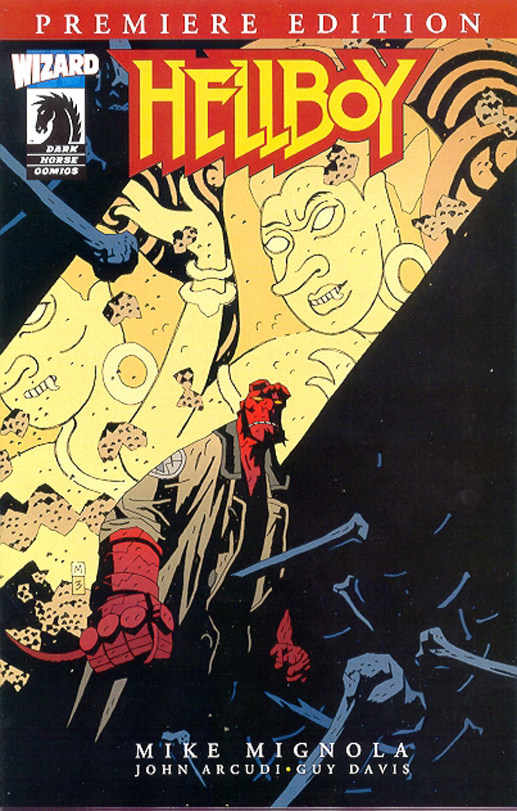

Hellboy faces a Malaysian demon.

## Publication History

*The Penanggalan* was originally published as part of *[Hellboy Premiere Edition](/entry/Hellboy%20Premiere%20Edition)* in March 2004. The issue, an exclusive published through *Wizard* magazine \#148, also contained the B.P.R.D. story *[Born Again](/entry/Born%20Again)*. The issue was published with 3 covers, one by [Mike Mignola](/entry/Mike%20Mignola) showing an image from *The Penanggalan*, one by [Guy Davis](/entry/Guy%20Davis) showing the members of the [B.P.R.D.](/entry/B.P.R.D.) and Hellboy, and a cover exclusive to the Los Angeles Wizard World showing a picture of Ron Perlman as [Hellboy](/entry/Hellboy).

*The Penanggalan* was reprinted, with small changes,[1] as part of [*Hellboy – Volume 7: The Troll Witch and Others*](/entry/TPB) in October 2007.

A digital version of this comic was also included on the DVD of *[Hellboy: Blood and Iron](/entry/Hellboy__Blood_and_Iron)*.

## Synopsis

[Hellboy](/entry/Hellboy) travels Malaysia in 1958. A Malay girl tells Hellboy that there was once an old woman who got so startled that she kicked her own head off. The woman's head and organs flew out of her body and became a demon, the first Penanggalan. The girl continues, that once the people respected the local Penanggalan and were able to pacify her. However, the older generation is gone and the Penanggalan has returned.

The girl takes Hellboy to the Penanggalan's cave. Hellboy sees the body of a Penanggalan, but realizes that it cannot be the current demon plaguing the area and that there must be another. He turns to see the headless body of the girl fall to the ground. The new Penanggalan attacks Hellboy, tangling him in her organs. Hellboy leaps outside as the sun rises, destroying the demon.

## Story Chronology

The story takes place in 1958, the same year as *[The Crooked Man](/entry/The%20Crooked%20Man)*.

## Notes

<references/>
! colspan = 1 | [Vol. 6 Strange Places](/entry/TPB) ! colspan = 2 | [Vol. 7 The Troll Witch and Others](/entry/TPB)

**Penanggalan, The** **Penanggalan, The**

[1] Mignola redrew the art in two panels