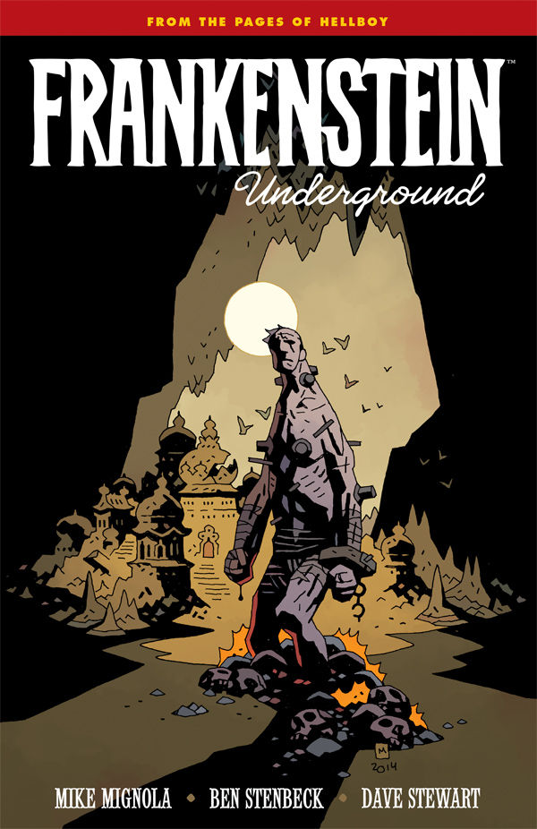

***Frankenstein Underground*** is a five-issue miniseries released from December 2015 to April 2016.

## Publication History

*Frankenstein Underground* debuted in December 2015 as a single five-issue limited miniseries.

Bleeding Cool first released a teaser image of the series in October 2014.

A three-page preview was also published in December 2014 in the first issue of *Hellboy and the B.P.R.D.: 1952*.

## Synopsis

### Part One

[The Frankenstein creature](/entry/Frankenstein%27s%20Monster) is alone, abandoned, and wandering underground, where he will discover other strange creatures—and dark secrets of the universe.

### Part Two

Chased by his tormentors into the center of the earth, Frankenstein’s monster becomes prey for a different kind of creature.

### Part Three

Frankenstein’s monster has been captured by an underground race of men—but instead of experimenting on the monster their master shares the secret history of their people and the Heliopic Brotherhood of Ra.

### Part Four

Deep underground, Frankenstein's monster is taken captive by the Heliopic Brotherhood of Ra. But while their master shares his story, the monster discovers the true history of the lost city and the powers which inhabit it.

### Part Five

Frankenstein's monster confronts the danger lurking within the underground city. Can he save the spirit of the city or will he meet his end?

## Gallery

文件:Frankenstein Underground Teaser.jpg|Bleeding Cool's teaser 文件:FrankensteinUnderground 1.jpg|Issue \#1 文件:FrankensteinUnderground 1 EmeraldCity.jpg|Issue \#1  
Emerald City Comic Con exclusive 文件:FrankensteinUnderground 2.jpg|Issue \#2 文件:FrankensteinUnderground 3.jpg|Issue \#3 文件:FrankensteinUnderground 4.jpg|Issue \#4 文件:FrankensteinUnderground 5.jpg|Issue \#5 文件:Frankenstein Underground Trade.jpg|Trade Collection

## Trade Paperback

  
*see also [Frankenstein Underground Trade Paperback Collections](/entry/TPB)*  

*Frankenstein Underground* was collected in an unnumbered trade paperback.

**Category:Comics** **Category:Story**