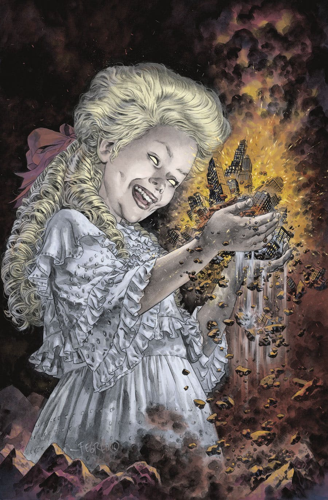
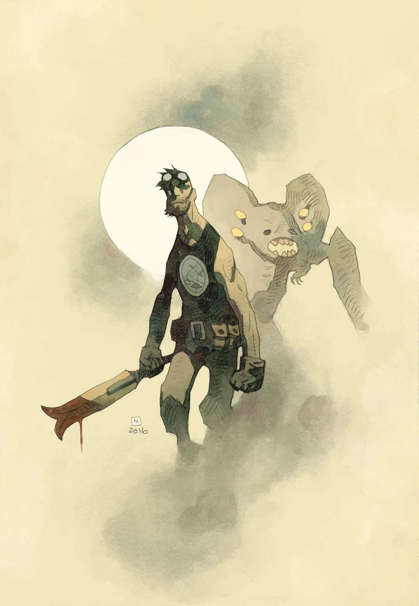
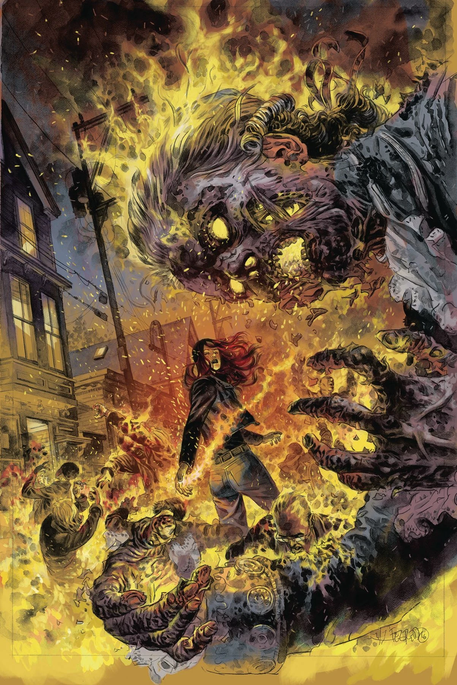
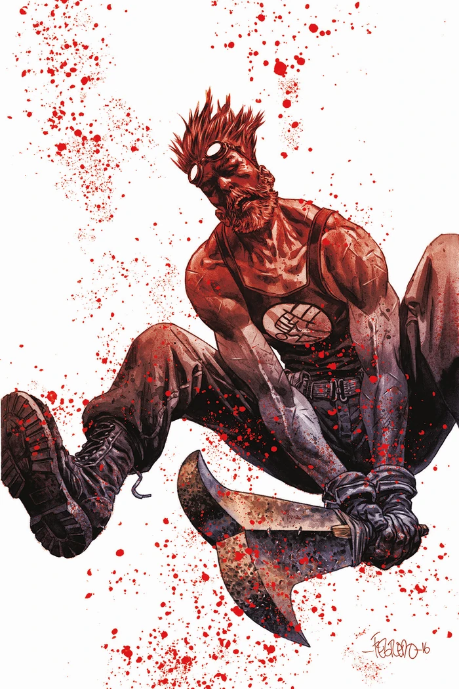
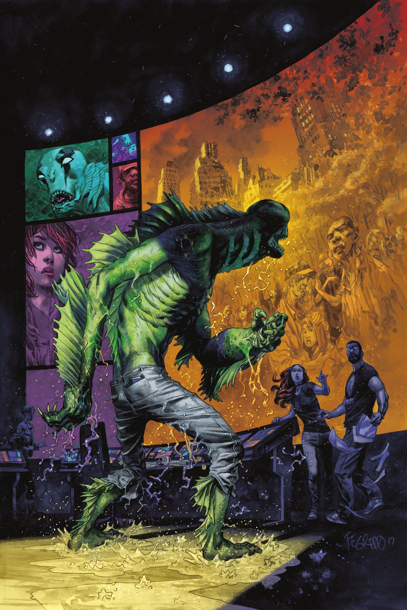
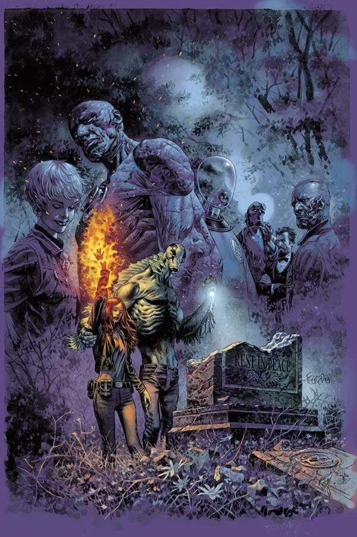

***弥赛亚***（*Messiah*）是[《魔鬼旧相识》故事环](/entry/The_Devil_You_Know_(story_cycle))的第一个故事篇章。

## 出版历史

这个共五期的故事篇章于 2017 年 7 月开启。最后一期包含一个重大揭示，解释了整个 [B.P.R.D.](/entry/B.P.R.D._(series)) 故事收官环为何取名为「魔鬼旧相识」（The Devil You Know）。

## 剧情简介

### 第一部

在被 B.P.R.D. 击败之前，洛夫克拉夫特式的怪物曾在人间造出一片地狱。如今，丽兹·谢尔曼率领一支小队穿行在怪物横行的废墟中，执行她一生中最重要的救援任务。当社会试图重建秩序时，诡异的邪教纷纷争权夺利，而一个恶魔现身，要为这一切领路……

### 第二部

末日劫难被勉强躲过之后，那些在全球危机中趁势而起的邪教如今落得无所事事。

### 第三部

一个与史前武器绑定的古老灵魂，向那些企图毁灭世界的怪物及其人类仆从展开了一场永无止境的战争。

### 第四部

驱魔人阿什利·斯托德引导 B.P.R.D. 锁定一名致命的邪教领袖，而菲尼克斯则力主重返凯特殒命之地。

### 第五部

众人重返已成废墟的总部——也就是凯特死去的地方，老队员们因此重聚；亚伯追猎一个恶魔，瓦尔瓦拉则揭露了她那可怕的计划。

在本期结尾，超自然现象研究与防御局的探员们在前总部旧址（该地在去年的《终结时刻》系列中被摧毁）有了一个真正出人意料的发现：一具棺材，里面躺着的似乎不是别人，正是地狱男爵的躯体——而他似乎正在睁开一只眼睛……

## 《无尽之谜：霍华德探员简史》

这篇两页的附赠短篇由马特·斯特拉克贝恩（Matt Strackbein）自编自绘，刊载于《B.P.R.D.：魔鬼旧相识——弥赛亚》第 3 期。它回顾了[泰德·霍华德](/entry/Ted_Howards)／[高尔·登纳尔](/entry/Gall_Dennar)的历史，未被收入任何合订本。

## 画廊

除特别注明外，封面均由[邓肯·费格瑞铎](/entry/Duncan_Fegredo)绘制。

\#1

\#1 变体封面，由[迈克·米格诺拉](/entry/Mike_Mignola)绘制

\#2

\#3

\#4

\#5

**Category:B.P.R.D.: The Devil You Know story**
