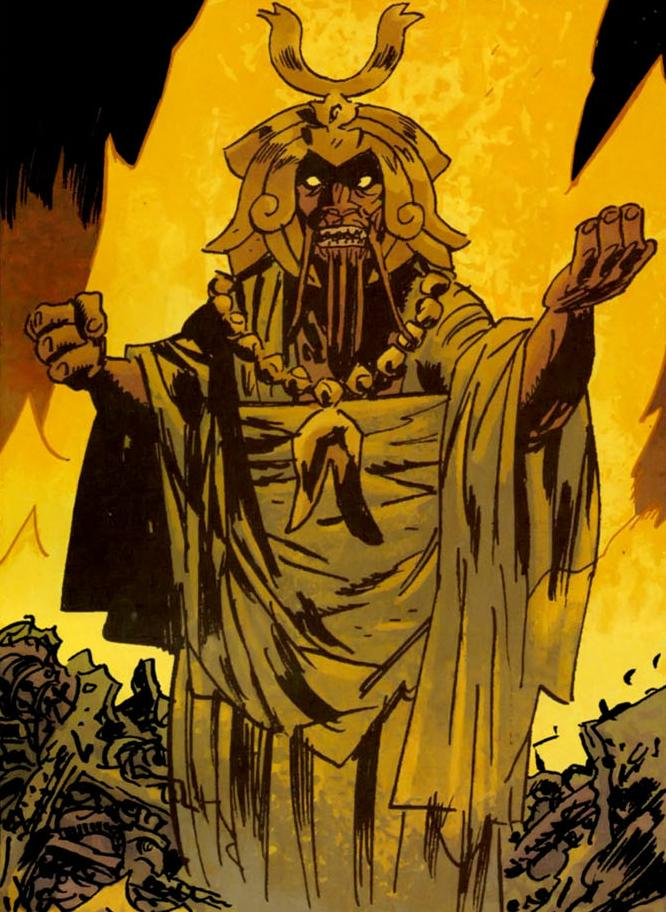

The **King of Fear** is the leader of the creatures known as "The Servants of the Left Hand". He first appears in *[Hollow Earth](/entry/Hollow%20Earth)*.

## History

It is unknown when the King of Fear became the ruler of the subterranean creatures "The Servants of the Left Hand," but it can presumably be measured for thousands of years, beginning after the end of Hyperborea. Like the rest of his kind, the King of Fear was created by "The Left Hand," a sect of pre-humans who chose to remain underground while the "Right Hand" journeyed above to dwell there. The "Left Hand" created the King and his kind as slaves to maintain the various machines and devices they had built. After time passed, a slave revolt, possibly led by the King himself, ensued and saw the slaves victorious and the masters wiped out completely. As the decades rolled by the slaves began to degenerate and many became animalistic, with the machines they were meant to tend falling into ruin. At some point the King of Fear arose as a leader and began gathering some of the slaves together to form a working society who's goal was to rebuild some of the machines and use them to conquer the world above. Unfortunately for the Servants of the Left Hand the machines did not have a working power source, a problem that kept them from launching their crusade.

A solution presented itself to the King of Fear near the dawn of the twenty first century, when [Liz Sherman](/entry/Liz%20Sherman) visited a nearby monastery in hopes of controlling her pyrokinetic powers. Sensing the great power Liz held inside her, the King of Fear sent an attack force to the monastery which killed all of the monks inside and removed Liz's fiery life force from her body. The King then had Liz's life force installed into an ancient generator, causing it to build up power. In doing this, the King began to awaken the machines little by little.

The generator was just about to reach full power when three [B.P.R.D.](/entry/B.P.R.D.) agents, specifically [Roger](/entry/Roger) the Homunculus, [Abe Sapien](/entry/Abe%20Sapien), and [Johann Kraus](/entry/Johann%20Kraus), entered the chamber that held the generator, with Roger carrying Liz's soulless body. Realizing what the King of Fear was planning to do, Kraus quickly warned his comrades that Liz's life essence would be rent apart if the machines the generator was tied to came fully online, effectively killing her. Abe Sapien shot the King, wounding him enough to slow down the re-charge just long enough for Roger to drain Liz's soul out of the generator and place it back in her body. Crackling with the excess energy Liz had created in the generator, Roger unleashed it into the ground, temporarily bringing many of the Left Hand war machines back online, much to the delight of the King of Fear. However, his celebration was short lived, as the energy Roger had released had damaged the floor of the chamber, causing it to collapse and take the King of Fear and his machines down with it.

The King of Fear, however, survived his battle against the B.P.R.D. agents. Sometime after the War on Frogs, the King of Fear encountered the [Black Flame](/entry/Landis%20Pope). The King of Fear forged an alliance with the Black Flame with promise of ruling the surface with using the ancient technology of the Golden Men to transfer the spirits of the Ogdru Hem into the Frog monsters. Eventually, the King of Fear realized that Black Flame never intended in honoring his deal. When a B.P.R.D. field team led by Abe Sapien and [Andrew Devon](/entry/Andrew%20Devon) were captured, the King of Fear was killed by the Black Flame, who saw no further use for him.

## Powers and Abilities

The King of Fear differed from the other "Servants of the Left Hand" in that he was taller, had longer facial tentacles, and spoke more intelligently. It is possible that these differences might be a testament to his age, or he might also have been some manner of mutant.

The King of Fear seemed to possess a great deal of knowledge about "The Left Hand" and their creations, and he might also have had knowledge of the ancient Hyperboreans. He had mechanical knowledge sufficient to know how to use Liz Sherman's soul as a power source, and how to maintain the Left Hand's machines with the help of his people. He also clearly knew how to use the machines as well.

Unlike the rest of his people, who were naked, the King of Fear was shown to be dressed in elaborate and regal looking garb, complete with flowing robes and a golden headpiece, likely a crown. He possessed a special sword or staff that glowed with golden light which he, appropriately, held in his left hand. With this instrument he was able to unleash blasts of energy, likely originating from Liz's soul, and he could also manipulate the Left Hand machines with it. It also provided him with the ability to levitate.

**Category:Male Characters** **Category:Villains** **Category:Deceased Characters**