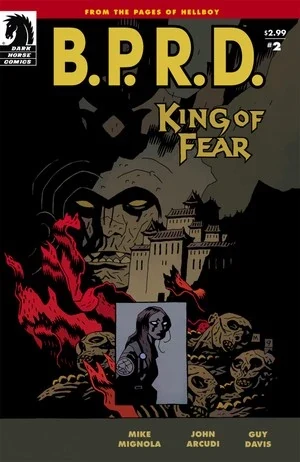
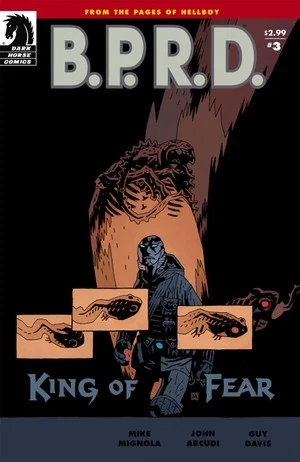
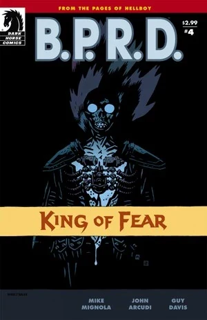
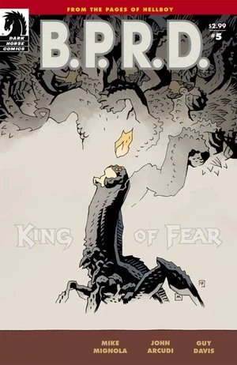
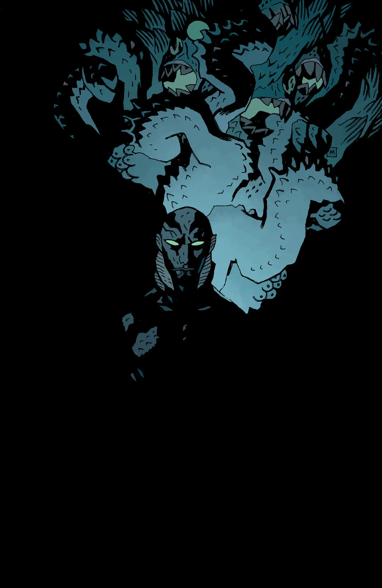

***《恐惧之王》***（King of Fear）是一部五期限定连载，为《[焦土三部曲](/entry/Scorched_Earth_Trilogy)》第三部，也是《[蛙族瘟疫故事环](/entry/Plague_of_Frogs_%28story_cycle%29)》的最终篇章。

## 出版历史

这部五期限定连载于 2010 年 1 月至 5 月出版，2010 年 11 月收录进平装合订本《B.P.R.D.：恐惧之王》（*[B.P.R.D.: King of Fear](/entry/Trade_Collections)*）。这是《蛙族瘟疫》故事线的最后一部系列。迈克·米格诺拉在第 4 期中绘制了两页。

## 剧情简介

### 第一部

击败神秘学者梅姆南·萨之后，超自然调查防御署因浴血营救丽兹·舍曼而与美国政府关系紧张；他们启程前往《B.P.R.D.：空心地球》的发生地乌拉尔山脉，要将蛙族威胁彻底了结。

与此同时，[凯特·考瑞根](/entry/Kate_Corrigan)独自前往奥地利的洪特城堡——[地狱男爵](/entry/Hellboy_%28character%29)当年击杀[征服之虫](/entry/Conqueror_Worm_%28Ogdru_Hem%29)之地——执行她自己的营救任务：拯救被[大螯虾强生](/entry/Lobster_Johnson_%28character%29)亡魂附身的灵体探员[约翰·克劳斯](/entry/Johann_Kraus)。

### 第二部

丽兹和亚伯率领一队探员与士兵进入空心地球，凯特·考瑞根则试图兼顾工作与感情。她前往奥地利探访洪特城堡的废墟——那座闹鬼的纳粹堡垒，犯罪斗士大螯虾强生在此殒命、地狱男爵在此大战征服之虫——她希望能让大螯虾强生的亡魂安息，并使他释放约翰·克劳斯的灵魂。

### 第三部

丽兹和亚伯在清扫西藏洞窟、意图摧毁怪物般的蛙族聚居地时，直面恐惧之王——他在毁灭地表世界的图谋中找到了一位强大的新盟友。

原来恐惧之王已与[黑焰](/entry/The_Black_Flame_%28character%29)结盟。黑焰最后一次出现时，正被蛙人拖入地下。他显然改变了心意，如今甘愿为蛙族的更大利益效力，而不再试图控制它们。

### 第四部

在[极北族](/entry/Hyperboreans)神殿的废墟之下，丽兹看到了迄今最骇人的世界末日幻象；亚伯则在发现自己与蛙怪之间的联系后，明白了自己在这场末日中扮演的角色。

### 第五部

一场深入地心的擅自行动，让 B.P.R.D. 背上了一大堆待解的疑问——也让他们最可怕的敌人们面临难以预料的命运。

## 内容

### 角色

#### [超自然调查防御署](/entry/Bureau_for_Paranormal_Research_and_Defense)（B.P.R.D.）

- [丽兹·舍曼](/entry/Elizabeth_Sherman)
- [汤姆·曼宁](/entry/Thomas_Manning)
- [亚伯拉罕·塞皮恩](/entry/Abraham_Sapien)
- [凯瑟琳·考瑞根](/entry/Kate_Corrigan)
- [约翰·克劳斯](/entry/Johann_Kraus)
- [安德鲁·德文](/entry/Andrew_Devon)
- [潘雅](/entry/Panya_%28character%29)
  - 奥利（Olly）
  - 变异动物
- 多丽丝（Doris，潘雅的看护人）
- [罗杰](/entry/Roger)（回忆）
- [地狱男爵](/entry/Hellboy_%28character%29)（回忆）
- [卡拉·贾罗科](/entry/Carla_Giarocco)（尸体、幻象）
- 其他探员与职员

#### 洪特城堡

- [布鲁诺·卡尔胡](/entry/Bruno_Karhu)
- 亡魂
  - [大螯虾强生](/entry/The_Lobster)
  - 中世纪亡魂
  - 美军士兵亡魂
  - [纳粹](/entry/%3ACategory%3ANazi)亡魂
- [克里格阿费](/entry/Kriegaffe)10 号（尸体）

#### 其他

- 军方将领
- 阿加尔塔居民
  - 盖亨大师（Master Gheghen，回忆）
  - 僧侣（尸体）
- [左手之仆](/entry/Servants_of_the_Left_Hand)
- [恐惧之王](/entry/King_of_Fear_%28character%29)
- [梅姆南·萨](/entry/Memnan_Saa)（幻象）
- [奥格德鲁·赫姆](/entry/Ogdru_Hem)
  - 丽兹幻象中的存在
  - 与[极北族](/entry/Hyperboreans)战争机器融合的存在
  - [索尔顿湖怪物](/entry/Salton_Sea_Monster)
- [蛙怪](/entry/Frog_monster)
- [兰迪斯·波普](/entry/Landis_Pope)（[黑焰](/entry/The_Black_Flame_%28character%29)）
- [奥格德鲁·贾哈德](/entry/Ogdru_Jahad)（被提及）
- [尚钦](/entry/Shonchin)
- [赫卡忒](/entry/Hecate)（幻象）
- 联合国代表
- 新闻播报员
- [津科公司](/entry/Zinco_Corporation)
  - [以赛亚·马斯顿](/entry/Isaiah_Marsten)
- [奥安尼斯学社](/entry/Oannes_Society)
  - 麦克惠特（McWhirter）

### 地点

- 美国
  - 华盛顿特区军事设施
  - [B.P.R.D.](/entry/Bureau_for_Paranormal_Research_and_Defense) 总部（科罗拉多州）
  - 联合国总部（纽约州纽约市）
  - 索尔顿海（加利福尼亚州）
- 奥地利
  - [B.P.R.D.](/entry/Bureau_for_Paranormal_Research_and_Defense) 第四野外总部
  - 洪特城堡
- 俄罗斯
  - 阿加尔塔（北极圈以北的乌拉尔山脉）
- 地底洞穴系统
- 印度尼西亚
  - 婆罗洲（仅被提及，已毁灭）
  - 苏拉威西（仅被提及，已毁灭）
- 泰国
  - 曼谷的一间酒吧

### 重要物品

- [极北族](/entry/Hyperboreans)之剑
- [极北族](/entry/Hyperboreans)战争机器
- [黑焰](/entry/The_Black_Flame_%28character%29)的战衣（与波普的躯体融合）
- [奥安尼斯学社](/entry/Oannes_Society)
  - 机械躯体
  - 潜艇

## 画廊

 \#1

 \#2

 \#3

 \#4

 \#5

 \#5
（未采用封面 unused cover）
