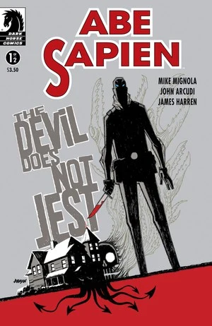
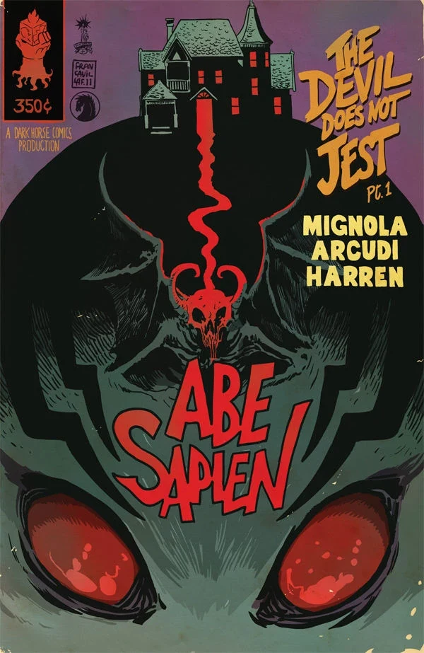

《**恶魔不说笑**》（The Devil Does Not Jest）是《[亚伯·赛皮恩](/entry/Abe_Sapien_%28series%29)》（Abe Sapien）的一个两话故事，由[迈克·米格诺拉](/entry/Mike_Mignola)（Mike Mignola）与[约翰·阿库迪](/entry/John_Arcudi)（John Arcudi）编剧。这也是画师[詹姆斯·哈伦](/entry/James_Harren)（James Harren）在地狱男爵宇宙中的首次亮相。

## 出版历史

《亚伯·赛皮恩：恶魔不说笑》于 2011 年 9 月至 10 月以两话迷你系列的形式出版。该故事与《[惊魂男孩](/entry/The_Haunted_Boy)》（The Haunted Boy）、《[深渊平原](/entry/The_Abyssal_Plain)》（The Abyssal Plain）一同收录于平装合订本《[亚伯·赛皮恩——第二卷：恶魔不说笑及其他故事](/entry/Trade_Collections)》（Abe Sapien — Volume 2: The Devil Does Not Jest and Other Stories）。

## 剧情简介

### 第一部

一位恶魔学家的地下室里，埋藏着一个幽深黑暗的家族秘密；其中骇人的神秘法术仪式，险些让亚伯·赛皮恩丧命。

### 第二部

亚伯·赛皮恩对一位恶魔学家的调查变得血腥起来——他落入一头畸形野兽的掌控，又意外撞见一棵腐朽家族谱系的秘密，而那根系之深，或许令他永远无法逃脱。

## 画廊

除特别注明外，封面均由[戴夫·约翰逊](/entry/Dave_Johnson)（Dave Johnson）绘制。

\#1

\#1 变体封面，[弗朗切斯科·弗兰卡维拉](/entry/Francesco_Francavilla)（Francesco Francavilla）绘制
