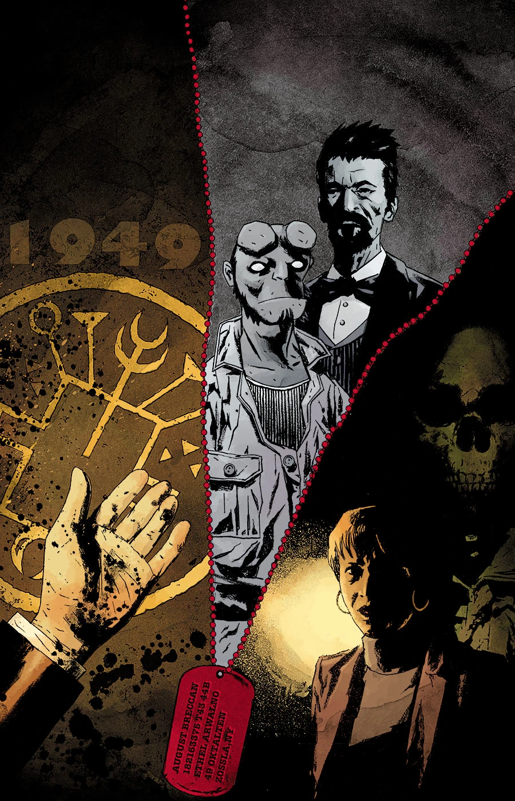
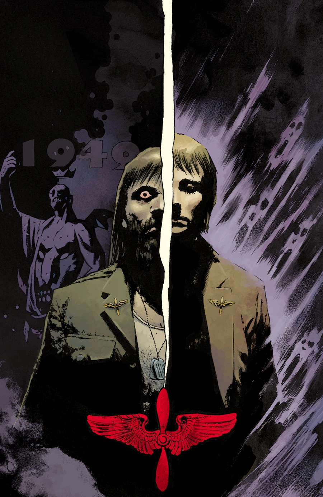

《恶魔之翼》（The Devil's Wings）是一部两期完结的支线，故事在当下围绕[凯特·考瑞根](/entry/Kate_Corrigan)展开，并穿插[地狱男爵](/entry/Hellboy_%28character%29)在 1949 年的闪回情节。

## 剧情简介

### 第一部

一场大停电在超自然调查防御署（B.P.R.D.）总部引发恐慌，凯特也在此刻与一名崇拜撒旦的老兵亡魂正面相遇。

### 第二部

大规模停电令超自然调查防御署（B.P.R.D.）总部彻底陷入瘫痪，我们的英雄不得不面对一个艰难的局面：为凯特·考瑞根，以及附在她身边的那名死去老兵驱魔。

## 画廊

\#1

\#2

**Category:Story** **Category:B.P.R.D. story** **Category:B.P.R.D.: Hell on Earth story**
