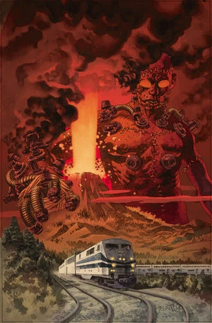
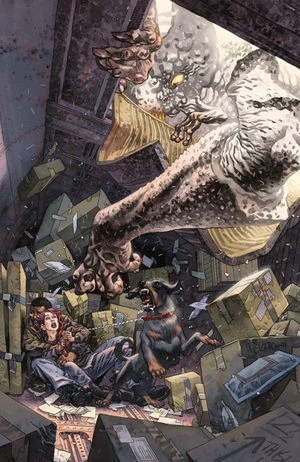
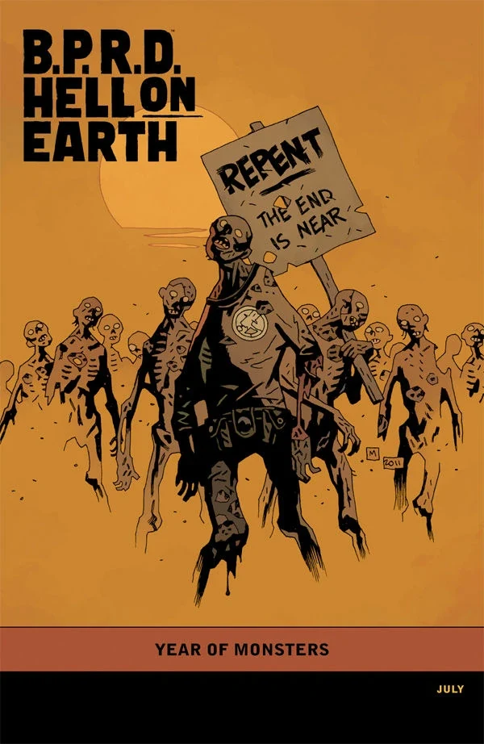

***《恶魔引擎》***（The Devil's Engine）是一部于 2012 年 5 月至 7 月出版的三期限定连载。

## 出版历史

《恶魔引擎》是[《人间炼狱》故事环](/entry/Hell_on_Earth_(story_cycle)))的一部分，接续《[俄罗斯](/entry/Russia)》的主线剧情。各期封面由[邓肯·费格瑞铎](/entry/Duncan_Fegredo)绘制，第 3 期另附有一款[迈克·米格诺拉](/entry/Mike_Mignola)绘制的“[怪兽之年](/entry/Year_of_Monsters)”变体封面。

在合订本中，《恶魔引擎》被排在《漫长的死亡》之前。

## 剧情简介

### 第一部

[德文](/entry/Andrew_Devon)与[菲尼克斯](/entry/Fenix)被夹在蝙蝠脸怪物、一场毁灭性地震以及[金科公司](/entry/Zinco_Corporation)疯狂的科学实验之间，为求活命，两人结成了同床异梦的同盟。

### 第二部

当地狱全面崩坏之际，一名超自然调查防御署探员与一位具有通灵能力的邋遢朋克青年联手，对抗巨型蝙蝠脸怪物。

### 第三部

金科公司的最新阴谋以灾难收场，菲尼克斯与德文逃出了蝙蝠脸怪物的魔爪，并道出了亚伯为何非死不可的原因。

## 画廊

\#1

\#2

\#3

\#3 变体封面

**Category:Story** **Category:B.P.R.D. story** **Category:B.P.R.D.: Hell on Earth story**
