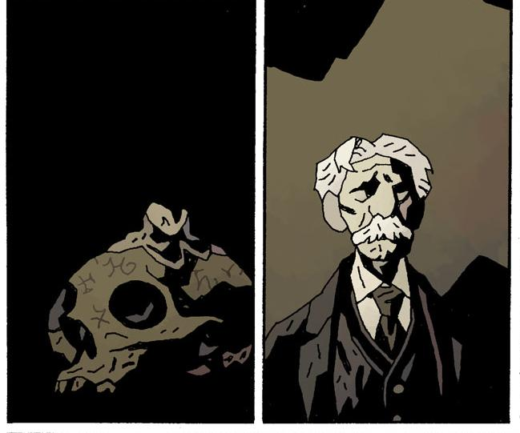

In 1985 [Hellboy](/entry/Hellboy%20%28character%29) is called in to Boston to look into the disappearance of a man and the desecrating of three graves.

## Publication History

*Hellboy: The Whittier Legacy* was first released as part of the DH:HD promotion. In the promotion, Dark Horse teamed up with USA Today to release 5 original 8-page stories on the USA Today website. *The Whittier Legacy* was the first of the 5, released in 2 parts of 4 pages each on October 11th and 12th 2010. The story is reprinted in [Hellboy: vol. 11 The Bride of Hell and Others](/entry/TPB), first published in October 2011.

## Synopsis

After Prof. Emile Stoop disappears, along with the bodies of three member of the Whittier Family and a skull once used by the family in occult rituals, [Hellboy](/entry/Hellboy%20%28character%29) is brought in to find out what is going on. Hellboy enters a house to find Stoop standing over the three bodies and holding the skull. He tells Helboy that he is not really a Stoop, rather is real father was a Whittier. He then lights a candle and begins to contact the forces that the Whittier family used to. One of the dead men asks Hellboy if Stoop has the medallions they used for protection. Stoop becomes possessed by the creatures from beyond and begins to transform. Hellboy banishes the creature with one of the medallions, but Stoop dies in the process.

## Links

The Story can be read on the USA Today Website [here](http://www.usatoday.com/life/comics/2010-10-11-hellboy11_ST_N.htm)

For more on the DH:HD promotion see the CBR article [here](http://www.comicbookresources.com/?id=28791&page=article)

! colspan = 3 | [Vol. 11 The Bride of Hell and Others](/entry/TPB)

**Whittier Legacy, The** **Whittier Legacy, The**