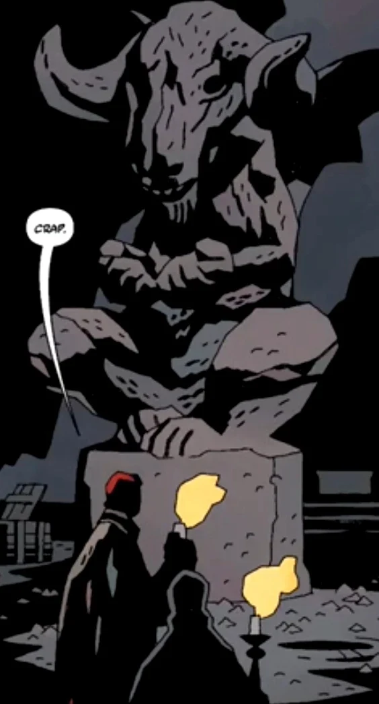

[Hellboy](/entry/Hellboy) travels to Portugal to investigate an artist who has been acting very strangely.

## Publication History

*In the Chapel of Moloch* was published in October of 2008. It was reprinted in *[Hellboy: vol. 10 The Crooked Man and Others](/entry/TPB)*, in June 2010.

## Synopsis

[Hellboy](/entry/Hellboy) travels to Portugal in 1992. He meets up with an art agent who is concerned about his friend Jerry, a painter. The pair had rented an old house with an attached chapel, and Jerry had been using the space as a studio. Lately Jerry has been weak and stays in bed all day, but at night enters the chapel and works.

Jerry's friend shows Hellboy a large statue of a horned monster. Apparently this is what Jerry has been working on during the night. His friend mentions that Jerry sometimes calls out "Moloch." Hellboy recognizes the name and explains that Moloch is mentioned in the bible and that people once sacrificed children to him.

Hellboy explores the chapel and sees the symbol of the [Order of the Knights of Saint Hagan](/entry/Order%20of%20the%20Knights%20of%20Saint%20Hagan), an order of knights that specialized in hunting down witches. Hellboy scrapes the statue and blood drips out of the scratch.

The two decide to wait in the chapel until dark to see what Jerry does there every night. A shriveled figure climbs out of a hole in the floor and grabs Jerry, guiding his hands as he sculpts. Hellboy forces the figure to flee, freeing Jerry of his possession. The statue begins to awaken and fights with Hellboy. Hellboy destroys the creature, all the while Jerry begging him to stop, because the creature has been giving him the inspiration he has lacked before.

Jerry says that he is ruined and will never paint again. Hellboy says that is not the worst thing that could happen to him, adding that he should give up sculpting as well.

! colspan = 3 | [Vol. 10 The Crooked Man and Others](/entry/TPB)

**Category:Story** **Category:Hellboy story**