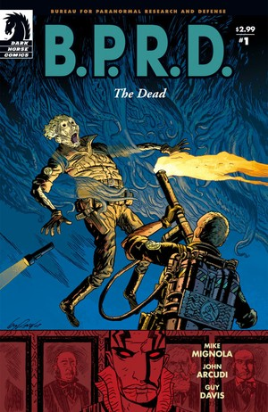
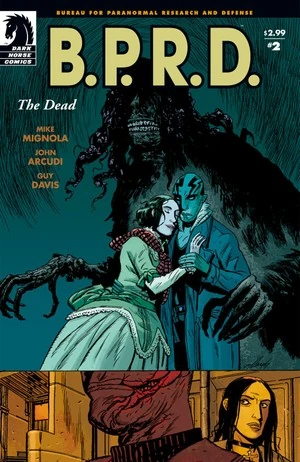
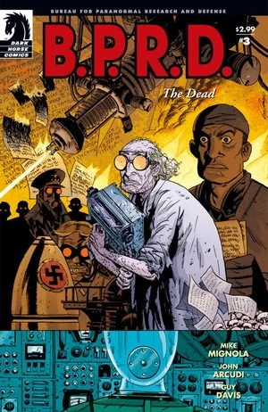
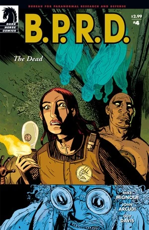
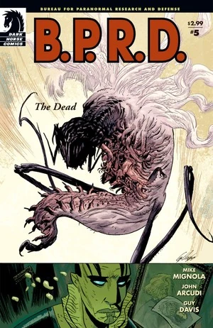

在***《斯人已逝》***（The Dead）中，[本·戴米奥](/entry/Benjamin_Daimio)加入队伍，并把他们迁往科罗拉多州的新总部。[约翰·克劳斯](/entry/Johann_Kraus)探查新基地，揭开了旧日的危险。与此同时，[亚伯·塞皮恩](/entry/Abraham_Sapien)和[凯特·考瑞根](/entry/Kate_Corrigan)调查亚伯新近曝光的过往。自始至终，[蛙怪](/entry/Frog_monster)都在持续蔓延。

## 出版历史

《[蛙族瘟疫](/entry/Plague_of_Frogs_%28story%29)》之后，[迈克·米格诺拉](/entry/Mike_Mignola)请来[约翰·阿库迪](/entry/John_Arcudi)担任 [*B.P.R.D.*](/entry/B.P.R.D._%28series%29) 产品线的常驻联合编剧。

这部五期限定连载于 2004 年 11 月至 2005 年 3 月出版，2005 年 9 月收录进平装合订本《B.P.R.D.：斯人已逝》（*[B.P.R.D.: The Dead](/entry/Trade_Collections)*）。

## 剧情简介

### 第一部

在北达科他州，[B.P.R.D.](/entry/Bureau_for_Paranormal_Research_and_Defense) 探员们调查一座被[蛙怪](/entry/Frog_monster)利用的谷仓。一个小小的卵状物体裂开，一只蛞蝓般的生物爬了出来，迅速长大到塞满整座谷仓；探员们慌乱地展开反击。

[亚伯·塞皮恩](/entry/Abraham_Sapien)和[凯特·考瑞根](/entry/Kate_Corrigan)前往罗德岛州利特尔波特，调查亚伯遥远的过去。亚伯得知[兰登·埃弗里特·考尔](/entry/Langdon_Everett_Caul)曾是伊莱休·卡文迪什（Elihu Cavendish）手下的水手，后来在利特尔波特定居，娶了伊迪丝·霍华德（Edith Howard）。考尔于 1865 年离去、再未归来；他的妻子无法承受失去他的痛苦，自杀身亡。

回到总部，队伍观看一段录像：停尸房里的一个死人起身说话。[汤姆·曼宁](/entry/Thomas_Manning)告诉大家，他们将迁往科罗拉多州一处旧政府设施，而录像里那个死人——[本·戴米奥](/entry/Benjamin_Daimio)——将出任新的野外小队指挥官。戴米奥向队伍做了一次略显尴尬的自我介绍。

一个穿白大褂的老人照看着一间长满蘑菇的屋子。

队伍飞往科罗拉多州的新基地，亚伯则走向利特尔波特那座考尔的旧居。

### 第二部

亚伯·塞皮恩走进考尔的房子，回忆起自己看到考尔变身的幻象（见《[蛙族瘟疫](/entry/Plague_of_Frogs_%28story%29)》第 5 期）。

队伍开始搬进科罗拉多州的新基地。其他人安顿下来时，约翰·克劳斯却似乎心不在焉。

那个老人坐在一间暗室里不停地打字。

伊迪丝·考尔的亡魂造访亚伯。她把他拉入一个房子仍崭新如初的世界，试图让亚伯留下来陪她。

[丽兹](/entry/Elizabeth_Sherman)醒来，看到约翰在大楼里游荡。他听到人声，循着声音走进一部旧电梯，发现一堵墙并试图撞开。丽兹和罗杰带他去见本·戴米奥。戴米奥说他们应把精力集中在蛙怪问题上，但还是允许他们破开那间密封的隔间——里面只有那个受惊的老人。

### 第三部

丽兹和本·戴米奥试图从老人口中问出情报。

在地下层，约翰找到一间满是上了锁的档案柜的房间。一个抽屉自己打开，一本书从中伸出。

老人自称京特·艾斯博士（Dr. Gunter Eiss）。1939 年太空计划失败后，他在德国以物理学家身份被招募（见《[征服之虫](/entry/Conqueror_Worm_%28story%29)》第 1 期）。他加入了一个试图为战争驾驭"天堂之力"的团体，但[诸神黄昏计划](/entry/Project_Ragna_Rok)最终胜出。战后他来到美国，继续[加拉拉加斯教授](/entry/Kyriakos_Gallaragas)的工作。1958 年，一场事故夺去了大多数研究员的性命，只有艾斯幸存。他被封在那间屋子里，靠蘑菇和蜘蛛活了下来。

约翰翻阅那本书，在一页三四十年代的图像前停下。图中包括[黑焰](/entry/The_Black_Flame_%28character%29)、带着[能乐猿猴](/entry/Noh_monkey)的[绯红莲花](/entry/Yumiko_Daimio)、一个陌生男人（后来证实是[梅姆南·萨](/entry/Memnan_Saa)）、钢鹰，以及一套[维里尔能量服](/entry/Vril_Energy_Suit)。本告诉约翰，他们一早会把艾斯送进医院，但约翰将信将疑。

艾斯在大楼里游荡，打开了一个旧储物柜。

探员们移走艾斯所说的引发爆炸的装置时，发现这装置没有任何活动部件，看起来只是某种道具。

约翰在一间屋里修理一些旧电子设备。他在其中一台监视器里看到五名科学家的亡魂，用德语与他们交谈。他向他们伸出手，他们的灵体外质形态便飞过整座基地。

回到利特尔波特，凯特·考瑞根正设法找亚伯。她询问去考尔家的路，却被告知得等风暴过去。

考尔宅内，伊迪丝抱着亚伯，对他说她爱他。

### 第四部

五个亡魂飞过基地，戴米奥试图阻止他们。

艾斯走进一部电梯，一群昆虫随之涌出。

[罗杰](/entry/Roger)和戴米奥看到约翰，约翰却不理会他们，一边摆弄某种电子设备，一边用德语喃喃自语。本召集探员们，直奔地下层。

伊迪丝·考尔请求亚伯·塞皮恩永远留在她身边。

戴米奥和探员们在地下层追上艾斯。艾斯佩戴着一个电气装置，手持朗基努斯之枪（Spear of Longinus）。他从长枪中放出电流，击倒了大多数探员。艾斯解释说，他一直在研究驾驭天堂之力，但同僚科学家起了疑心。他们试图拆解他的研究，却引发爆炸，炸死了科学家们，也把他封在了里面。艾斯声称他将打开一扇通往天堂的大门。他启动机器时，身体骤然爆裂，一头生物从他体内长出。

### 第五部

戴米奥拼命寻找一件能用的武器来对付那头生物。

约翰背着一台大型装置，朝地下层、朝那头生物走去。他一进屋，生物便发起攻击。搜寻中，戴米奥找到一只罐中的小型能乐猿猴。约翰用机器关闭了那扇允许怪物进入我们世界的传送门，引发一场大爆炸。五个亡魂完成了击败艾斯的任务，离开了约翰的密闭防护服。为防再生事端，戴米奥朝艾斯的残骸开了枪。

回到利特尔波特，亚伯仍处在伊迪丝·考尔创造的世界里。屋里有一面被遮住的镜子。此时以考尔形态存在的亚伯知道，镜中映出的会是他的真身。他说服伊迪丝去看、去面对真相。她照做了，随即化为雾气消散。

## 内容

注：平装合订本与精选合订本（Omnibus）所收录序幕的内容，见《[Born Again](/entry/Born_Again)》。

### 角色

#### 主线故事

- 北达科他州警长
- 罗兰·威尔逊（Roland Wilson，录像中）
- 京特·艾斯（Gunter Eiss，化为"炽天使 Seraphim"）
- [蛙怪](/entry/Frog_monster)
- [纳粹](/entry/%3ACategory%3ANazi)
  - [诸神黄昏计划](/entry/Project_Ragna_Rok)（回忆）
    - [拉斯普京](/entry/Rasputin)（回忆）
    - [卡尔·鲁普雷希特·克勒南](/entry/Karl_Ruprect_Kroenen)（回忆）
    - [利奥波德·库尔茨](/entry/Leopold_Kurtz)（回忆）
- 德美两国科学家（回忆与亡魂形态）
- [基里亚科斯·加拉拉加斯](/entry/Kyriakos_Gallaragas)（仅被提及）
- 二战档案（均为照片）
  - [雷蒙德·迪斯特尔](/entry/Raimund_Diestel)（[黑焰](/entry/The_Black_Flame_%28character%29)）
  - [弓子·戴米奥（绯红莲花）](/entry/Yumiko_Daimio)
  - [梅姆南·萨](/entry/Memnan_Saa)
  - [鲁道夫·贝尔根（钢鹰）](/entry/Rudolf_Bergen)
  - 帕特里克·雷丁（Patrick Redding）
- [能乐猿猴](/entry/Noh_monkey)（尸体与照片）

#### 亚伯的故事

- 惠特利庄园图书管理员（Whateley Hall Librarian）
- [奥安尼斯学社](/entry/Oannes_Society)
  - [伊莱休·卡文迪什](/entry/Elihu_Cavendish)（回忆）
  - [兰登·埃弗里特·考尔](/entry/Abraham_Sapien)（回忆）
  - 其他成员（回忆）
- 伊迪丝·霍华德（Edith Howard）
- [水之精灵](/entry/Water_Spirit)（回忆）
- 尼古拉斯神父（Father Nicholas，断头）（回忆）
- [地狱男爵](/entry/Hellboy_%28character%29)（回忆）
- 亨伯特·T·琼斯（Humbert T. Jones，回忆）

### 地点

- 美国
  - 北达科他州的农场
  - [B.P.R.D.](/entry/Bureau_for_Paranormal_Research_and_Defense) 总部（康涅狄格州费尔菲尔德）
  - 罗德岛州利特尔波特
    - 惠特利庄园（Whateley Hall）
    - 废弃的考尔宅邸
  - [卡文迪什庄园](/entry/Cavendish_Hall)（纽约上州）（回忆）
  - 彼得森空军基地（科罗拉多州科罗拉多斯普林斯）
  - B.P.R.D. 新总部（科罗拉多州）
  - 圣特里尼安医院（华盛顿特区）（回忆）
    - [奥安尼斯学社](/entry/Oannes_Society)聚会地（回忆）
  - 纽约市军械库（纽约州纽约市）（回忆）
- 罗马尼亚（回忆）
  - 圣巴多罗买修道院（回忆）
- 苏格兰（回忆）
  - 瓜里诺宅邸（洛克梅本 LockMaben）（回忆）
- 大西洋（回忆）
- 俄罗斯（照片）
  - 莫斯科郊外（照片）
- 比利时（照片）
  - 梅利讷（Melines）（照片）

### 重要物品

- [奥安尼斯学社](/entry/Oannes_Society)
  - 潜水服（回忆）
  - 潜艇（回忆）
- [维里尔能量服](/entry/Vril_Energy_Suit)（照片）
- 基督圣袍（Robe of Christ）
- 朗基努斯之枪（Spear of Longinus）

## 画廊

封面作者：Guy Davis

 \#1

 \#2

 \#3

 \#4

 \#5

**Category:Story** **Category:B.P.R.D. story** **Category:B.P.R.D.: Plague of Frogs story**
