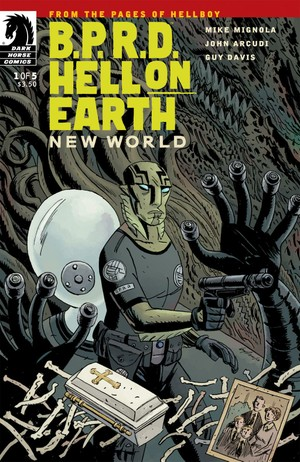
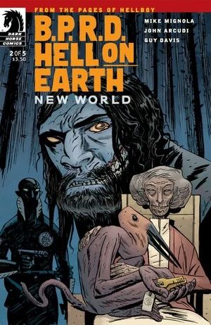
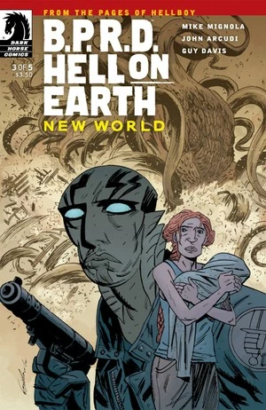
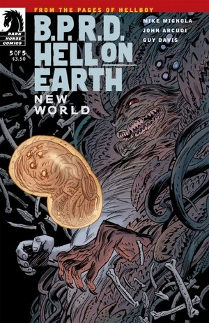
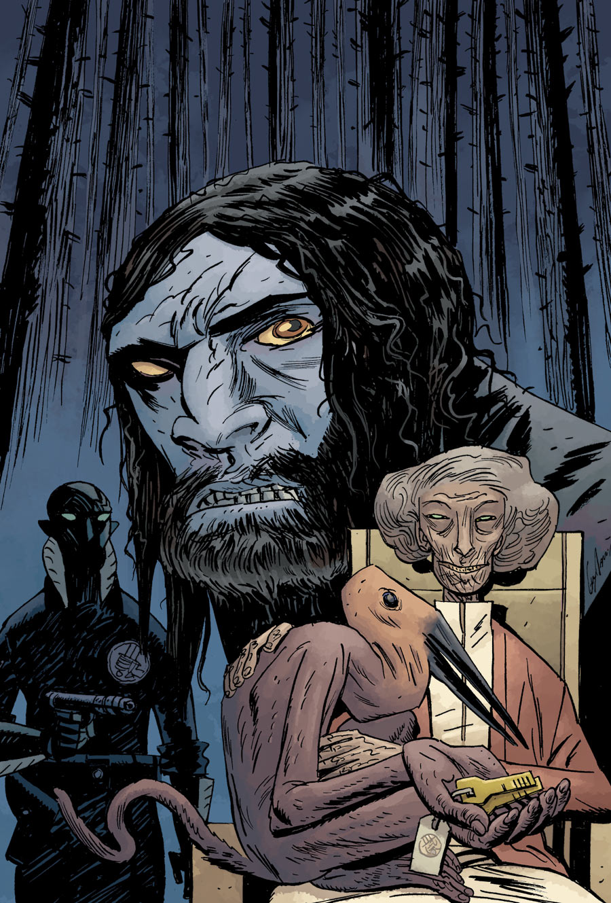

## 《新世界》

是 [BPRD:Hell on Earth](/entry/BPRD%3AHell%20on%20Earth)（人间地狱）的第一篇。

BPRD主编剧，John Arcudi。应该bprd故事都是他写的。mike只是挂名。整个系列都要挂他名。

画师依旧是Guy Davis 画风粗狂，镜头大气。人物个性

故事上接着bprd主系列。

达米奥的前面情节都忘了差不多了，在前面他几乎被黑化的几乎都有点无法逆转了。

## 出版历史

《新世界》（New World）是一部五期限定连载，于 2010 年 8 月至 12 月出版，是[《B.P.R.D.：人间炼狱》](/entry/Hell_on_Earth_(story_cycle))系列的第一个故事篇章。

在[《B.P.R.D.：恐惧之王》](/entry/King_of_Fear_%28story%29)完结之后，[《B.P.R.D.》漫画系列](/entry/Hellboy_Comics)休刊两个月，随后以[《B.P.R.D.：人间炼狱》](/entry/Hell_on_Earth_(story_cycle))的新品牌重新出发，《新世界》是更名后的第一部限定连载。

## 剧情简介

### 第一部

在不列颠哥伦比亚省的马雷基奥斯（Marekeos），人们正接二连三地消失得无影无踪。[亚伯·塞皮恩](/entry/Abe_Sapien)正在读一篇报道，称当地有人目击到一只巨大的白色生物，这时他接到了[凯特·考瑞根](/entry/Kate_Corrigan)的视频通话。两人谈起在与怪物的战斗中如何寻找线索。亚伯抱怨[安德鲁·德文](/entry/Andrew_Devon)对他的种种指控，并建议把德文开除。通话结束后，德文走进凯特的办公室，让她盯紧亚伯，凯特只回以满心的烦躁。

两人走到一间监控室，[约翰·克劳斯](/entry/Johann_Kraus)正坐在那里，观看加利福尼亚州索尔顿湖（Salton Sea）那只生物的视频画面（见[《恐惧之王》第 5 期](/entry/King_of_Fear_%28story%29)）。一名如今隶属超自然调查防御署的官僚向凯特报告法国出现了一起湖怪目击事件，凯特决定派德文前去调查。

他们身后的电视上，一名记者正在采访一个男人。此人批评联合国介入美国本土事务，主张应由"人类"而不是"怪物"来处理这些问题。

凯特接到了探员[卡拉·贾罗科](/entry/Carla_Giarocco)的电话。卡拉说最新的线索一无所获，还告诉凯特亚伯开了一辆悍马车往北去了。

亚伯站在如今已成空城的马雷基奥斯镇中。

与此同时，一个男人在墓地里掘出了一口小小的棺材。

联合国安理会那位戴眼镜的代表翻阅着几份档案，发现了一张[达里尔·泰农](/entry/Daryl_Tynon)与家人的合影。他向凯特问起此事，凯特却把话题岔开了。

约翰顺路去看从[奥安尼斯社](/entry/Oannes_Society)手中寻回的那具仍不完整的躯体，[潘雅](/entry/Panya_%28character%29)的一只宠物在一旁看着。

亚伯循着白色怪物最后一次被目击的线索，深入不列颠哥伦比亚省的森林。他正独自穿行，突然一个面目狰狞的大胡子男人跳了出来，厉声质问亚伯在做什么。

### 第二部

凯特在安排超自然调查防御署探员的轮班时遇到了困难，约翰声称自己抽不出身顶班。他一直把时间花在观察储液槽中那具合成躯体上。潘雅的一只宠物偷走了这个房间的钥匙，约翰一路追着它找到潘雅。这件事最终闹到凯特面前，约翰指控潘雅偷钥匙，是想把从她岛上寻回的所有生物都放出来。

电视上，内丁牧师（Reverend Nedin）声称眼前展开的种种地狱般的事件，都是罪孽以及罪孽不受遏制地蔓延所招致的后果。在一个拖车停车场里，杰布（Jeb）和托德（Todd）两个男人看着这个节目。托德越看越上火，冲着电视机大吼大叫，杰布提醒他小声点，别吵醒另一间屋里的女人。托德怒气冲冲地摔门而出。

亚伯和[本·达米奥](/entry/Ben_Daimio)（上一期结尾出现的那个大胡子男人）围坐在林中的篝火旁。亚伯试图劝他回到超自然调查防御署，但达米奥宁愿留在森林里，因为这里没有旁人会被他伤害。他们入睡时，化身为温迪戈（wendigo）的达里尔正盯着他们。

清晨，达米奥把亚伯带到一个名叫"地狱釜"（Hell's Kettle）、湖水漆黑的湖边。达米奥认为这湖与失踪事件有某种关联。亚伯决定下水一探究竟，潜了进去——水里满是腐烂的尸体。

### 第三部

在不列颠哥伦比亚省的林恩镇（Lynne），一个女人抱着用毯子裹住、紧贴胸口的婴儿，和一名治安官走进一家小餐馆。女侍者想看看婴儿，女人立刻变得激动而焦躁。另一名食客突然开始窒息，呕出绿色的黏液。正当其他人冲过去救助这个垂死的男人时，女人和治安官却站在吧台边毫无反应。她怀抱着孩子，而治安官的眼睛被映得一片漆黑，神情呆滞。

在超自然调查防御署总部，凯特、约翰和联合国联络官惊恐地看着新闻报道：得克萨斯州休斯敦地下凭空冒出一座火山并喷发，摧毁了整座城市，数百万人丧生。他们很快从恐惧与震惊中回过神来，意识到在联邦应急管理局（FEMA）处理灾情的同时，超自然调查防御署必须派人进驻当地应对媒体。凯特主动请缨，把总部交给约翰负责。

在加拿大荒野中，亚伯和本从地狱釜里往上拖尸体。他们认出死者正是马雷基奥斯的居民，于是决定前往离马雷基奥斯最近的城镇——林恩。抵达后，他们发现镇上的居民也已消失，只剩三个人：开头出现的那个女人和她的婴儿，以及另一个男人；三人正朝一栋房子走去。本走近他们时，看见那男人纯黑的眼睛——男人随即将门冲着他们关上，本立刻意识到危险。他跑回车旁大喊让亚伯开车，就在这时，一只巨大的怪物破屋而出，追了上来。

在超自然调查防御署总部，联合国联络官惊讶地发现坐在控制中心看监控屏的是潘雅而不是约翰；约翰已回去盯着奥安尼斯社那具残存的躯体，同时升级房间的安保措施。

亚伯拼尽全力开车逃离怪物，本则用上手头所有武器和炸药阻挡它逼近。最终，在弃掉一辆车、又撬线点火弄来另一辆车之后，他们总算甩掉了那东西。女人抱着孩子毫发无伤地从房屋废墟中走出来，沿着公路离去。

亚伯和本返回营地补充武器、筹划下一步行动时，发现有个男人正坐在篝火旁等他们，身边放着一口孩童的棺材。

### 第四部

那男人自述曾是一名美军士兵，当年他抛下怀孕的妻子妮莎（Nessa）赴海外服役。他在战场上负了伤，他不在的那段日子里，儿子出生了。回国后，他发现妻子变得古怪而疏离，还以孩子生病为由禁止他见儿子。她寸步不离地守着孩子，他很快起了疑心，联系了妻子的家人，却得知他离家期间她就已经失去了腹中的孩子。他被这个真相惊呆了，想去看清楚婴儿房里睡着的究竟是什么，妮莎却把他打晕，带着那个"孩子"逃走了，没等他查明真相。

如今他追猎于荒野之间，一路拖着棺材里他们真正的孩子的尸体，孤注一掷地想让妻子相信儿子已经死了——也想把她从那个如今附在她身上的东西身边拉开。就在这时，在林恩追击过他们的同一只怪物穿过树丛袭来，攻向他们的营地。

在超自然调查防御署总部，联合国联络官向凯特抱怨说人手不足，约翰又没有到岗，他不得不亲自盯监控屏。凯特让他改叫卡拉·贾罗科来顶班。

约翰继续坐着观察奥安尼斯社的那具躯体，忽然探测到脑波活动，躯体动了起来，把手掌贴在了玻璃上。约翰为这动静欣喜若狂，潘雅则在门口看着，脸上挂着狡黠的微笑。

亚伯、本和那名士兵继续与怪物搏斗。本开始感到自己正在向豹人（Were-Jaguar）变身，士兵则被怪物的触手杀死。亚伯打光了弹药，温迪戈达里尔从林中冲出，与亚伯并肩攻击怪物。本意识到怪物追的不是他们而是女人妮莎，便冲进树林找她，确信她就在附近。妮莎一棍打在本身上，本却夺下了她的武器，看清她一直抱着的"孩子"原来是一只体型不大、生着许多触手的怪物，和他们苦战的那只如出一辙。他站到她身前，正要给出致命一击，那生物的灵体却在他身后升腾而起。

### 第五部

亚伯逃离怪物之际，本遭到那生物灵体的攻击，灵体试图占据他的身体。就在那一刻，两人的意识相触，他看见了它的思绪——当初妮莎孤身一人、丈夫不在身边，哀悼着死去的婴孩，它正是借着这份悲痛来到这个世界。他看见它如何在她子宫中着床受孕，与它的"孪生体"一同生长。本最终凝聚起足够强的意志力压制住那生物，开枪击中妮莎。灵体渐渐消散，她悲叹上帝为何不肯赐她一个孩子，随后与两只怪物一同死去。

亚伯和本挖好墓穴让这一家人入土为安，本讲述了他所窥见的一切：那怪物本是[奥格德鲁·赫姆](/entry/Ogdru_Hem)之一，原本没有固定的形状。它被妮莎的悲痛吸引，以她为锚点让自己获得实体。它利用她的卵巢孕育自身，分裂出一块组织造出了一个"孪生体"。这个孪生体长成了他们与之搏斗的那只巨型怪物，靠暴食动物血肉长到骇人的体型，充当保护者；它还能化成人形（林恩的治安官、屋里的那个男人）。另一只怪物，也就是本体，体型更小，专以灵魂为食，所有失踪的人归根结底都死于它手。然而，是妮莎的生命把它们拴在这个世界上，她一死，那生物的灵体便消散了——两个"孪生体"随之同归于尽。

亚伯被这真相震惊，奇怪这种事为何此前没有发生过。本认为世界已经越过了临界点，直到如今这些恐怖之物才能溜进他们的世界。亚伯请求本回到调查局，本拒绝了，并警告亚伯：最大的危险是对人心与思想的入侵；这比从索尔顿湖中升起的那类怪物风险更大。不过他还是托亚伯从总部替他取几样东西。

在超自然调查防御署总部，亚伯与德文探员、约翰、凯特·考瑞根一起就失踪人员事件听取汇报。德文对亚伯充满敌意，质问他当初为什么要跑去不列颠哥伦比亚。亚伯为自己的行动辩解，怒气冲冲地正要离开，一名技术助理进来报告说亚伯的笔记本电脑被人植入了间谍软件。亚伯勃然大怒，指控德文监视他，德文则连声喊冤。凯特试图平息事态，却无济于事。

在约翰的办公室里，剧情揭晓间谍软件正是约翰所为。他分析着亚伯笔记本电脑里的数据，看到报纸上关于不列颠哥伦比亚出现温迪戈目击事件的报道，随即拉开抽屉，看着他在[《杀戮场》](/entry/Killing_Ground)中从查韦斯（Chaves）手里拿走的那把刀——一把能够杀死豹人的刀。

在一片林间空地，亚伯秘密与本见面，给他送去一些补给，其中有雪茄，还有一张过了塑的达里尔全家合影。两人互道好运，就此分别。

## 画廊

\#1

\#2

\#3

\#4

\#5

### 第 2 期备选封面

征订宣传期间，第 2 期的封面经过修改，以便对达米奥回归一事保密。第 1 期出版后不久，真正的封面才揭晓。

**Category:Story** **Category:B.P.R.D. story** **Category:B.P.R.D.: Hell on Earth story**
