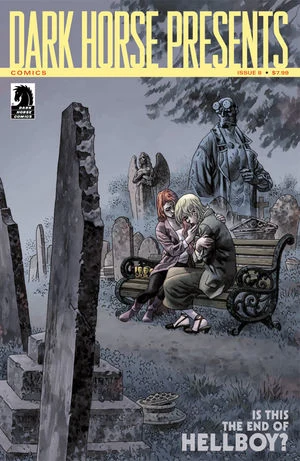

***《无名者墓》***（An Unmarked Grave）是一篇八页的短篇故事，发表于《黑马呈现》（*Dark Horse Presents*）第 8 期，封面由[邓肯·费格瑞铎](/entry/Duncan_Fegredo)（Duncan Fegredo）绘制。

本故事接续《俄罗斯》的事件，也可视为[*地狱男爵*](/entry/Hellboy_%28series%29)故事《[怒火燎原](/entry/The_Fury)》的某种尾声。

《无名者墓》与《[俄罗斯](/entry/Russia)》一同收录于《B.P.R.D.：人间炼狱——俄罗斯》（*[B.P.R.D.: Hell on Earth—Russia](/entry/Trade_Collections)*）平装合订本中。

## 剧情简介

[凯特·考瑞根](/entry/Kate_Corrigan)在英格兰与[比尔神父](/entry/Father_Bill)（Father Bill，上一次登场是在《[山雨欲来](/entry/The_Storm)》中）会面，想弄清地狱男爵究竟遭遇了什么。会面之后，凯特在一座教堂墓地里遇到了一位红发女子——[爱丽丝·莫纳汉](/entry/Alice_Monaghan)（Alice Monaghan），她告诉凯特，地狱男爵已经遇害。爱丽丝试图劝说凯特留在英格兰，因为这片土地已受过地狱男爵之血的洗礼，必将成为地球上最后的花园。

凯特拒绝了爱丽丝的提议，也不肯放弃对这个世界的希望。随后她接到了布鲁诺·卡尔胡（Bruno Karhu）的电话。布鲁诺告诉凯特，他不会再来英格兰与她相会了，两人之间的关系太过复杂，他已经无力再维持下去。当凯特再把注意力转回爱丽丝身上时，爱丽丝已经消失不见，而整片墓地里开满了百合花。

**Category:Story** **Category:B.P.R.D. story** **Category:B.P.R.D.: Hell on Earth story**