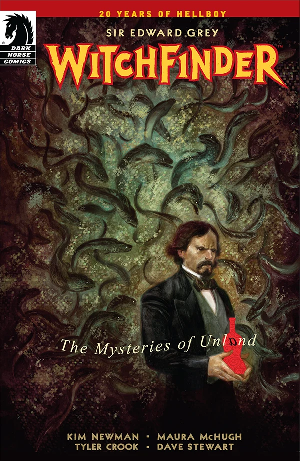

***The Mysteries of Unland*** is an upcoming five-issue miniseries written by [Kim Newman](/entry/Kim%20Newman) and [Maura McHugh](/entry/Maura%20McHugh) with [Tyler Crook](/entry/Tyler%20Crook) on art duties and Julián Totino Tedesco on covers.

## Publication History

### Teaser Campaign

Dark Horse starting featuring an advertisement for "Poole's Elixir" in its letter columns in January 2014 with no explanation for its appearance. On February 13, 2014, the first teaser appeared on various social media platforms, repackaging the advertisement from the letter columns but with a mysterious wallpaper.

The second teaser made it clear this project was a part of the Hellboy universe thanks to a red band along the top saying, "20 Years of Hellboy." This also introduced the phrase "Go to Unland" with a reversed letter a. The fourth teaser revealed Tyler Crook was the artist for the series and showed some eels as a part of his concept work.

The fifth teaser finally revealed the cover and the title.

<File:Poole's_Elixir_Teaser.jpg%7CFrom> the *Baltimore: Chapel of Bones \#2* letter column <File:GoToUnland_Teaser1.jpg%7C13th> February 2014 <File:GoToUnland_Teaser2.jpg%7C18th> February 2014 <File:GoToUnland_Teaser3.jpg%7C21st> February 2014 <File:GoToUnland_Teaser4.jpg%7C24th> February 2014 <File:GoToUnland_Teaser5.jpg%7C27th> February 2014

The five-issue miniseries was finally announced on the 7th of March at [Comic Book Resources](http://www.comicbookresources.com/?page=article&id=51311). It will be written by the writing team of Kim Newman and Maura McHugh, with art by Tyler Crook, colors by Dave Stewart, and covers by Julian Totino Tedesco. There were also announcements shortly after on the [blog of Kim Newman](http://johnnyalucard.com/2014/03/07/the-mysteries-of-unland/) and the [blog of Maura McHugh](http://splinister.com/post/2014/03/07).

## Synopsis

### Part One

Edward Grey is sent to Hallam to investigate a mysterious death. Once there, he hears rumors about the mysterious Unland, the wetlands around the town, and the creatures that inhabit it. Grey’s skepticism vanishes when he encounters the monsters of Unland, and he realizes that Hallam is a place of secrets.

### Part Two

After a dangerous clash with giant eel monsters, Sir Edward Grey determines that all signs of the secrets of Hallam point to Poole’s Elixir factory.

### Part Three

Local officials present a façade of normalcy, but the Witchfinder knows there’s something wrong with the denizens of Unland, and he’s starting to uncover what that has to do with the dying founder of the town and the elixir he invented that put the town on the map...

### Part Four

In a struggle with the local police, the witchfinder is taken down, but before they can drown him in the rising waters, a strange fish woman takes him in and reveals the mystery of Unland.

### Part Five

Sir Edward Grey digs deeper into the shocking truth about Unland even as the city drowns in the rising waters. With the help of a mysterious woman, Grey faces raging waters and the eel assassins that have haunted his every step!

## Gallery

文件:The Mysteries of Unland 1.jpg|Issue \#1 文件:The Mysteries of Unland 2.jpg|Issue \#2 文件:The Mysteries of Unland 3.jpg|Issue \#3 文件:The Mysteries of Unland 4.jpg|Issue \#4 文件:The Mysteries of Unland 5.jpg|Issue \#5

**Mysteries of Unland, The** **Mysteries of Unland, The**