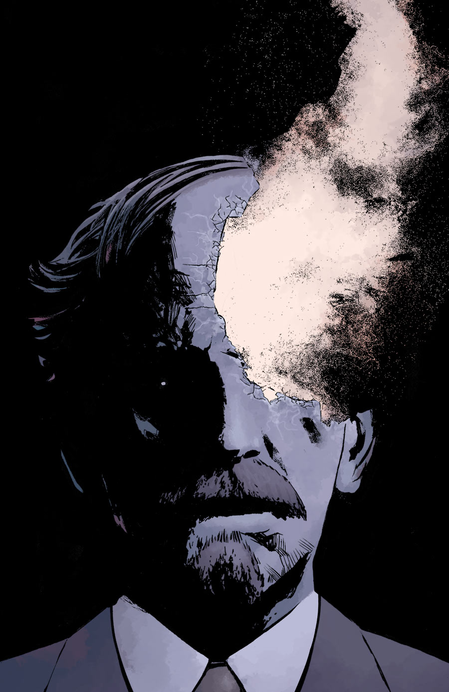
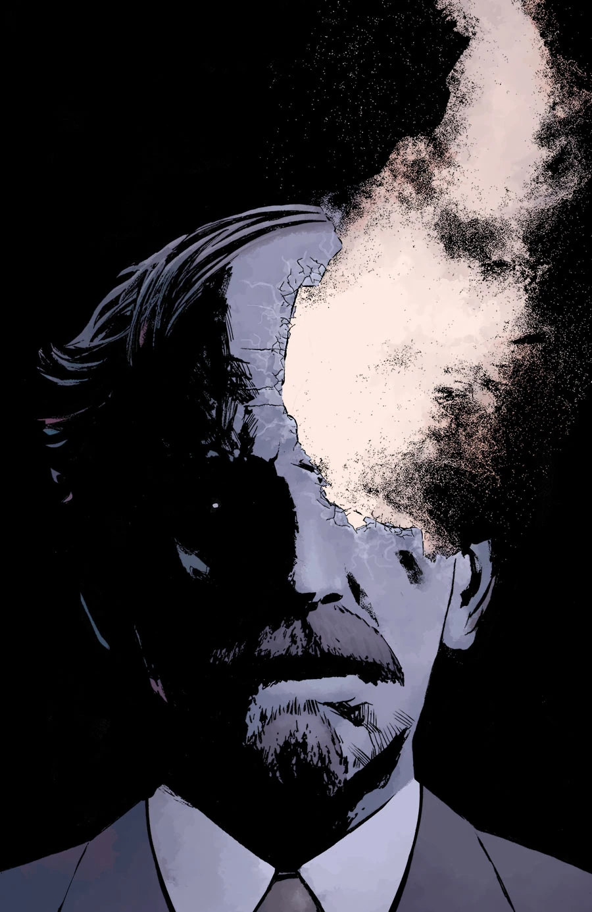
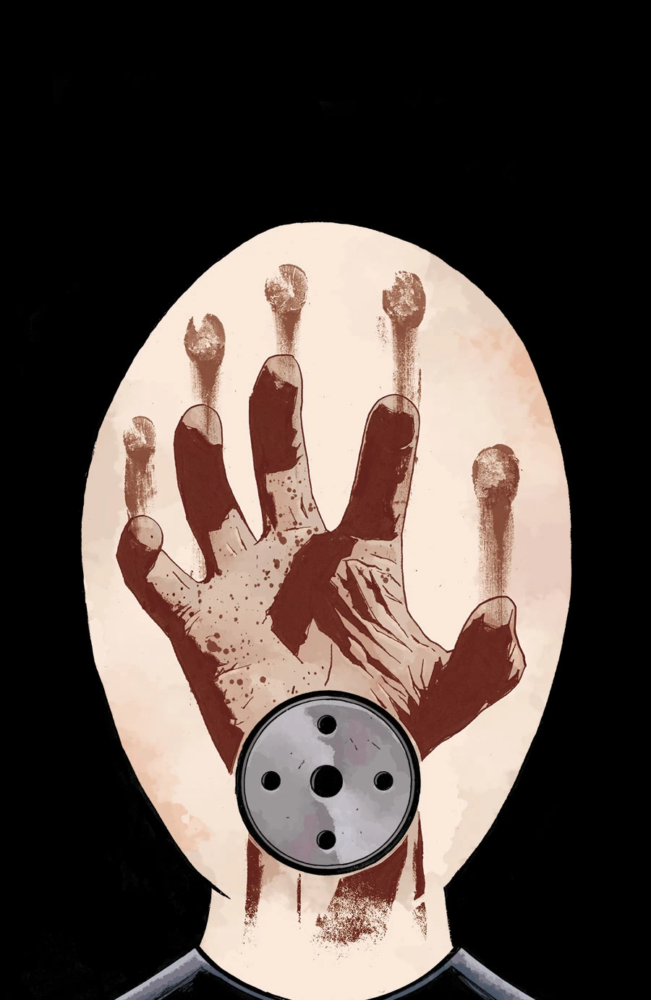
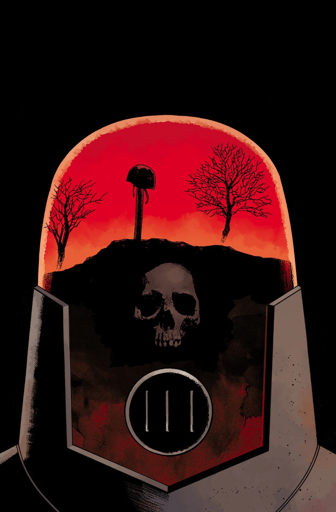

***《无所归宿，一无是处》***（Nowhere, Nothing, Never）是一个三期完结的故事篇章，由彼得·斯奈比约（Peter Snejbjerg）作画。

## 发布消息

本篇章于十月的"地狱男爵十三天"（13 Days of Hellboy）宣传活动中在[漫画资源网](http://www.comicbookresources.com/?page=article&id=56025)（Comic Book Resources）上公布。除了标题和[斯科特·阿利](/entry/Scott_Allie)（Scott Allie）的一段话之外，外界对这个故事几乎一无所知：

> 阿库迪对米格诺拉世界最大的贡献，是让这个世界住满了活生生、会呼吸的人。不幸的是，他们并不总能一直活下去、一直呼吸下去。他们不得不一次又一次地面对身边队友的死亡，而对大多数人来说，这件事从来不会变得更容易。约翰与生死之间那层本就模糊的关系在此刻变得清晰起来——因为对他而言，接受身边人的离去，已经变得太过轻易了……

## 剧情简介

### 第一部

一次可怕的任务之后，探员[约翰·克劳斯](/entry/Johann_Kraus)与[超自然调查防御署](/entry/Bureau_for_Paranormal_Research_and_Defense)（B.P.R.D.）的其他探员日渐疏远，他因此采取了极端的手段。其他探员会把真相告诉[凯特](/entry/Kate_Corrigan)吗？这位幽灵探员又将何去何从？

### 第二部

约翰失踪后，凯特向超自然调查防御署的探员们追问，要弄清堪萨斯州一座小镇上汽车旅馆大屠杀的真相。

### 第三部

约翰回到一名在他手下殉职探员的墓前，却发现那名探员死亡的真相比他所知的要惨烈得多。

## 画廊

\#1

\#2

\#3

**Category:Story** **Category:B.P.R.D. story** **Category:B.P.R.D.: Hell on Earth story**