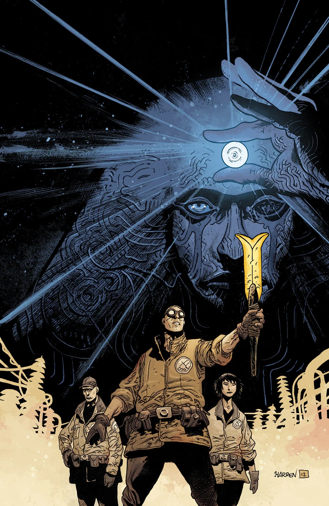
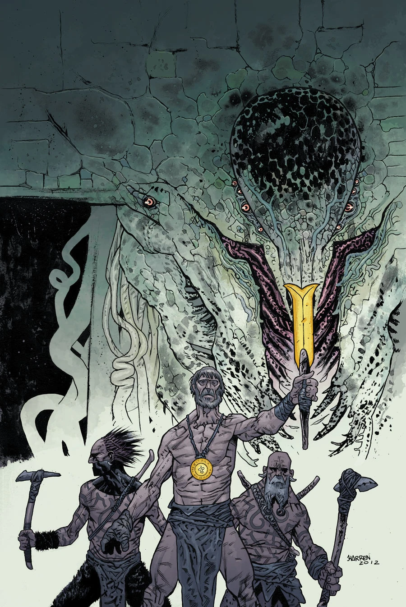

BPRD：人间地狱 中的中篇故事

画风非常强，分镜很舒畅

画师 [詹姆斯·哈伦](/entry/James_Harren)（James Harren）。

***《时间的深渊》***（The Abyss of Time）是一部两期限定连载，于 2013 年 1 月至 2 月间出版。

## 出版历史

《B.P.R.D.：人间炼狱——时间的深渊》（*B.P.R.D.: Hell on Earth—The Abyss of Time*）是一部两期限定连载，于 2013 年 1 月至 2 月间出版。

## 剧情简介

### 第一部

一队探员进入芝加哥一座废弃仓库，却在其中发现了一场百年前魔法仪式的遗址，以及一件古老的极北族（Hyperborean）武器——由此揭开了关于人类史前史与奥格德鲁·赫姆遗产的惊人真相！

### 第二部

[霍华德探员](/entry/Ted_Howards)被传送回史前时代，发现自己置身于一个穴居人部落之中，而他们正与一群怪物以及怪物所崇拜的邪神鏖战。

## 画廊

封面由[詹姆斯·哈伦](/entry/James_Harren)绘制。

 \#1

 \#2

**Category:Story** **Category:B.P.R.D. story** **Category:B.P.R.D.: Hell on Earth story**
