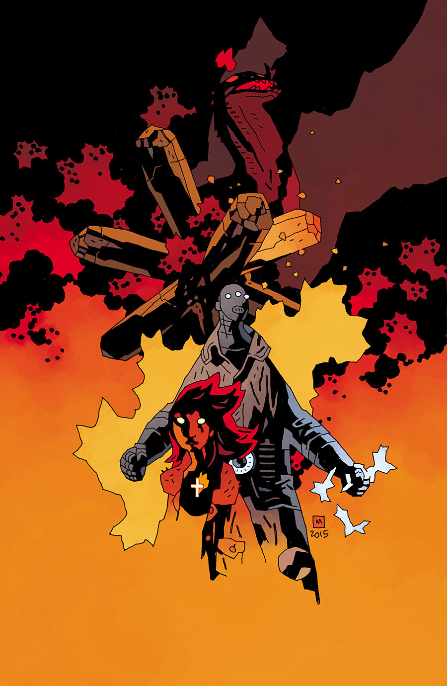
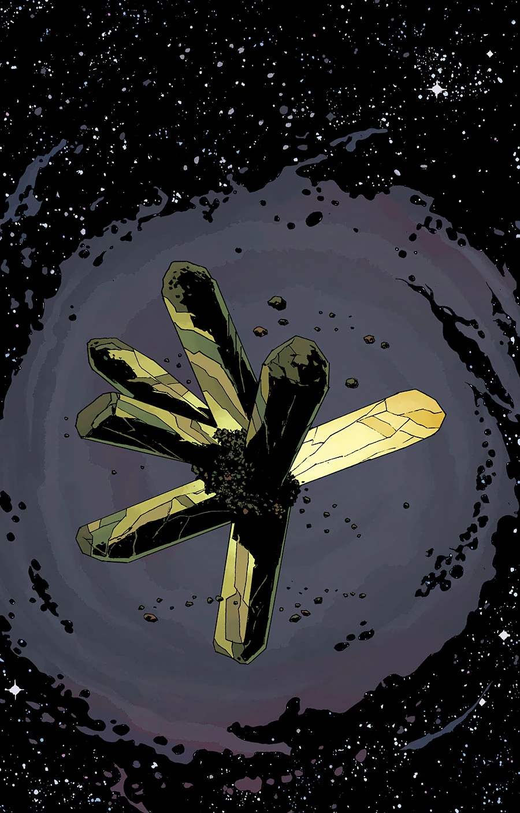
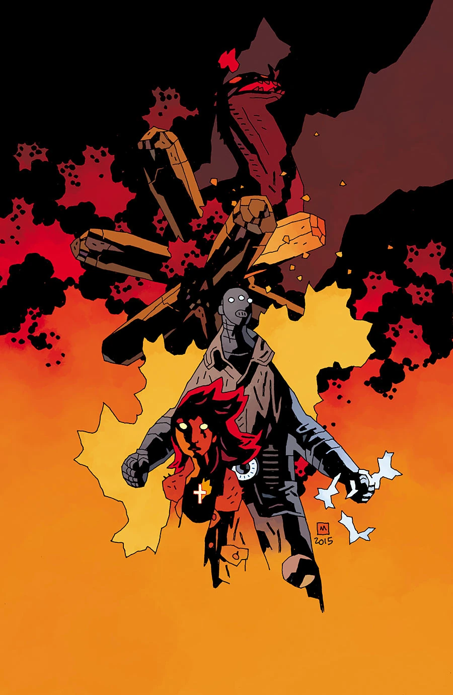
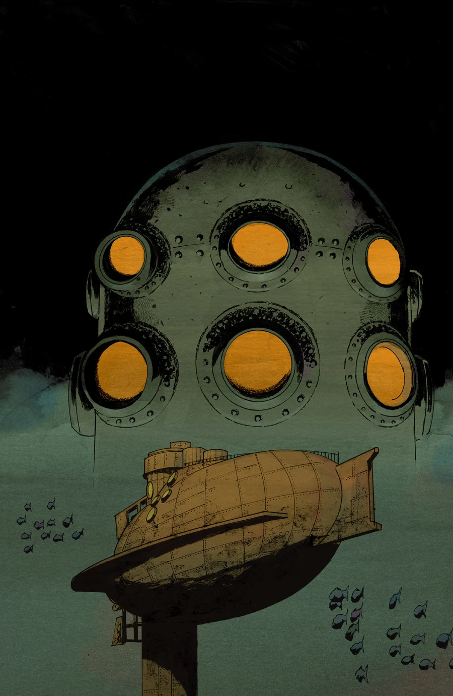
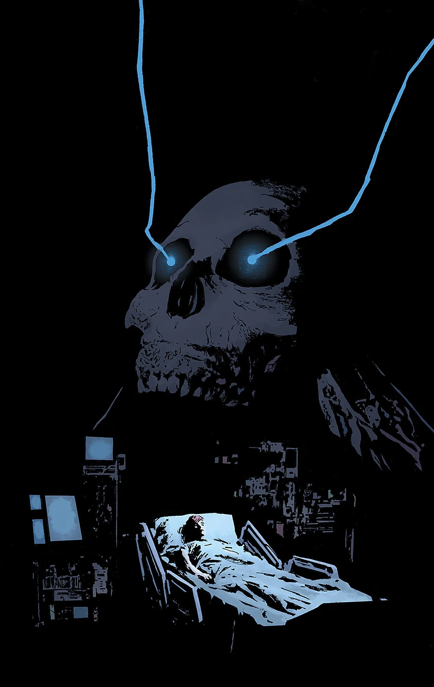
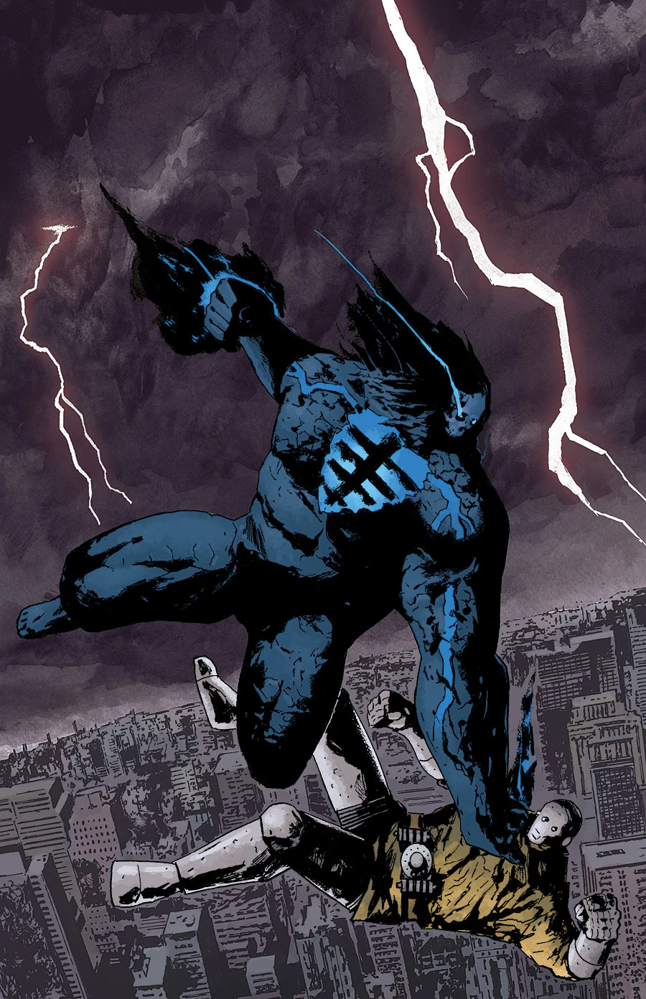
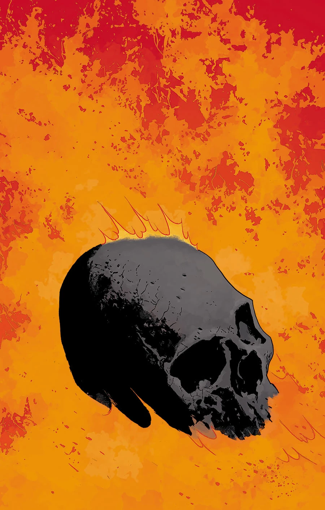

***《末日降临》（End of Days）*** 是一部共五期的连载故事，是*[《B.P.R.D.：人间炼狱》](/entry/Hell_on_Earth_(story_cycle))*终章宏大故事的前半部。

## 出版历史

该故事线的一张宣传图最早于 2015 年 5 月在[Bleeding Cool](http://www.bleedingcool.com/2015/05/13/dark-horse-reveals-the-impossible-will-happen-for-the-mignolaverse-this-summer-plus-august-covers/)网站上公开。

## 剧情简介

### 第一部

不可能之事终将发生！

在《人间炼狱》终章宏大故事展开之际，局势空前严峻，黑焰（Black Flame）不断试探着自身力量的极限。

### 第二部

中西部告急！超自然调查防御署有史以来最强大的敌人降临大地，署里竭力阻止浩劫蔓延，但即便他们最强力的武器也毫无用处！

### 第三部

超自然调查防御署派出麾下最强的两位战士协助消灭黑焰，而借助最新盟友那件不可思议的武器，形势终于出现了转机。

### 第四部

黑焰卷土重来，在哈得孙河上大肆破坏！潘雅（Panya）与凯特在超自然调查防御署总部尝试以灵能远程支援，丽兹和约翰则与黑焰正面交锋，阻止他摧毁纽约市。

### 第五部

超自然调查防御署与黑焰之间的战斗愈演愈烈！丹佛的小队试图从远方打击敌人，丽兹与约翰则要在黑焰毁灭纽约市之前亲手了结这场战斗。

## 《杀死黑焰》

这篇由[马特·斯特拉克拜恩（Matt Strackbein）](/entry/Matt_Strackbein)编剧并绘制的两页备用短篇，刊载于*《B.P.R.D.：人间炼狱——末日降临》*第 1 期，回顾了[黑焰](/entry/The_Black_Flame_%28character%29)的来历。该短篇未收录进任何合订本。

## 画廊

\#135

\#135　迈克·米格诺拉（Mike Mignola）变体封面

\#135　纽约漫展（NYCC）变体封面

\#137

\#138

\#139

**Category:B.P.R.D. story** **Category:B.P.R.D.: Hell on Earth story** **Category:Story**
