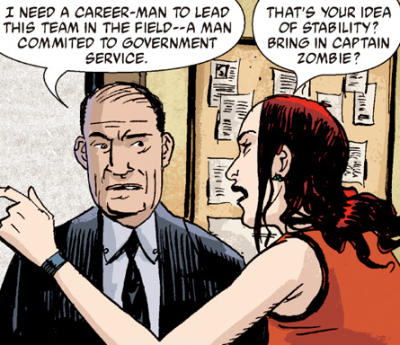
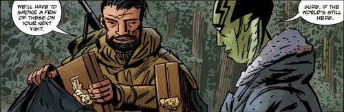
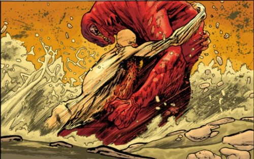

BPRD成员，领队之一。

达米奥上尉

虎怪

**Benjamin Daimio** was a member of the [B.P.R.D.](/entry/B.P.R.D.) A former U.S. Marine who returned from the dead under mysterious circumstances, Ben joined the bureau in 2004 as a team commander. With years of military experience Ben assisted the Bureau in planning and prosecuting its war against the supernatural threats it faces, all the while dealing with his own demons and the events surrounding his rebirth.

## History

### Early Life and Death

Born into a military family - his father having flown over twenty missions in Vietnam - Ben Daimio served with distinction in the U.S. Marines for many years, achieving the rank of Captain.

His first brush with the supernatural would have life altering consequences. On June 10, 2001 Ben Daimio led a squad of 8 Marines into the Bolivian Jungle to locate and rescue a group of Nuns allegedly held captive by a political organization called the Truth Path. Though they were skeptical, the True Path having never engaged in violent activities of any kind, the marines were nevertheless ordered into the jungle. They soon discovered the true culprits - a hidden cult that worshipped a native Jaguar god, a cult that was responsible for attacking and killing peaceful tribes in the area. After a firefight with the cult which saw several of his men killed or badly wounded, including Ben, he came face to face with the monster itself who induced horrific visions in the soldier before enigmatically declaring his new life was to begin.

Presumed dead and scheduled for autopsy he awoke three days later just prior to the procedure, slicing out of his body bag. Despite seemingly retaining his injuries, including a large gash on the left side of his face, he recovered fully and was assigned to Pentagon Special Ops - eventually becoming an informal consultant for the [B.P.R.D.](/entry/B.P.R.D.)  

### Joining the Bureau

Ben Daimio left the Pentagon and joined the B.P.R.D as a Field Team Commander in 2004. With [Abe Sapien](/entry/Abe%20Sapien) and [Kate Corrigan](/entry/Kate%20Corrigan) on leave in order to further investigate Abe's recent revelations regarding his past, Director Tom Manning placed Ben in command of preparing the Bureau for open war with the frogs. He spearheaded the relocation of the Bureau from Fairfield, Connecticut to the mothballed Center for Defense Research and Development in the Colorado mountains - a secret facility he became aware of during his time in the Pentagon. The move was not without difficulties and Daimio's blunt attitude, perceived callousness and preference for force over diplomacy caused friction within the team, particularly with [Liz Sherman](/entry/Liz%20Sherman), while becoming an unlikely role model for an impressionable [Roger](/entry/Roger).

### [War on Frogs](/entry/War%20on%20Frogs)

As the B.P.R.D's fight with the frog monsters continued to rage across the United States, and a subdued Abe retreated from field work, Captain Daimio was responsible for planning and leading many of the military operations to stem the spread of the Frogs. Though Ben and Liz continued to clash on a regular basis, Roger became more attached to Ben - spending more time in the field, leading soldiers into battle and even picking up several of his habits; especially his cockiness, brashness and penchant for cigars much to Ben's amusement

### The Black Flame and the Universal Machine

Unknown to the bureau the [Zinco Corporation](/entry/Zinco%20Corporation) and it's CEO [Landis Pope](/entry/Landis%20Pope) had allied with the frogs under the mantle of the Black Flame, and an unsuspecting Roger was lured into a trap and killed. Though they eventually rallied and defeated the monstrous Katha Hem, putting a temporary halt to the frog's machinations, Ben felt tremendous guilt on his part for Roger's death; fearing that Roger's attempt to emulate him had been what ultimately led him to his doom.

As the Bureau attempted to find ways to restore Roger to life, Ben grew slightly closer to his colleagues; though his attitude still found him at odds with them on occasion, especially Liz, he shared elements of his past including the story of his death and rebirth. Ben and Abe also formed a bond, one born of mutual appreciation of each other's skills and work ethic.

### The Oannes Society

When Abe journeyed to Indonesia to discover more about his former life, Ben accompanied him on the journey. Abe confided in the Captain the story of his previous life. When Abe eventually discovered his former colleagues still alive and their sinister plans to murder millions, Ben worked with local authorities, Abe and the Egyptian mummy [Panya](/entry/Panya) to put an end to their scheme.

### Inner Demons

But throughout his tenure at B.P.R.D. Ben was haunted by the specters of his past and the mysterious events circling his death in Bolivia and subsequent resurrection three days later. Unknown to his colleagues, he had been receiving frequent secret visits from a mystic he referred to simply as "the Chinaman" who performed esoteric rituals on Captain Daimio to suppress a dark force he felt brewing within him; a force he was finding increasingly difficult to deal with.

Things came to a head when [Johann Kraus](/entry/Johann%20Kraus) discovered Ben's grandmother was the infamous Japanese war criminal known as the Crimson Lotus and informed the Bureau of his discovery, confronting Ben. Ben defended his secrecy, angrily declaring it was not something the US army had been concerned with and neither should they - his own track record, as well as his father's own military service, should remove any suspicion. This drove another wedge between Ben and the others; especially Johann.

### Killing Ground

As Daryl the Wendigo was moved to B.P.R.D's new headquarters Ben's inner turmoil spilled over with fatal consequences. The Jaguar Spirit that had attacked him and his men all those years ago had made a home within Ben and now began to manifest itself - first killing the Chinese mystic who had been trying to help suppress the demon and soon began killing B.P.R.D staff.

Though suspicions initially fell onto the recently freed wendigo the creature's innocence was revealed when a mysterious assailant, eventually discovered to be a former marine and another survivor of the fateful Bolivian mission, infiltrated the base and tried to kill Ben with a bomb - knowing full well that he was possessed by something terrible. The man, Chaves, failed and was shot and killed by Abe. But out of debris emerged the true culprit responsible for the deaths; the Jaguar spirit itself given form in Ben's body. The monster killed several more personnel, including destroying Johann's new body he had taken possession of from the Oannes Society, and fled into the Colorado wilderness.

Ben's friend Abe led the expedition to try and find him in the wilds but to no avail as other matters pulled the B.P.R.D away. Meanwhile a seething Johann swore revenge against him for the destruction of his new physical form.

Both Ben and the wendigo vanished.

### Isolation

Distraught over the death of so many innocents at his hands, and knowing full well he could not contain the spirit that had taken hold of him, Ben made a home in isolation in the wilderness and eventually made his way into Canada and British Columbia; as did Daryl the Wendigo, whom Ben felt compelled to stay close to.  
Though he lived in seclusion for months, Ben continued some of his efforts to assist others in need and when tracking the strange disappearances of rural towns and villages in British Columbia he found himself teaming up with Abe Sapien once again, the latter investigating both the disappearances and reported sightings of Daryl. The two fought side-by-side to put an end to the threat of an Ogdru Hem that had been responsible for the deaths in Canada. A guilty Ben declined Abe's invitation to return to the Bureau and the two parted amicably - Abe returned some weeks later with additional supplies for Ben, including cigars, and even a photo of Daryl's family to be given to the wendigo.

Though Abe kept Ben's location secret, a vengeful Johann had tracked Abe's investigations after bugging his laptop and confirmed his suspicions when he found the information regarding possible sightings of the Wendigo - knowing that wherever the wendigo was, Ben was sure to be close.

### The Long Death

Many weeks later, with Abe now out of action after being shot and Liz still missing, new reports surface regarding further disappearances in the British Columbia not far from where Abe originally traveled. Johann leaps at the opportunity to lead a team to investigate, knowing he may find Daimio.

It soon becomes a clear the Jaguar spirit, now more in control than ever, is responsible for the deaths as it descends on the B.P.R.D team and kills several soldiers, narrowly being driven off by [Carla Giarocco](/entry/Carla%20Giarocco). Armed with a special blade he found on Chaves' body and hid from the Bureau, a weapon capable of destroying the Jaguar spirit and Ben with it, Johann heads into the forest in possession of a dead Park Ranger's body and eventually confronts Ben. Though Ben attempts to make right, to apologize for what he has done to him and others, Johann rejects his apology; declaring that forgiveness is long past and only his death can make amends. The two fight, with the jaguar demon emerging the victor and Johann's spirit returning to his containment suit - the knife lost.

 An increasingly desperate and guilt stricken Daimio knows that he has failed to contain the jaguar spirit and that more innocent blood could well be on his hands. Unable to take his own life, he seeks out Daryl the wendigo - the only being capable of fighting and killing the Jaguar spirit - and forces the peaceful creature into mortal combat as he transforms into the demon. The two creatures battle throughout the night with the wendigo eventually emerging victorious and Ben's body is destroyed. Johann discovers the remains of Ben the next day and departs satisfied. The status of the wendigo, and that of Ben's soul, remains unknown.

## Abilities

A former US Marine officer, Ben was in both good physical shape as well having a wealth of military experience. He is also an experienced marksman and has a wealth of knowledge on a wide variety of weapons. Despite his previous death and rebirth, Ben had no supernatural abilities.

When under the control of the Jaguar spirit the situation was very different. It possessed exceptional strength, speed and durability. The Jaguar spirit was immune to almost all conventional means of attack, including bullets and physical force. In addition it could rapidly regenerate almost any injury. Only fire and explosives could temporarily harm the spirit, though it would still heal rapidly. It was not indestructible however - it could be harmed by certain magical weapons, such as the knife wielded by Chaves and later Johann and at the hands of another powerful supernatural creature; specifically, the wendigo.

## Notes

<references/>

**Category:B.P.R.D. agent** **Category:Male Characters** **Category:Monsters** **Category:Americans**