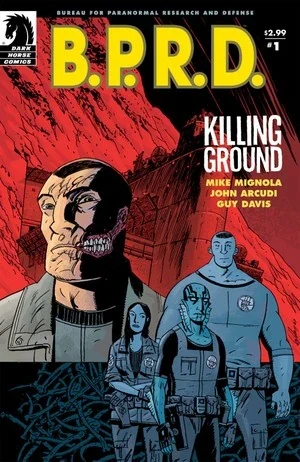
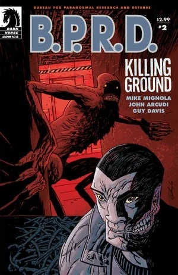
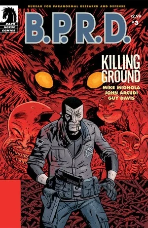
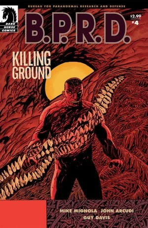
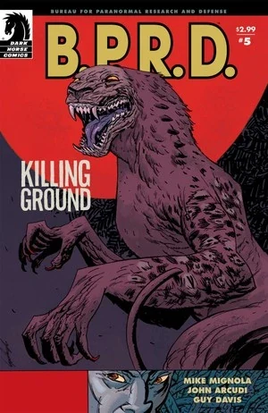

***《杀戮地带》***（Killing Ground）是一部于 2007 年下半年出版的五期限定连载。

## 出版历史

这部五期限定连载于 2007 年 8 月至 12 月出版，2008 年 5 月收录进平装合订本《B.P.R.D.：杀戮地带》（*[B.P.R.D.: Killing Ground](/entry/Trade_Collections)*）。

## 剧情简介

### 第一部

[B.P.R.D.](/entry/Bureau_for_Paranormal_Research_and_Defense) 正在发生变化。[亚伯](/entry/Abraham_Sapien)在印度尼西亚的遭遇为防御署带来了一位新成员，而[约翰](/entry/Johann_Kraus)发现自己掌握了一件极其珍贵的"商品"。但并非所有变化都向好——当超自然现象的猎人与猎物之间的界限日渐模糊，邪恶势力已悄然渗入防御署总部的心脏；B.P.R.D. 必须动用全部新资源才能应对。

### 第二部

某种邪恶之物已降临 B.P.R.D.。[丽兹](/entry/Liz_Sherman)的末日幻象不断加剧，[戴米奥](/entry/Benjamin_Daimio)则继续与队友们疏远。

### 第三部

某种邪恶之物已降临 B.P.R.D. 的新总部。一头[怪物](/entry/Daryl_Tynon)在逃，大楼里又闯入了一名神秘武装人员，死亡人数不断攀升；B.P.R.D. 的探员们已没有多少时间来辨明谁才是可以信任的人。

### 第四部

一头神秘怪物在 B.P.R.D. 总部的心脏地带一路杀戮，探员们束手无策；与此同时，丽兹愈发沉溺于自己的幻象世界。

### 第五部

在《B.P.R.D.：杀戮地带》的最终期里，怪物消失了，只留下一路尸体与未解的疑问。[凯特](/entry/Kate_Corrigan)和约翰希望从掌握着近期谋杀案钥匙的人——也就是受害者们——那里得到答案。

## 内容

### 角色

#### [超自然调查防御署](/entry/Bureau_for_Paranormal_Research_and_Defense)（B.P.R.D.）

- [本雅明·戴米奥](/entry/Benjamin_Daimio)（化身为豹人 Werejaguar）
- [丽兹·舍曼](/entry/Elizabeth_Sherman)
- [凯瑟琳·考瑞根](/entry/Kate_Corrigan)
- [约翰·克劳斯](/entry/Johann_Kraus)
- [亚伯拉罕·塞皮恩](/entry/Abraham_Sapien)
- [潘雅](/entry/Panya_%28character%29)
- [詹姆斯·亨利·奥唐奈教授](/entry/James_Henry_O%E2%80%99Donnell)
- [安德鲁·德文](/entry/Andrew_Devon)
- [汤姆·曼宁](/entry/Thomas_Manning)（仅被提及）
- 多恩先生（Mr. Dorne）
- 其他探员与职员

#### 其他

- 曼努埃尔·安东尼奥·查韦斯（Manuel Antonio Chaves）
- [达里尔·泰农](/entry/Daryl_Tynon)（[温迪戈](/entry/Wendigo)）
- [奥格德鲁·赫姆](/entry/Ogdru_Hem)（梦境/幻象）
- [蛙怪](/entry/Frog_monster)（梦境/幻象）
- [梅姆南·萨](/entry/Memnan_Saa)
- "中国佬"（"Chinaman"）
- 奥利（Olly，猫）
- [潘雅](/entry/Panya_%28character%29)的梦境
  - 奥拉维西（Olavisi，猫）
  - 潘雅之父 / 阿肯那顿
- [约翰](/entry/Johann_Kraus)的"朋友们"（波琳 Pauline、费伊 Faye 等）
- [大螯虾强生](/entry/The_Lobster)
- 查韦斯的故事（回忆）
  - 埃里克·波兰科（Eric Polanco，豹人）
  - 陆军上校
  - 乌亚纳（Huyana）

### 地点

- 美国
  - [B.P.R.D.](/entry/Bureau_for_Paranormal_Research_and_Defense) 总部（科罗拉多州）
  - 前 [B.P.R.D.](/entry/Bureau_for_Paranormal_Research_and_Defense) 总部（康涅狄格州费尔菲尔德）
  - 谢恩靴步公路酒吧（Shaney's Boot Scootin' Roadhouse，科罗拉多州博尔德郊外）
- 埃及（梦境）
  - [潘雅](/entry/Panya_%28character%29)的家（梦境）
- 玻利维亚（回忆）

### 重要物品

- [奥安尼斯学社](/entry/Oannes_Society)的生物躯体
- 罐中的[能乐猿猴](/entry/Noh_monkey)
- [尖刺圆柱](/entry/Spiked_Cylinder)（[极北族](/entry/Hyperboreans)器物）（梦境）
- 乌亚纳的匕首

## 趣闻

- 一格画着[温迪戈达里尔](/entry/Daryl_Tynon)吃山羊的画面，致敬了戈雅的名画《[萨图恩吞噬其子](https://en.wikipedia.org/wiki/Saturn_Devouring_His_Son)》。同一幅画后来在《The Long Death》第 2 期封面上再次被致敬。地狱男爵故事《In the Chapel of Moloch》中也着重提到了戈雅。
- "谢恩靴步公路酒吧"里播放的歌曲是《[Achy Breaky Heart](https://en.wikipedia.org/wiki/Achy_Breaky_Heart)》，原作由 Don Von Tress 创作；最流行的版本（也最可能是被致敬的版本）由 [Billy Ray Cyrus](https://en.wikipedia.org/wiki/Billy_Ray_Cyrus) 演唱。

## 画廊

封面作者：Guy Davis

 \#1

 \#2

 \#3

 \#4

 \#5

**Category:Story** **Category:B.P.R.D. story** **Category:B.P.R.D.: Plague of Frogs story**
