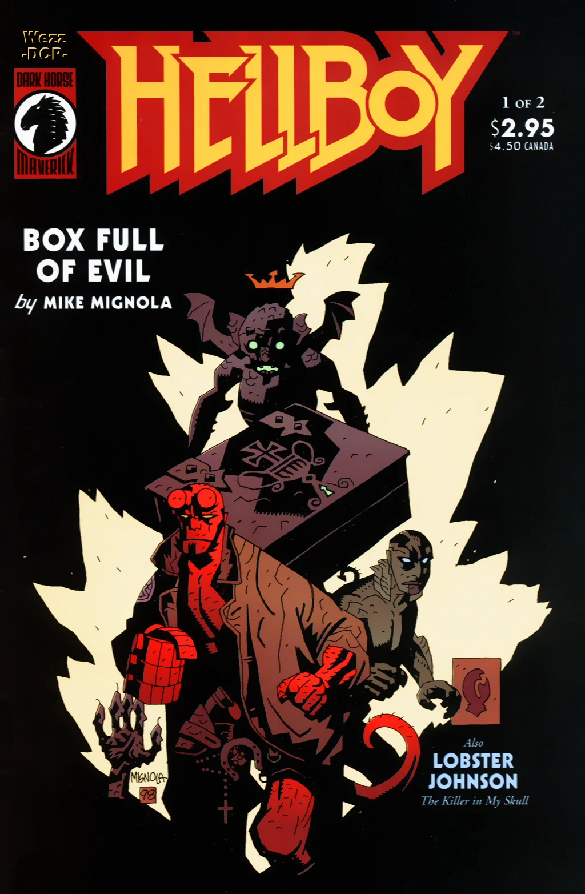

This short story introduces [the Lobster](/entry/The%20Lobster) and his assistant, Bob (here unnamed). The Lobster investigates an unusual murder case.

## Publication History

*The Killer in My Skull* was first published as the backup story to *[Hellboy: Box Full of Evil](/entry/Box%20Full%20of%20Evil)* \#1 in August 1999. The story was collected in the trade paperback *[B.P.R.D.: Hollow Earth & Other Stories](/entry/TPB)*, in January 2003.

## Synopsis

In 1938, the police are investigating a strange murder in New York. A man named Dr. Skinner has been killed, crushed under a desk, but Skinner was alone in his room. [Lobster Johnson](/entry/Lobster%20Johnson) arrives with his assistant. He connects the murder to three others, all employees of [Zinco-Davis Laboratories](/entry/Zinco%20Corporation). A photo discovered in Dr. Skinner's apartment led the Lobster to the last remaining scientist, [Stanley Corn](/entry/Stanley%20Corn).

The Lobster breaks into Corn's apartment and accuses him of the murders. Corn had been part of a top secret research team working on brain-wave energy. When Corn was fired he continued his experiments on himself, giving him the ability to move objects with his brain. Corn tries to attack the Lobster, but his assistant brought a device to jam the energy. When Corn learns he will be sent back to the Zinco-Davis Lab, he shoots himself in the head. Though his body dead, Corn's brain and spinal cord rise out of the body and attacks Johnson. Johnson hits the brain with the jamming device as it overloads killing the brain.

The Lobster then advises the detective, who have assisted on his case, to destroy the evidence and not tell anyone, and claims "I've seen worse things than this".

## Story Chronology

The story takes place in 1938. Later that year, Lobster Johnson calls off the search for [Memnan Saa](/entry/Memnan%20Saa).[1] In December of 1938, Johnson ends his fight on crime in New York City and Chicago.[2]

## Notes

- First appearance of Lobster Johnson's assistant, Bob. Other assistants Harry, Bill, and Lester would be introduced in *The Iron Prometheus.*

<references/>
! colspan = 3 | [*B.P.R.D. – Volume 1: Hollow Earth & Other Stories*](/entry/TPB)

**Killer in My Skull, The** **Killer in My Skull, The**

[1] *[The Black Goddess](/entry/The%20Black%20Goddess)* \#1

[2] *[The Iron Prometheus](/entry/The%20Iron%20Prometheus)* \#2, in "True History"