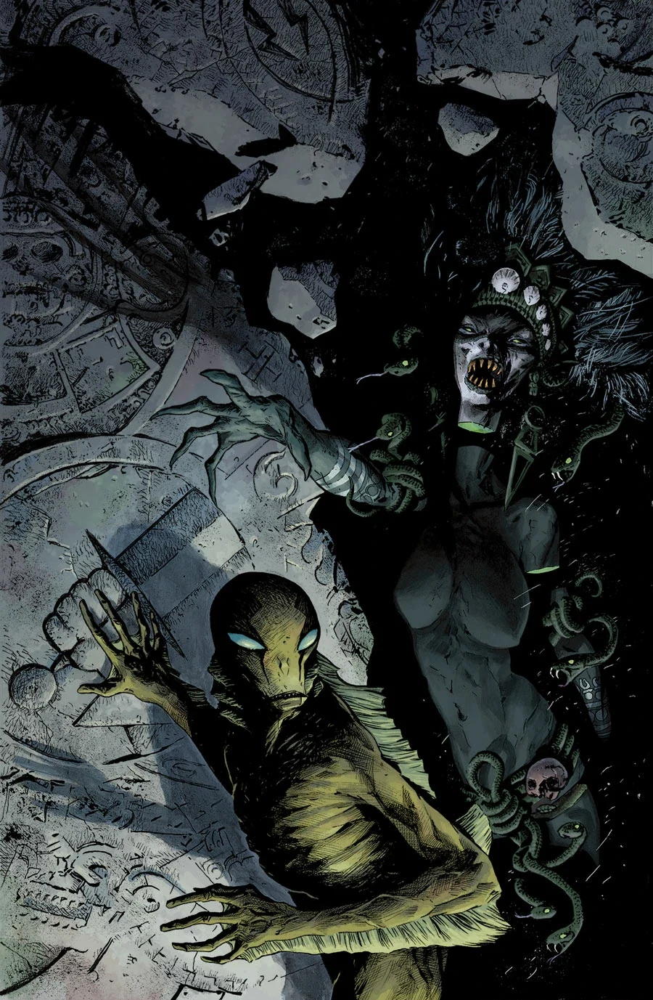
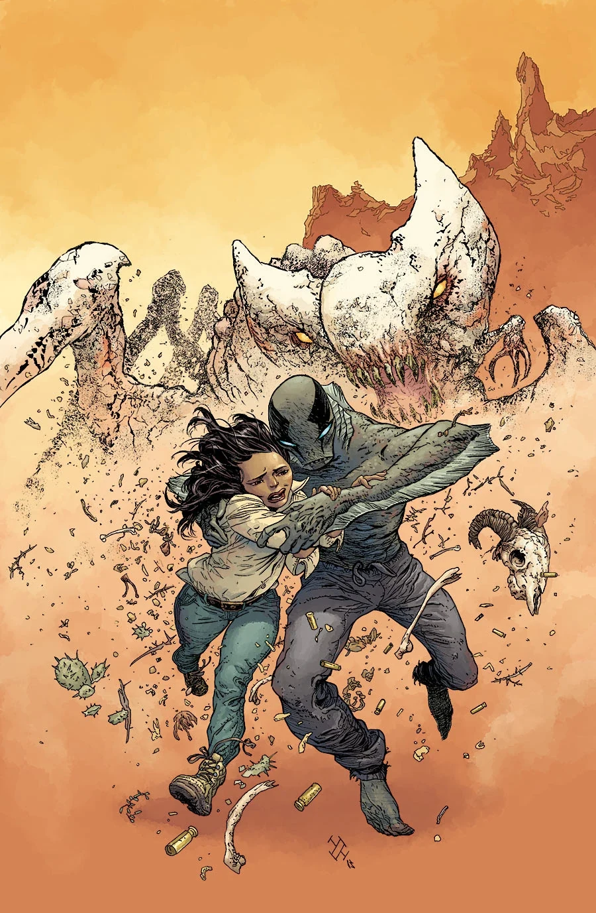

《**来者之形**》（The Shape of Things to Come）是一部两期篇幅的故事线，于 2013 年 10 月至 11 月出版，由塞巴斯蒂安·菲乌马拉（Sebastián Fiumara）担任绘画。

## 剧情简介

### 第一部

[亚伯](/entry/Abraham_Sapien)发现，他与[超自然调查防御署](/entry/Bureau_for_Paranormal_Research_and_Defense)（B.P.R.D.）正在经历的人间地狱，与那些浸透鲜血的玛雅传说——关于人类起源与世界末日的传说——之间存在着联系。

### 第二部

从沙漠黄沙中爬出的食肉怪物，与将菲尼克斯城同外部世界隔绝的筑垒民兵展开激战，亚伯一头扎入了这场厮杀。

亚伯对决玛雅天启！

## 画廊

