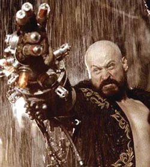

**Grigori Rasputin** was a prominent agent of the [Ogdru Jahad](/entry/Ogdru%20Jahad) and the archenemy of [Hellboy](/entry/Hellboy). He is based on the real life Russian mystic that was connected to the late Romanov family of imperial Russia.

## History

Grigori Rasputin was born on January 21 1869. As a young man he frequently had visions, and was aware of great power inside him, the ability to heal sick people and see the future. These powers convinced him he was destined for greatness. He used his power to gain a place in the court of Tsar Nicholas II, using his powers to cure prince Alexei's hemophilia. After being assassinated by Prince Felix Yusopov on December 16th, 1916, Rasputin was revived and contacted by the [Ogdru Jahad](/entry/Ogdru%20Jahad). They enlisted him as their mortal agent in the world. Soon after, Rasputin was contacted by the Nazis to begin development on an occult method for ending the Second World War. From this, [Project Ragna Rok](/entry/Project%20Ragna%20Rok) was born. The Nazis sought to use Rasputin to defeat the Allies, but Rasputin knew this would never happen. He merely intended to use the Nazi’s resources as long as he could to achieve his own goals: to trigger the apocalypse which would jumpstart a new Eden.

Rasputin summoning the Beast of the Apocalypse for the Nazis. When the summoning accidentally placed the creature ([Hellboy](/entry/Hellboy%20%28character%29)) in the hands of the Allies, Rasputin retreated to the Arctic Circle.

He returned in 1994 with [Sadu-Hem](/entry/Sadu-Hem), a monstrous spawn of the Ogdru Jahad, in tow. Rasputin's goal was to use Hellboy's stone right hand to free the Ogdru Jahad from their crystal prisons and permit them to raze the earth. However, Rasputin's plans were foiled by the timely intervention of Hellboy's associates from the [Bureau for Paranormal Research and Defense](/entry/Bureau%20for%20Paranormal%20Research%20and%20Defense), [Liz Sherman](/entry/Liz%20Sherman) and [Abe Sapien](/entry/Abe%20Sapien). Rasputin was killed and Sadu-Hem was burned to death.

### Wake the Devil

Rasputin re-appeared as a ghost while his pawns attempted to restore the vampire [Vladimir Giurescu](/entry/Vladimir%20Giurescu) to life. Rasputin directed [Ilsa Haupstein](/entry/Ilsa%20Haupstein), a loyal member of Project Ragna Rok, to abandon her efforts to revive Giurescu and instead place herself within an enchanted iron maiden presented by [Koku](/entry/Koku). Haupstein did so, dying in the process, but her blood allowed the goddess [Hecate](/entry/Hecate) to use the iron maiden as a permanent and indestructible body. Hecate's mortal form, like that of Rasputin himself, had been destroyed. Soon after, Rasputin retreated to the roots of Yggdrasil where he met the Baba Yaga, who she tells him that he was nothing but a pawn for the Ogdru Jahad.

### Conqueror Worm

Rasputin appeared lastly in his ghostly form as a counsel to [Inger von Klempt](/entry/Inger%20von%20Klempt). He persuaded her that she was to be the first of a final race of men, but she was executed by [Lobster Johnson](/entry/Lobster%20Johnson) and the end of the world was averted with the destruction of the [Conqueror Worm](/entry/Conqueror%20Worm). Rasputin's failed efforts to restart his new Eden was mocked by Hecate, to which Rasputin angrily lashed out at the goddess in response and, as a result, he is then decimated by Hecate. [The Baba Yaga](/entry/Baba%20Yaga%20%28character%29) took what was left of his soul and placed it in an acorn.

### Legacy

#### Rasputin's Acolyte

When the BPRD investigated the disappearance of a regenerated [Sadu-Hem](/entry/Sadu-Hem) from a Bureau facility in New Jersey, they found a Doomsday cult led by an acolyte of Rasputin. The acolyte, who had exhibited a chest wound the day that Rasputin was speared to death, fulfilled Rasputin's prophecy regarding his killer. [Abe Sapien](/entry/Abe%20Sapien), the agent that killed Rasputin, was himself speared to death by the acolyte. Sapien, however, was soon revived and both the acolyte and Sadu-Hem were killed.

#### Darkness Calls

Towards the end of the series, as Hellboy is trying to fight his way out of [the Baba Yaga](/entry/Baba%20Yaga%20%28character%29)'s world, the villainess puts as much of her power as she can into her slave [Koshchei](/entry/Koshchei) the Deathless to kill Hellboy. As she runs out of her own power, she states she has one more try, and wants to use the spirit of Rasputin, (who is still in the acorn) to power Koshchei. But her demon friend [Koku](/entry/Koku) throws the acorn between the roots of the World Tree, stating "not him." Hellboy hears Rasputin's name mentioned and only states "Don't even get me started on that guy!" The acorn containing Rasuptin's soul then fell into Hell.

## Powers and Abilities

Even before Grigori Rasputin was recruited by the Ogdru Jahad, he possessed some measure of supernatural abilities, including the power to temporarily heal others. After he made contact with the Baba Yaga in the late nineteenth/early twentieth century, his powers truly began to come into their own, making Rasputin a very powerful wizard indeed. By offering Baba Yaga a portion of his soul, Rasputin also became immortal, though not invincible.

Prior to his death, Rasputin demonstrated a wide array of supernatural talents. It was with his magic that Hellboy was brought into the world, and it was with his guidance that many of the Nazi doomsday projects came into existence. With the assistance of an Ogdru Hem, Rasputin was able to transform four explorers into frog men. When Hellboy first encountered Rasputin in Cavindesh Hall, the wizard was able to survive a large calibur gunshot wound to the head and knock Hellboy away with barely a murmur while easily overriding the numerous charms of protection Hellboy kept on his person. Rasputin was also able to take control of Liz Sherman's mind through arcane means, and was shown to survive a spear through the chest, though the injury did sap his powers significantly. Reduced to a flaming skeleton, the last power he demonstrated before his death was the ability to breath fire, in which afterwards Hellboy shattered him with his stone fist, killing him.

After his death Rasputin became a ghost, albeit one that still possessed a great deal of power. Even as a ghost he still bore the spear wound Abe Sapien had given him, which had become a wound that now produced blue flame. As a ghost Rasputin was shown to have the ability to teleport, become immaterial, and make people blind. He could also venture into different dimensions, even going as far as to visit the Baba Yaga near the World Tree. Rasputin could also "mark" individuals he deemed important, causing a blue flame to flicker above their heads. What this mark entailed to the individual, if anything, is unclear.

## Film version

### *Hellboy*

 Actor Karel Roden played Rasputin, the primary antagonist, in *[Hellboy](/entry/Hellboy%20%28film%29)*. He was seen working with the Nazis in the film and demonstrated great occult abilities linked with the underworld. Rasputin was depicted as being nearly immortal; every time he died, he was resurrected with a part of his god within his body. This ability was likely inspired by rumors of the real-life Rasputin being difficult to kill.

In 1944, Rasputin attempted to open a portal into the beyond and unleash the [Ogdru Jahad](/entry/Ogdru%20Jahad). From what he believed, the Ogdru Jahad would destroy their enemies and remake the world into a paradise. However, an Allied attack on the church where the ceremony was performed disrupted it. When Professor [Trevor Bruttenholm](/entry/Trevor%20Bruttenholm) tossed a grenade at the portal, it destabilized it and it sucked Rasputin into it. The results of the portal's opening was a child-like, red creature the Allies decided to name "[Hellboy](/entry/Hellboy%20%28character%29)".

Sixty years later, Rasputin's lover, Ilsa von Haupstein and [Karl Ruprecht Kroenen](/entry/Karl%20Ruprecht%20Kroenen) resurrect him in the mountains of Moldavia. Returned to a world that has changed in his absence, Rasputin set in motion events that would lead to the end of the world. During the climax of the film, Rasputin nearly succeeded in freeing the [Ogdru Jahad](/entry/Ogdru%20Jahad), but Hellboy rejected him and stabbed Rasputin with one of his own severed horns. Rasputin's 'god', a giant tentacled monster called the Behemoth, burst from his body and grew to gigantic size. Dying and outliving his usefulness, Rasputin was crushed to death by the Behemoth.

### *[Hellboy II: The Golden Army](/entry/Hellboy_II__The_Golden_Army)*

On the 3-disc DVD version of *Hellboy II: The Golden Army*, an animated comic called the "Zinco Epilogue" shows a company called [Zinco](/entry/Zinco%20Corporation) researching through the remains of the mausoleum from the first movie. The company only find Kroenen's body and takes it for research. Mr. Zinco, the founder, travels to the Amundsen Glacier along with Kroenen's decapitated head. Zinco places Kroenen's head on a machine he finds and the head is brought back to life. Kroenen responds "As you promised, my master." Zinco responds that he isn't his master, until it's revealed that Rasputin has returned. It isn't revealed yet if Rasputin has survived from the Behemoth or if he's a ghost due to the fact that Rasputin reappears in front of Zinco.

## Gallery

<File:292583-74717-grigori-efimovich-ra_super.jpg>

sv:Grigori Rasputin de:Grigori Rasputin

**Category:The Ogdru Jahad and their Agents** **Category:Characters** **Category:Undead** **Category:Russians** **Category:Male Characters** **Category:Occultists** **Category:Humans** **Category:Villains** **Category:Hellboy (2004 film) characters**