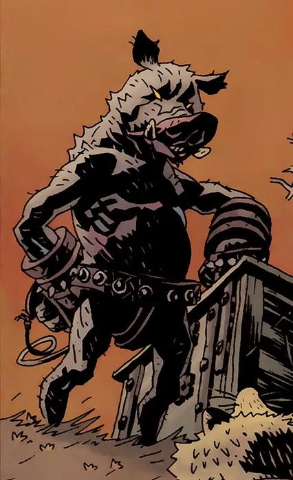

The **Gruagach of Lough Leane** is a fairy creature of the Daoine Sidhe, and a vengeful adversary of [Hellboy](/entry/Hellboy). He is currently trapped in the degenerated body of the fomorian giant Grom, which now resembles a stunted anthropomorphic boar. He blames Hellboy for his current state and seeks revenge for his humiliations. He is also driven by a desire to see his people returned to their former glory, and would rather see the fairy folk die fighting for their survival, instead of simply fading away in the shadow of the human race.

## History

### Pre-Hellboy

Gruagach was once a shapeshifting warrior of the Tuatha De Danann, who would later become the Daoine Sidhe; the fairy folk of Ireland. Long ago, he rode with the sons of the High King [Dagda](/entry/Dagda) against the giants (presumably the Fomorian enemies of the Tuatha de Danann, as recounted in Celtic myth). Gruagach was able to change into many shapes, and during the battle he took the form of a hulking monster, personally killing twenty of the giants.

Some time thereafter, Gruagach fell in love with a human girl. This girl wished to see the form he took when he fought the giants, but the fairy was reluctant, fearing that she would be affrighted by him. There was a strange law which meant that should the girl scream at the sight of his monstrous form, Gruagach would be banished to some purgatorial land of mists and never see her again. Nevertheless, the girl managed to persuade him into appearing as a monster. As he'd feared, the girl was quailed by the sight of her fairy lover as a giant, tusked beast, though she resisted the urge to scream. In order to allay her apparent fear, Gruagach turned into a little songbird. However a cat appeared and the girl screamed to warn him, but with that scream Gruagach was lost to the mists.

Gruagach found himself stranded in a forlorn misty dimension, inhabited by other wretched lost souls of the fairy folk. He wandered this limbo aimlessly for an unknown amount of time, slowly degenerating into withered husk of his former self. Eventually, he managed to find his way back into the world, having lost almost all of his power.

### [The Corpse](/entry/The%20Corpse)

In 1959, Gruagach (reduced to a mere infantile changeling) was sent to Ireland in order to replace the kidnapped baby [Alice Monaghan](/entry/Alice%20Monaghan). The Monaghan's had an inkling of this ruse and managed to call on [Hellboy](/entry/Hellboy) to investigate their unusual child. Hellboy exposed the changeling using the age-old fairy bane of Cold Iron. Gruagach was forced to tell Hellboy how to get the child back from the Daoine Sidhe. Adding insult to injury, Gruagach was released into the furnace, but made good his escape. Humiliated, the changeling rather hypocritically swore vengeance on Hellboy for his cruel treatment. While Hellboy set out to play the old game of the fairy folk by their rules, Gruagach dove into a murky river and awoke the folkloric river hag called Jenny Greenteeth (with whom it was implied Gruagach had once shared a love affair). He had Jenny set loose the imprisoned war-monster Grom, last of the Fomorian giants, who resembled a huge boar-headed humanoid.

Hellboy was erstwhile engaged with lugging around the talkative corpse of a hanged man named Tam O'Clannie, in order to find him a christian burial place and therefore appease the fairy folk. Grom was unleashed upon Hellboy while he was crossing an old stone bridge with the corpse in tow. Gruagach, floating recklessly nearby, gleefully castigates Hellboy before he himself is snatched from the air mid-taunt and devoured whole by Grom. Hellboy battled with Grom and managed to best the giant using a holy relic which causes Grom to shrink and flee. While Hellboy succeeds in rescuing baby Alice from the Daoine Sidhe, the spirit of Gruagach manages to overthrow the mind of Grom and usurp control over the now-dwarfed body of the Fomorian.[1]

### Council of the Daoine Sidhe

In *[The Third Wish](/entry/The%20Third%20Wish)* \#2, Gruagach, now permanently trapped in Grom's porcine body, stands together with King [Dagda](/entry/Dagda) and [Sir Edward Grey](/entry/Sir%20Edward%20Grey), holding court with many other fairy creatures. Gruagach states his belief that without [Hellboy](/entry/Hellboy) the fairy folk will be able to rule the world again, rather than retreating into the darkness beneath the world and fading away, a fate which Dagda has resigned himself to. Grey says that Gruagach only wants revenge. He does not deny this and says that Hellboy once burned him with iron, and that he is now trapped in the 'pig-body' of Grom. Again Gruagach says he will have revenge.

In the epilogue of *[The Island](/entry/The%20Island)*, Gruagach speaks to Mab, former fairy queen of the Tuatha De Danann. She tells him that [Hellboy](/entry/Hellboy) still lives and is returning to England. Gruagach still wants to stop Hellboy, and asks what the witches are doing. Mab replies that they await word from their queen [Hecate](/entry/Hecate). She tells him that he cannot beat Hellboy, but Gruagach refuses to listen. He boldly declares that even if it will cause an end to his people, he would rather see them go out in the glory of war than simply fade away.

### [Darkness Calls](/entry/Darkness%20Calls)

Gruagach gate crashes a gathering held by the witches of England, who seek to find a replacement for the (effectively neutralized) Hecate. He tells them they must make 'Her' their queen, speaking of an unknown benefactress. The witches are deeply wary of his suggestion, filled with terror and old shame, but they realize that the one he speaks of is their last best hope for survival.[2]

Gruagach, together with a band of two fairy cronies, travel to a secret cavern beneath an English church. He awakens the guardian of the cavern and presents this giant with a letter from the witches of Britain. The Giant reluctantly complies with the demands of the letter, and travels into a secure pit to release the being imprisoned there, the one who would become the new Queen of Witches.[3]

Gruagach observes as the giant returns with a wooden chest containing the dismembered remains of a former witch queen, betrayed by her own followers. The giant returns to his resting place, wanting nothing to do with the events soon to transpire. Gruagach and his companions take their leave of the church and spot an innocuous bird. He tells the bird that its mistress should choose which side she is on, because the new Queen is coming. The fairies drag away the chest containing their newfound mistress. Meanwhile, Dagda watches them from afar, and foresees that their actions shall bring about the doom of his people.[4]

Gruagach and his companions return to the gathering of the Daoine Sidhe, bringing with them the box. King [Dagda](/entry/Dagda) pleads with them to rethink their actions. One of Gruagach's companions, caught up in the furor of the moment, stabs the fairy monarch in the back. The fairy is nonchalant at first, but when he sees the golden blood staining his knife, the gravity of his murder sinks in. Wretchedly crowing the name of his king, the murderer commits suicide and evaporates. Gruagach, caught off-guard, appears to be deeply troubled by this unexpected turn, but he takes advantage of the moment all the same. He laments the loss of their king, but rallies the fairy folk behind himself and his Queen of Blood.[5]

### [The Wild Hunt](/entry/The%20Wild%20Hunt)

Gruagach stands on a hilltop in the midst of a gathering fairy army. A hedgehog fairy, who appears to speak for the assembled host, expresses disappointment that no word has arrived from the other tribes of the fairy folk, including the Scottish Seelie Court, the Welsh Court of Ellyllon, the Nordic Trolls and the Germanic Feens. Gruagach reveals that the Giants are abroad again, and that the Queen of Blood had long ago promised some of their territories would be restored to them, but she was betrayed before she could carry out her plans. The urchin fairy demands to know when this queen would return, but Gruagach can only reply that she will come when she is ready, and that she will bring with her a great host to join the battle.[6]

Later, the demon [Astaroth](/entry/Astaroth) approaches the hilltop in disguise, requesting the company of the Gruagach of Lough Leane. Astaroth is surprised (or feigns surprise) that the stunted pig-man before him is the one he seeks, and Gruagach sadly recounts the tragic events of his past which have led to his sorry state. He expresses hope that the Queen of Blood will restore him to his former glory, and Astaroth gives him a golden and bejeweled Ciborium filled with human blood from a nearby village. Gruagach pours the blood into the box and the Queen of Blood is restored to life, intoning an ominous curse.[7]

Having given her back life, Gruagach attends to the Queen of Blood as she re-establishes her power. He sits with his head in her lap while she coddles him, promising to restore his power when the time was right, so that he might serve well by eliminating [Hellboy](/entry/Hellboy) for her. A sleepy Gruagach bears witness to the dwarf-like emissary from the fairy king of Jutland, who pledges his army to the Queen of Blood and presents her with a golden crown. True to her reputation, she orders the terrified ambassador to reforge the crown into a knife with which he must assassinate his own king. Instead of a crown, she desires an iron helmet in the likeness of three ravens, graven with the names of Badbdb, Macha and Mor-Rioghain (the Celtic triple goddess of war).[8]

Hellboy subsequently lays claim to the sword Excalibur and his unexpected birthright as the rightful King of Britain. Gruagach's queen is also revealed as being Nimue, the former Lady of the Lake, who worshiped the Ogdru Jahad. An impatient Gruagach begs his mistress to empower him now, but the Queen of Blood refuses. The fairy makes the costly mistake of questioning her power, a mistake which he promptly begs forgiveness for, but to no avail. The Queen denounces him, claiming 'better a hedgehog to serve me! A hundred times better, faithless pig!' and casts him out of her service. Blubbering miserably, he flees.[9]

### [The Storm](/entry/The%20Storm) and [The Fury](/entry/The%20Fury)

While Hellboy resumes his adventure with the grown-up [Alice Monaghan](/entry/Alice%20Monaghan) in tow, a distraught Gruagach roams aimlessly through the woods, seeking to escape the growing storm. He stumbles onto a stone marker and encounters a ghostly bearded man in a robe, who claims that Gruagach is now standing on his grave. Gruagach cowers in front of the man and begs for mercy, calling him master. The man sneers and tells him 'no mercy for you, pig'.[10]

The man, revealing himself as the legendary [Merlin](/entry/Merlin), elaborates on his history with Nimue, who seduced him into giving away all his secrets and then tricked him into an eternal entombed slumber. Without his guidance, the Lady of the Lake was driven mad by the call of the [Dragon](/entry/Ogdru%20Jahad) and became the Queen of Blood. Merlin then reveals to Gruagach that the Queen's army has begun to answer her call, and condemns the fairy for releasing her in the first place over a mere slight against Hellboy, thus setting in motion the destruction of his own race. Gruagach contests that claim, only to have his hopes crushed when Merlin shows him that the Queen of Blood has murdered Queen Mab, spilling the last pure blood of the Tuatha De Danann and using it to mark her new champion. The wizard chides Gruagach for his naivete and blind rage, predicting that only rivers of blood and fields of bone shall be left in the wake of Nimue's war. Finally, Merlin curses Gruagach, that he shall live to suffer to witness all that he has wrought, 'until the world ceases to turn.'[11]

As Hellboy goes to the Queen's tower to confront her, he happens upon Gruagach, who is hanging from a tree by a noose around his neck, but unable to die. Weeping piteously, he confesses that he wanted revenge against Hellboy, but never wanted the ruin he has brought upon the world, and his own people, by releasing the Queen of Blood. He begs for death, and Hellboy tries to oblige him, emptying an automatic pistol into his chest. Merlin's curse holds, and Gruagach cannot die. Later, Alice Monaghan also passes Gruagach on her way to help Hellboy.

After the Queen of Blood has been defeated, [Morgan Le Fey](/entry/Morgan%20Le%20Fey) finds Gruagach, still hanging in the forest, and tells him that of all the players in this game, he was always her favorite. Gruagach pleads that he does not want to see the world that is coming, and she says nor does she. Using her power to free him from Merlin's curse, she takes his hand and says they must leave the world now, and go where people like them must go.'[12]

## Notes

A *Gruagach* (pronounced *groo*-ah-gak, meaning 'Hairy One' in Scottish Gaelic) is a fairy creature appearing primarily in the Celtic folklore of Scotland. It is uncertain even in the original legends whether there is one solitary Gruagach or a variety of them (this is the case with most kinds of fairy). The fact that [Astaroth](/entry/Astaroth) called him *the* Gruagach *of* Lough Leane implies that there might be others.

Folkloric Gruagachs were often friendly to humans and were reputed to protect livestock, but they could be capricious like most of the fair folk. A common tradition was to leave a saucer of milk out for them, lest they steal all the milk from the farmstead. They are a local variation of the *Pooka* (a yellow-eyed, shapeshifting hobgoblin who delights in frightening or tricking passerbys) and also bear similarities with the *Brownie* (a small domestic hobgoblin who helps around the household).

Lough Leane (from Irish: Loch Léin meaning "lake of learning") is the largest of the three Lakes of Killarney, a renowned scenic attraction located near Killarney, County Kerry, in Ireland. The River Laune drains Lough Leane to the north towards Killorglin and into Dingle Bay. The other two lakes are known as Upper Lake and Middle Lake, and they lie in a valley ringed by several mountains.

It is curious to note that Lough Leane is an Irish locale, and that Gruagach held fealty to the Tuatha De Danann and the Daoine Sidhe of Ireland - yet Gruagachs themselves are particular to Scottish folklore, associated with the Seelie fairy court of Scotland (which is mentioned in [The Wild Hunt](/entry/The%20Wild%20Hunt) \#1). A possible explanation for this is historically the Scots and their Gaelic culture originated in Ireland and the Gruagach might have originally been from Ireland aswell.

## References

<references />

**Category:Daoine Sidhe** **Category:Male Characters** **Category:Immortals** **Category:Monsters** **Category:Hellboy characters**

[1] *[The Wild Hunt](/entry/The%20Wild%20Hunt)* \#2

[2] *[Darkness Calls](/entry/Darkness%20Calls)* \#3

[3] *[Darkness Calls](/entry/Darkness%20Calls)* \#4

[4] *[Darkness Calls](/entry/Darkness%20Calls)* \#5

[5] *[Darkness Calls](/entry/Darkness%20Calls)* \#6

[6] *[The Wild Hunt](/entry/The%20Wild%20Hunt)* \#1

[7] *[The Wild Hunt](/entry/The%20Wild%20Hunt)* \#2

[8] *[The Wild Hunt](/entry/The%20Wild%20Hunt)* \#5

[9] *[The Wild Hunt](/entry/The%20Wild%20Hunt)* \#8

[10] *[The Storm](/entry/The%20Storm)* \#1

[11] *[The Storm](/entry/The%20Storm)* \#2

[12] *[The Fury](/entry/The%20Fury)* \#2