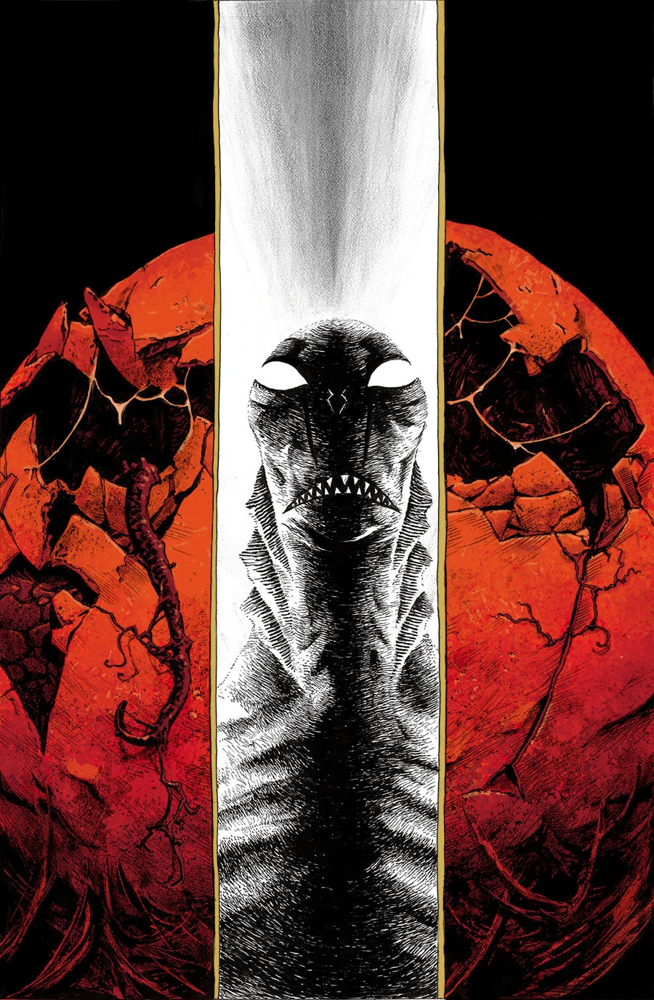
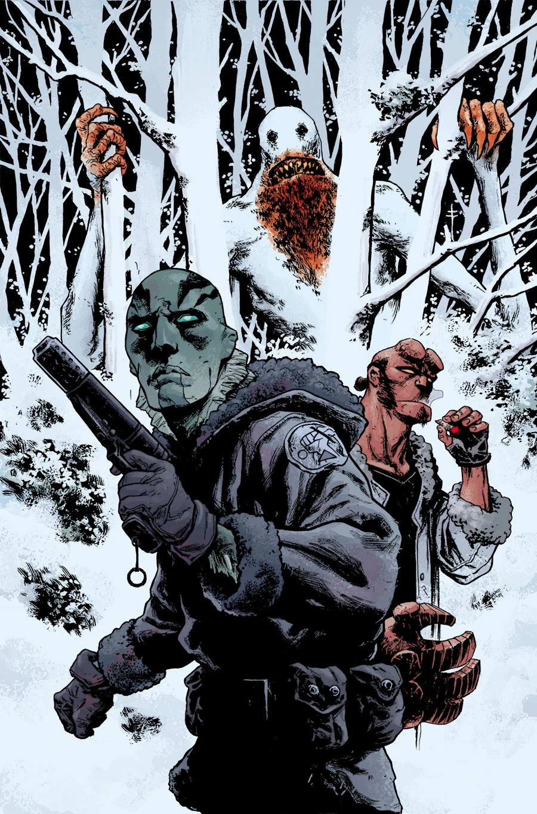
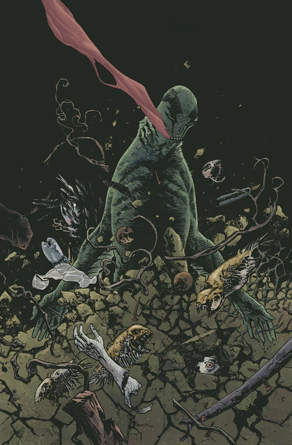

《**次世代新人类**》（The New Race of Man）是一部迷你系列，讲述亚伯（Abe）调查索尔顿湖虫卵的故事。

## 出版历史

《次世代新人类》是一部两期篇幅的故事线，于 2013 年 7 月出版，由马克斯·菲乌马拉（Max Fiumara）担任绘画。

《次世代新人类》是约翰·阿库迪（John Arcudi）长久以来一直想讲述的故事，但他觉得自己无法在[《B.P.R.D.》](/entry/B.P.R.D._%28series%29)的正篇中把它讲好。

## 剧情简介

### 第一部

在逃离超自然调查防御署期间，亚伯辗转来到索尔顿湖，在那里遭遇了一个崇拜怪卵的诡异邪教。

### 第二部

一具被吃掉一半的尸体被冲上湖岸后，一个小邪教怀疑那个饥饿的杀手可能正是亚伯。亚伯逃向索尔顿湖，却迎面遭遇了一只危险的奥格德鲁·赫姆（Ogdru Hem）幼虫。

## 画廊

