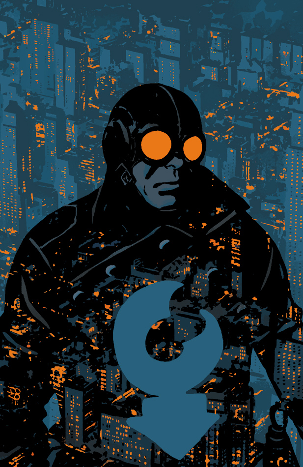

The story takes place early in [the Lobster's](/entry/The%20Lobster) career as a crime fighter in the 1930s.

## Publication History

This one-shot will be published in September 2012, featuring a cover by Tonči Zonjić and a variant cover by Mike Mignola as a part of the *[Year of Monsters](/entry/Year%20of%20Monsters)* covers.

## Synopsis

Hellboy's favorite gun-blazing vigilante takes justice to the skies this time by getting locked in combat aboard a zeppelin!

## Gallery

文件:Caput Mortuum.jpg|by [Tonci Zonjic](/entry/Tonci%20Zonjic) 文件:Caput Mortuum Variant.jpg|[Year of Monsters](/entry/Year%20of%20Monsters) variant  
by [Mike Mignola](/entry/Mike%20Mignola)

! colspan = 1 | [ Vol. 2 The Burning Hand](/entry/TPB) ! colspan = 2 | [ Vol. 3 Satan Smells a Rat](/entry/TPB)

**Category:Story** **Category:Lobster Johnson story**