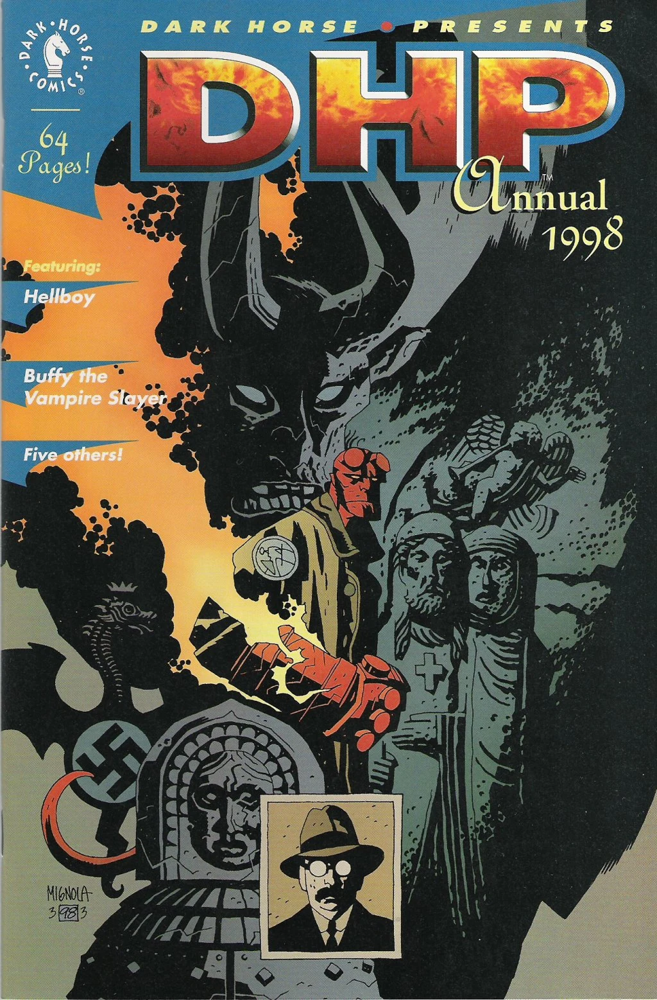

[Hellboy](/entry/Hellboy%20%28character%29) meets with Adrian Frost and recounts his life story.

## Publication History

*The Right Hand of Doom* was published in black and white, as part of the *[Dark Horse Presents](/entry/Dark%20Horse%20Presents) Annual 1998*, in August 1998 (dated September). The story was reprinted in color in *[Hellboy: vol. 4 The Right Hand of Doom](/entry/TPB)*. In the trade this story was connected to *[Box Full of Evil](/entry/Box%20Full%20of%20Evil)* by way of a new epilogue.

## Synopsis

[Hellboy](/entry/Hellboy%20%28character%29) travels to Spain to meet with a priest Adrian Frost, son of [Malcolm Frost](/entry/Malcolm%20Frost). Malcolm had been present at Hellboy's 'birth' and had spent eight years trying to have Hellboy destroyed. Adrian Frost shows Hellboy a scrap of paper written in Lemurian, with a picture of Hellboy's hand that reads "Behold The Right Hand of Doom." Adrian Frost agrees to give the text to Hellboy in return for hearing Hellboy's life story.

Hellboy recounts his 'birth' in England, childhood in New Mexico and his joining of the [B.P.R.D.](/entry/B.P.R.D.) in 1952. Briefly Hellboy describes the events of *[Seed of Destruction](/entry/Seed%20of%20Destruction)*, *[The Chained Coffin](/entry/The%20Chained%20Coffin)* and *[Wake the Devil](/entry/Wake%20the%20Devil)* focusing on his alleged destiny. Frost asks about the Hand, and Hellboy suggests he might cut it off, but Frost retorts that it would never be safe. Hellboy leaves with the blessing of Adrian Frost, still skeptical of his 'destiny.'

## Story Chronology

The story takes place in 1998. The story does not state this explicitly. However, Hellboy says that [Trevor Bruttenholm](/entry/Trevor%20Bruttenholm) was killed four years ago, and *[Seed of Destruction](/entry/Seed%20of%20Destruction)* occurred in 1994. So the story probably goes after [Abe Sapien versus Science](/entry/Abe%20Sapien%20versus%20Science), but before [Box Full of Evil](/entry/Box%20Full%20of%20Evil).

## [Hellboy: Blood and Iron](/entry/Hellboy__Blood_and_Iron)

In the [Hellboy Animated](/entry/Hellboy%20Animated) movie *Blood and Iron*, a parchment fragment, just like the one in *The Right Hand of Doom* can be seen in a flashback towards the end of the movie. In the scene [Malcolm Frost](/entry/Malcolm%20Frost) and [Trevor Bruttenholm](/entry/Trevor%20Bruttenholm) briefly discuss the parchment.

! colspan = 3 | [Vol. 4 The Right Hand of Doom](/entry/TPB)

**Right Hand of Doom, The** **Right Hand of Doom, The**