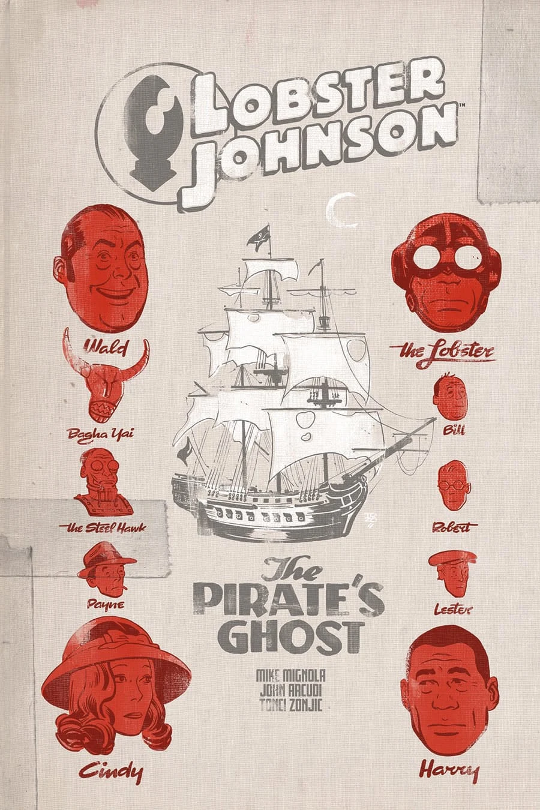

The story takes place in the middle of [the Lobster's](/entry/The%20Lobster) career as a crime fighter in the 1930s.

## Publication History

This three-issue miniseries was published from March to May 2017. Tonci Zonjic did his own colors for the series.

## Synopsis

### Part One

New York Harbor Patrol is in over their heads when a ghostly pirate ship appears on the Hudson River, and the Lobster’s hunt for a major mob boss may have something to do with it.

### Part Two

The Lobster searches for a connection between a missing reporter and the appearance of a ghostly pirate ship.

### Part Three

The Lobster’s search for a missing reporter comes to an explosive end aboard a pirate ship.

## Gallery

文件:The Pirate's Ghost 1.jpg|Issue \#1 文件:The Pirate's Ghost 2.jpg|Issue \#2 文件:The Pirate's Ghost 3.jpg|Issue \#3

! colspan = 2 | [ Vol. 5 The Pirate's Ghost and Metal Monsters of Midtown](/entry/TPB) ! colspan = 1 | [ Vol. 6 A Chain Forged in Life](/entry/TPB) **Pirate's Ghost, The** **Pirate's Ghost, The**