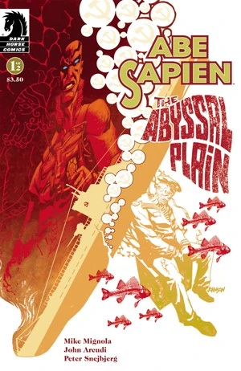
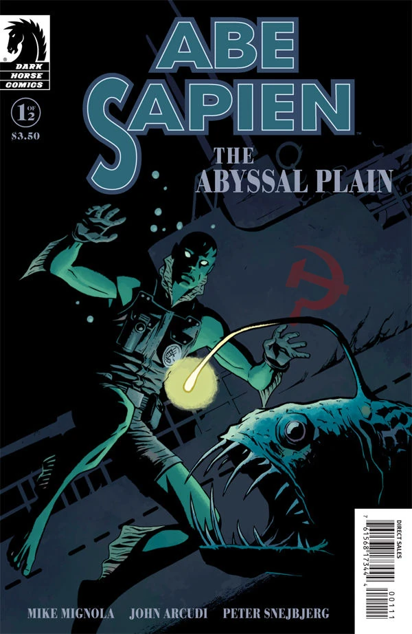
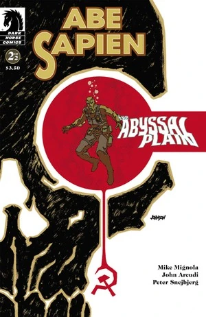

《**深海平原**》（The Abyssal Plain）是一部由[迈克·米格诺拉](/entry/Mike_Mignola)与[约翰·阿库迪](/entry/John_Arcudi)编剧、[彼得·斯奈比约](/entry/Peter_Snejbjerg)作画的两期限定《[鱼人亚伯](/entry/Abe_Sapien_%28series%29)》迷你系列。

## 出版历史

《鱼人亚伯：深海平原》（*Abe Sapien: The Abyssal Plain*）于 2010 年 6 月和 7 月作为两期限定迷你系列出版。第一期发行了两个封面：一个由[戴夫·约翰逊](/entry/Dave_Johnson)绘制，另一个是由[彼得·斯奈比约](/entry/Peter_Snejbjerg)与[戴夫·斯图尔特](/entry/Dave_Stewart)合作的变体封面。本故事与《[闹鬼的男孩](/entry/The_Haunted_Boy)》和《[魔鬼不开玩笑](/entry/The_Devil_Does_Not_Jest)》一同收录于平装合订本《[鱼人亚伯——第 2 卷：魔鬼不开玩笑及其他故事](/entry/Trade_Collections)》中。

## 剧情简介

### 第一部

1948 年，一名名叫[约瑟夫](/entry/Iosif_Nichayko)的苏联士兵坐在沉没于挪威海海底的潜艇里，慢慢等待死亡的降临。他靠在一只标有“梅尔基奥雷的轻盔”（Melchiorre's Burgonet）字样的箱子上，给深爱的女人写信。

多年之后，1984 年 8 月，[鱼人亚伯](/entry/Abe_Sapien)与特工萨尔·塔索（Sal Tasso）乘一艘船驶进挪威海，要取回“梅尔基奥雷的轻盔”。亚伯讲述了这件物品的来历：

在教皇克莱门特七世时期，乌戈·梅尔基奥雷以船长的身份为他效力。在摩德纳战役中，梅尔基奥雷成功将必败之战扭转为胜利。尽管他身负重伤，却无需搀扶便自行走下了战场。然而，人们刚一摘下他的头盔，他便断了气。

第二次世界大战期间，这顶轻盔落入纳粹手中。战后的 1946 年，苏联特殊科学局接管了这件神器。1948 年，轻盔被装上一艘潜艇，准备送往一位俄罗斯神秘学者处研究，但潜艇始终没有抵达目的地。

亚伯潜到沉船处，带着轻盔返回。在探查残骸时，亚伯对惊扰死者一事心中五味杂陈。回到船上后，亚伯说他打算把这顶头盔交给[奥唐奈教授](/entry/Professor_James_Henry_O%27Donnell)进行分析。

船长与亚伯就打捞沉船一事发生了争执。亚伯希望潜艇能归于安宁，以纪念死者；而船长急需用钱，想看看船上是否还留有什么值钱的东西。可争执尚未结束，一具被水泡得肿胀的僵尸便独自爬上了甲板。

### 第二部

本集在苏联士兵约瑟夫的回忆场景与船上的鱼人亚伯之间交替展开。

当下，一艘苏联巡洋舰正朝潜艇沉没的地点驶去。一位名叫瓦西里的苏联特殊科学局特工正与他的指挥官讨论任务。瓦西里告诉长官，他之所以自愿加入特殊科学局，是因为想再次体验那种恐惧——小时候亲眼见到鬼魂时所感受到的恐惧，以积累经验。

与此同时，塔索特工开枪射击那具僵尸，但它毫发无伤，继续走着，也没有伤害他们。亚伯意识到，这具僵尸正是当年守在轻盔旁边的那个人，于是决定观察它。

僵尸站在如今存放着轻盔的保险箱前，依旧没有对他们采取任何行动。亚伯仍想继续等待、静观其变，船长却一心想毁掉它。突然，他们收到消息：一艘苏联巡洋舰正在逼近。

一段回忆中，我们得知约瑟夫曾在特殊科学局工作，尽管他深爱自己的妻子，却依然认真对待自己的职责。他被带去与[瓦尔瓦拉](/entry/Varvara)谈话。瓦尔瓦拉告诉他，接下来五个星期他要负责押运一只板条箱。他抗议说这样就会错过妻子的生日，但她坚持要他执行。

当下，苏联巡洋舰逼近的消息终结了亚伯与船长之间的争执。船长准备起航。仍在观察僵尸的亚伯意识到，它一复活便立刻恢复了守卫轻盔的职责。他走上前去，替它打开了保险箱。

另一段回忆中，约瑟夫告诉妻子，他必须离开去履行职责，但他发誓一定会回到波琳娜身边，从此再也不离开。

俄国人逼近沉船时，亚伯和塔索驾船离去。塔索说，轻盔要落到他们手里真是可惜。亚伯回答说，他已经用无线电联系了梵蒂冈，他们会向克里姆林宫施压，迫使其交出轻盔。就在两人说话之际，我们看到瓦西里带着一脸狂喜朝沉船潜去——他正逼近约瑟夫那具僵尸，后者蜷缩在轻盔周围，护卫般地守护着它。

## 故事年表

潜艇于 1948 年春沉没。主线故事发生在 1984 年 8 月。

## 画廊

除特别注明外，封面均由[戴夫·约翰逊](/entry/Dave_Johnson)绘制。

\#1

\#1 变体封面
作者：[彼得·斯奈比约](/entry/Peter_Snejbjerg)

\#2
