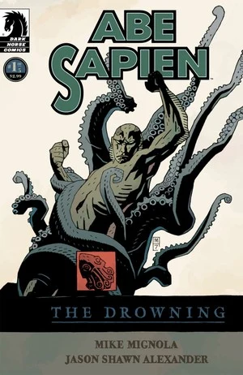
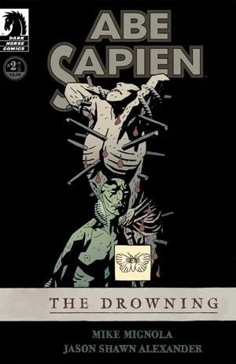
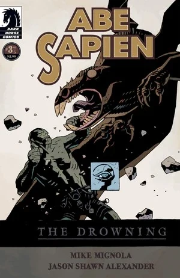
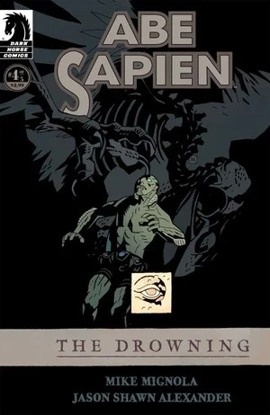
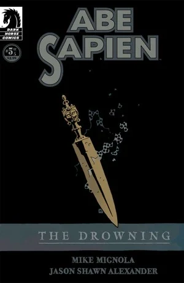

《**溺亡**》（The Drowning）是[鱼人亚伯](/entry/Abe_Sapien_%28series%29)的第一部个人迷你系列，故事背景设定在 20 世纪 80 年代初。

## 出版历史

《鱼人亚伯：溺亡》（*Abe Sapien: The Drowning*）于 2008 年 2 月至 6 月作为五期限定迷你系列出版。本故事收录于 2008 年 9 月出版的平装合订本[《鱼人亚伯——第 1 卷：溺亡》](/entry/Trade_Collections)中。

## 剧情简介

### 第一部

一个世纪以前，超自然调查员[爱德华·格雷](/entry/Edward_Grey)在圣塞巴斯蒂安岛外与一名强大的巫师交战，并将其消灭。20 世纪 80 年代初，[B.P.R.D.（超自然研究与防御局）](/entry/Bureau_for_Paranormal_Research_and_Defense)最新的特工被派去取回这名巫师的遗骸。然而，鱼人亚伯对挡在他面前的超自然力量毫无准备。

### 第二部

超自然力量在圣塞巴斯蒂安岛上汇聚，[亚伯](/entry/Abraham_Sapien)发现自己孤身一人，对抗着一个世纪之久的邪恶。

### 第三部

同伴全部殒命，圣塞巴斯蒂安岛被梦魇般的事物吞噬，亚伯一边拼命求生，一边杀出一条血路，朝风暴之眼——以及藏在其中的怪物——挺进。

### 第四部

随着亚伯进一步深入这座岛屿的谜团、深入那段与人类历史同样漫长的邪恶遗产，圣塞巴斯蒂安的可怕秘密逐渐浮出水面。

### 第五部

在他第一部个人迷你系列这一惊心动魄的结局中，亚伯与数百年来一直守护着圣塞巴斯蒂安的那股力量正面相对。

## 画廊

\#1

\#2

\#3

\#4

\#5
