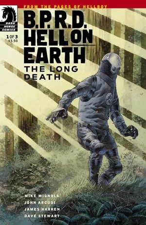
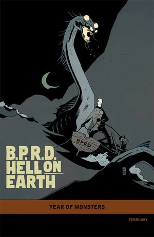
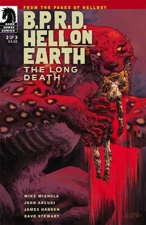
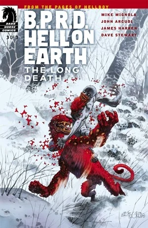

***《漫长的死亡》***（The Long Death）是一部三期限定连载，于 2012 年 2 月至 4 月间出版。

## 出版历史

本篇是[《人间炼狱》故事环](/entry/Hell_on_Earth_(story_cycle))的第五个篇章，紧接[《俄罗斯》](/entry/Russia)之后。各期封面由[邓肯·费格瑞铎](/entry/Duncan_Fegredo)绘制。首期另附有一款由[迈克·米格诺拉](/entry/Mike_Mignola)绘制的「[怪兽之年](/entry/Year_of_Monsters)」（Year of Monsters）变体封面。

在平装合订本中，《漫长的死亡》被排在《恶魔引擎》之后。

## 剧情简介

### 第一部

[约翰·克劳斯](/entry/Johann_Kraus)梦见自己过去与[本·达米奥](/entry/Ben_Daimio)的一场谈话，谈的是他在《蛙人之战》中[帮助那些被变成蛙怪的灵魂渡向来世时所陷入的精神危机](/entry/War_on_Frogs)。他猛然从噩梦中惊醒，只见自己的封存舱骤然膨胀、炸裂开来，一头狰狞的怪物实体从中显现。

约翰向同事[潘雅](/entry/Panya_%28character%29)和联合国联络官汇报：自从他的肉身于[杀戮地带](/entry/Killing_Ground)一役中[被毁](/entry/Killing_Ground)以来，这是他第一次能够入睡、做梦，他将此归功于自己在[俄罗斯的近期事件](/entry/Russia)中获得的新式封存服。联合国联络官报告说，不列颠哥伦比亚省又发生了多起失踪案，地点距离亚伯当初报告称击败了一只[奥格德鲁·赫姆](/entry/New_World_%28B.P.R.D._story_arc%29)邪灵之处不远。亚伯此刻昏迷不醒，约翰当即主动请缨前往调查——他心里十分清楚自己可能会发现什么。

直升机上，约翰与[卡拉·贾罗科](/entry/Carla_Giarocco)交谈，后者拿出儿子受洗的照片给他看。

一到目的地，约翰便迅速消失在森林中，撇下了自己的队伍；卡拉愤怒地向联合国代表报告约翰失踪后，队员们只好在一处护林员驿站暂避。约翰把近期事件的种种线索拼凑起来，很快意识到这里正是本·达米奥最后现身、也是亚伯前来与他会面的区域。他带上了从查韦斯（Chaves）尸体上找到的那把刀——这把刀能够毁灭豹人，连同本一起毁灭——随即在林中展开追猎。

与此同时，卡拉在驿站给儿子录下一段留言，队友们则试图入睡。一名队员刚数落了她几句，豹人便发起了袭击；数名[超自然调查防御署](/entry/B.P.R.D.)士兵被它迅速解决，众人拼命抵抗却毫无成效。卡拉虽已负伤，仍呼喊全队撤退，并在近距离朝怪物掷出一枚手榴弹。

### 第二部

灵体探员约翰·克劳斯率领一支特遣队，穿行在怪物横行、遍布露营者残缺尸体的西北丛林中，只为追杀那个他害得自己失去寄居肉身的人——他要取其性命，以报《杀戮地带》之仇。

### 第三部

在一座冻僵的营地里，遍地是遭屠杀探员的尸体，两名贯穿全篇的怪物级角色将正面交锋，展开一场生死决战！

## 画廊

\#1

\#1 变体封面

\#2

\#3

## 趣闻

- 第 \#2 期封面是对[弗朗西斯科·戈雅](https://en.wikipedia.org/wiki/Francisco_Goya)名画[《萨图恩吞噬其子》](https://en.wikipedia.org/wiki/Saturn_Devouring_His_Son)的致敬。

**Category:Story** **Category:B.P.R.D. story** **Category:B.P.R.D.: Hell on Earth story**
