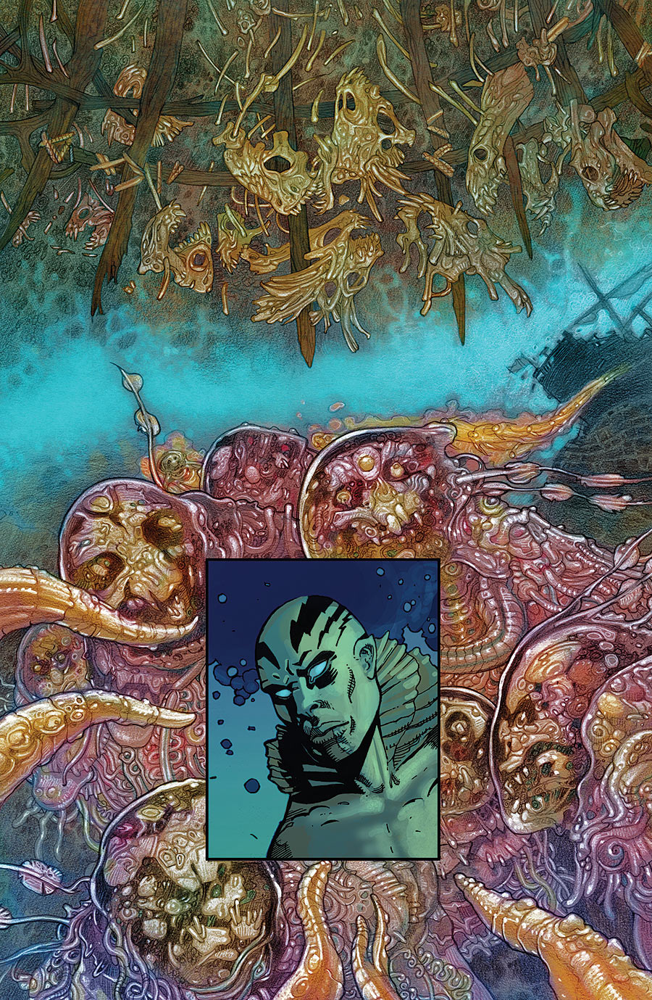

《**潜意识**》（Subconscious）是一部短篇故事，由[约翰·阿库迪](/entry/John_Arcudi)（John Arcudi）编剧、[马克·纳尔逊](/entry/Mark_Nelson)（Mark Nelson）作画——这也是纳尔逊在地狱男爵宇宙中的首次亮相。它是 1995 年故事《[锁链棺材](/entry/The_Chained_Coffin)》的续作，也是少数几部没有[迈克·米格诺拉](/entry/Mike_Mignola)编剧署名的故事之一。

## 剧情简介

地狱男爵曾写信给亚伯·塞皮恩，讲述自己做的梦；亚伯则回了一封信，讲了讲自己做的梦。

**Category:Story** **Category:Abe Sapien story**
