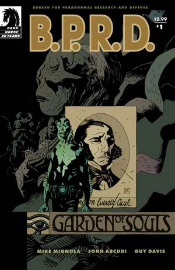
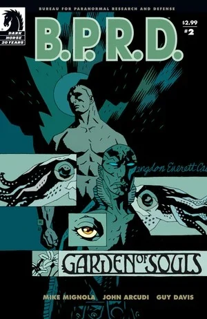
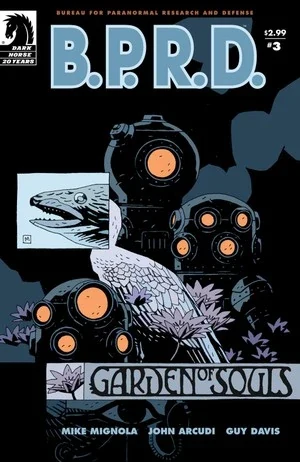
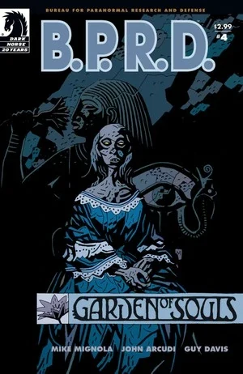

在***《灵魂花园》***（Garden of Souls）中，[亚伯·塞皮恩](/entry/Abraham_Sapien)循着一条诡异的线索来到印度尼西亚丛林，找到一个与他美国南北战争时期前世有关联的秘密社团。与此同时，[丽兹](/entry/Liz_Sherman)的末日幻象开始加剧，[约翰](/entry/Johann_Kraus)则对[防御署](/entry/Bureau_for_Paranormal_Research_and_Defense)的一名成员有了惊人发现。

## 出版历史

这部五期限定连载于 2007 年 3 月至 7 月出版，2008 年 1 月收录进平装合订本《B.P.R.D.：灵魂花园》（*[B.P.R.D.: Garden of Souls](/entry/Trade_Collections)*）。

## 剧情简介

### 第一部

亚伯·塞皮恩的过去找上了他，B.P.R.D. 由此前往南中国海，深入印度尼西亚丛林。

### 第二部

亚伯·塞皮恩的调查让他逼近一处丛林营地，那里栖居着一群与他自己的过去有着诡异关联的改造人（cyborgs）。与此同时，在 B.P.R.D. 新总部的地下室里，约翰对队伍的一名成员有了惊人发现，而丽兹则看到了世界末日的幻象。

### 第三部

在拼命搜寻亚伯的过程中，[戴米奥](/entry/Ben_Daimio)发现了一个足以撼动大地根基的阴谋。与此同时，亚伯与前世旧识重逢，气氛却急转直下——他坦言自己对作为兰登·考尔（Langdon Caul）的前世几乎毫无记忆。回到 B.P.R.D. 总部，约翰、[凯特](/entry/Kate_Corrigan)和丽兹讨论着戴米奥自身隐秘过往意味着什么。

### 第四部

亚伯了解到另一位从维多利亚时代幸存下来的离奇人物的来历，并揭穿了他昔日同党毁灭世界的图谋；戴米奥则与一个小女孩争分夺秒，阻止地球上一切生命的终结。

### 第五部

随着印度尼西亚的事态推向高潮，亚伯和戴米奥争分夺秒，要阻止亚伯前世那些离奇人物的末日计划。

## 内容

### 角色

#### [超自然调查防御署](/entry/Bureau_for_Paranormal_Research_and_Defense)（B.P.R.D.）

- [亚伯拉罕·塞皮恩 / 兰登·考尔](/entry/Abraham_Sapien)
- [丽兹·舍曼](/entry/Elizabeth_Sherman)
- [本雅明·戴米奥](/entry/Benjamin_Daimio)
- [约翰·克劳斯](/entry/Johann_Kraus)
- [凯瑟琳·考瑞根](/entry/Kate_Corrigan)
- [汤姆·曼宁](/entry/Thomas_Manning)（照片）
- 其他探员与职员

#### 其他

- [梅姆南·萨 / 马丁·吉尔弗瑞德](/entry/Memnan_Saa)
- [潘雅](/entry/Panya_%28character%29)
- [太阳神拉的赫利奥皮克兄弟会](/entry/Heliopic_Brotherhood_of_Ra)
  - [亚当·格拉伦](/entry/Adam_Glaren)（回忆）
- [奥安尼斯学社](/entry/Oannes_Society)
  - 爱德华·马斯格罗夫·桑德伯恩（Edward Musgrove Sundborne）
  - 麦克惠特（McWhirter）
  - 菲利普·恩斯纳（Philip Ensner）
  - 达梅隆（Dameron）
  - 变异动物
- 丹尼尔·普安（Daniel Puan）
- [尚钦](/entry/Shonchin)（回忆）
- "中国佬"（"Chinaman"）
- [能乐猿猴](/entry/Noh_monkey)
- 戴米奥的玻利维亚任务士兵（梦境）
- [京特·艾斯](/entry/Gunter_Eiss)（仅被提及）
- 伊迪丝·霍华德（照片）
- 拉斯特里（Lastri）
- B.P.R.D. 档案
  - [基里亚科斯·加拉拉加斯](/entry/Kyriakos_Gallaragas)（照片）
  - [雷蒙德·迪斯特尔](/entry/Raimund_Diestel)（[黑焰](/entry/The_Black_Flame_%28character%29)）（照片）
  - [弓子·戴米奥（绯红莲花）](/entry/Yumiko_Daimio)（照片）
  - [鲁道夫·贝尔根（钢鹰）](/entry/Rudolf_Bergen)（照片）
  - 里卡德·莫特（幽灵 Geist）（照片）[1]
- [奥格德鲁·赫姆](/entry/Ogdru_Hem)（幻象）
- [蛙怪](/entry/Frog_monster)（幻象）
- 巴厘巴板（Balikpapan）警察
- [水之精灵](/entry/Water_Spirit)（回忆）

### 地点

- 英国
  - 明伯勒勋爵的贝沃特宅邸（伦敦）（回忆）
- 美国
  - [B.P.R.D.](/entry/Bureau_for_Paranormal_Research_and_Defense) 总部（科罗拉多州）
  - 圣特里尼安医院（华盛顿特区）（回忆）
    - [奥安尼斯学社](/entry/Oannes_Society)聚会地（回忆）
- 印度尼西亚
  - 巴厘巴板（Balikpapan）
  - [奥安尼斯学社](/entry/Oannes_Society)的岛屿 / 宅邸

### 重要物品

- [罗杰](/entry/Roger)的坟墓（以"阿奇·斯坦顿 Archie Stanton"之名下葬）
- [维里尔能量服](/entry/Vril_Energy_Suit)头盔（普罗米修斯型号）（照片）
- [大螯虾强生](/entry/The_Lobster)的名片
- [奥安尼斯学社](/entry/Oannes_Society)
  - 机械躯体
  - 生物躯体
  - 炸弹
  - 潜水服
  - 潜艇

## 趣闻

- 第 2 章中，约翰办公桌后方的画作是画家皮埃尔·皮维·德·夏凡纳（Pierre Puvis de Chavannes）的《[梦："在睡梦中，他看见爱、荣耀与财富向他显现"](https://www.wikiart.org/en/pierre-puvis-de-chavannes/the-dream-in-his-sleep-he-saw-love-glory-and-wealth-appear-to-him-1883)》。
- 第 3 章中，达梅隆哼唱的歌是 Charles K. Harris 的《[After the Ball](https://www.youtube.com/watch?v=zIXGlQdTDKY)》。
- [奥安尼斯学社](/entry/Oannes_Society)成员称潘雅为 [Naunet](https://en.wikipedia.org/wiki/Nu_(mythology))——代表海洋的埃及原初女神。

## 画廊

 \#1

 \#2

 \#3

 \#4

 \#5

## 注释

[1] 据速写集（sketchbook）。
