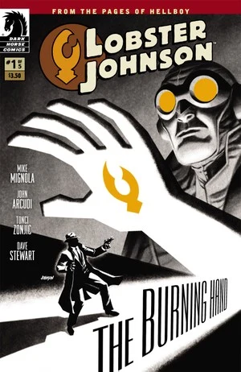

The story takes place early in [the Lobster's](/entry/The%20Lobster) career as a crime fighter in the 1930s.

## Publication History

The five issue mini-series was published from January to May 2012. The series featured covers by Dave Johnson and *[Year of Monsters](/entry/Year%20of%20Monsters)* variant covers by [Mike Mignola](/entry/Mike%20Mignola) for \#1 and \#4.

## Synopsis

### Part One

When a tribe of phantom Indians start scalping policemen, Hellboy's crime-fighting hero Lobster Johnson and his allies arrive to take on these foes and their gangster cronies!

### Part Two

With a city swamped in dead gangsters with claws branded into their foreheads, mob boss Arnie Wald seeks the assistance of a deadly mystic and her strange partner to take down the vigilante known as [Lobster Johnson](/entry/Lobster%20Johnson).

### Part Three

A fiery menace is turning the city into an inferno, and only Lobster Johnson and his league of crime fighters can put an end to these paranormal horrors.

### Part Four

As dead gangsters bloody the floor of his secret hideout, crime fighter Lobster Johnson goes head to head with a powerful German undead—The Black Flame.

### Part Five

Lobster Johnson blasts his way through an army of mad sewer cannibals in order to get to the greedy mob boss Arnie Wald.

## Gallery

Covers by [Dave Johnson](/entry/Dave%20Johnson) unless otherwise stated.

文件:The Burning Hand 1.jpg|Issue \#1 文件:The Burning Hand 1b.jpg|Issue \#1 [Year of Monsters](/entry/Year%20of%20Monsters) variant  
by [Mike Mignola](/entry/Mike%20Mignola) 文件:The Burning Hand 2.jpg|Issue \#2 文件:The Burning Hand 3.jpg|Issue \#3 文件:The Burning Hand 4.jpg|Issue \#4 文件:The Burning Hand 4b.jpg|Issue \#4 [Year of Monsters](/entry/Year%20of%20Monsters) variant  
by [Mike Mignola](/entry/Mike%20Mignola) 文件:The Burning Hand 5.jpg|Issue \#5

! colspan = 1 | [ Vol. 1 The Iron Prometheus](/entry/TPB) ! colspan = 1 | [ Vol. 2 The Burning Hand](/entry/TPB) ! colspan = 1 | [ Vol. 3 Satan Smells a Rat](/entry/TPB) **Burning Hand, The** **Burning Hand, The**