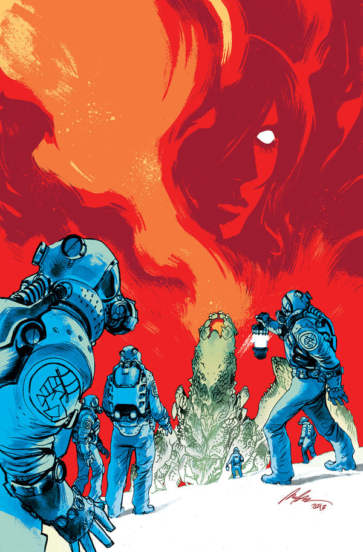
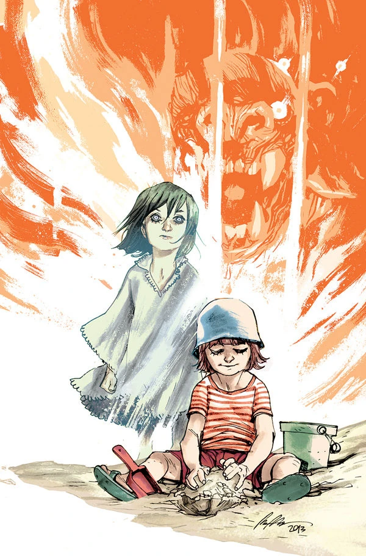
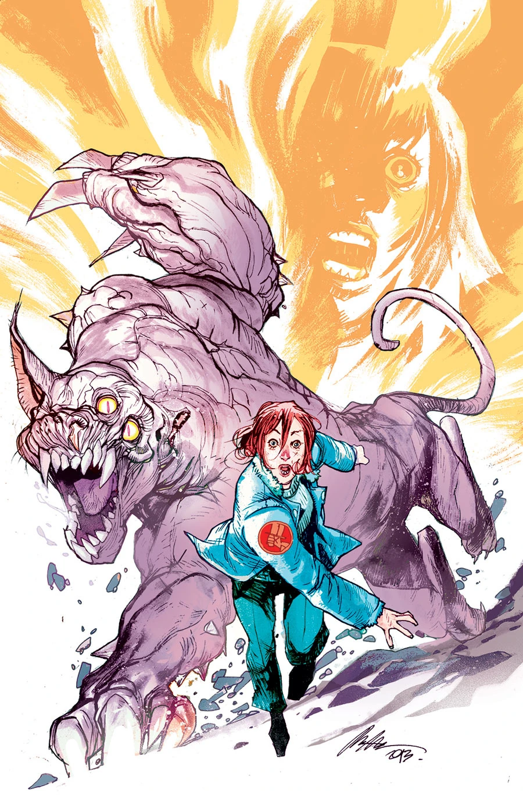
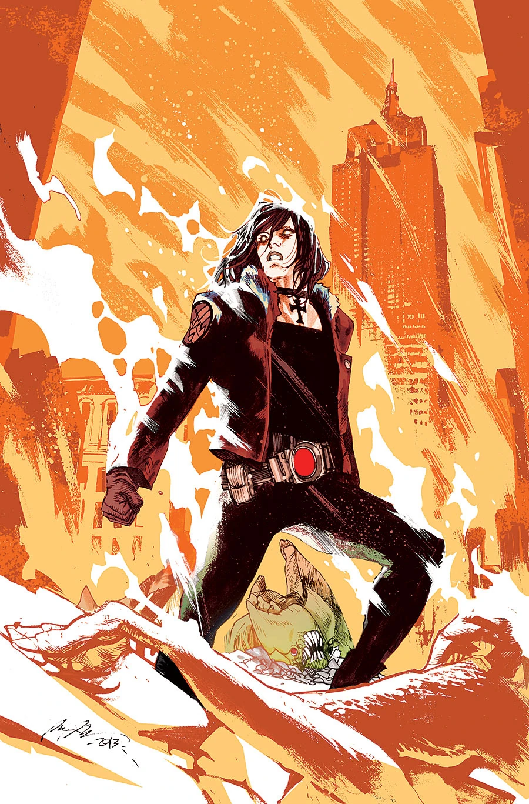
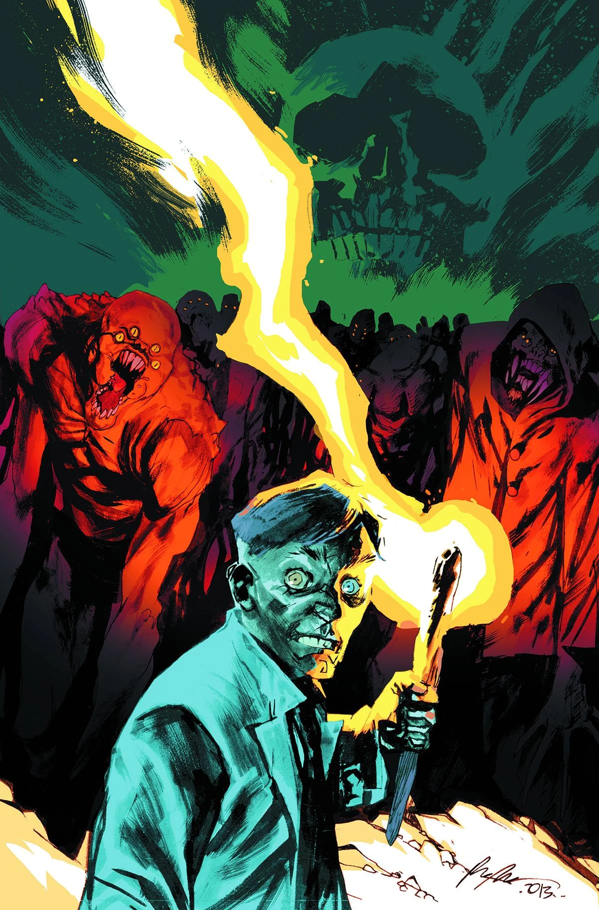

***《烈焰之湖》***（Lake of Fire）是一部五期完结的迷你系列，自 2013 年 8 月起出版，封面由[拉斐尔·阿尔伯克基](/entry/Rafael_Albuquerque)（Rafael Albuquerque）绘制。

## 剧情简介

### 第一部

丽兹·舍曼在犹他州的一家医院里为活命而挣扎；与此同时，超自然调查防御署派出一支侦察小队，进入曾经是纽约市的无人区；年轻的灵能者菲尼克斯则在索尔顿湖（Salton Sea）遭遇了一个崇拜怪物的邪教。

### 第二部

年轻的灵能者菲尼克斯误打误撞，闯进了一个崇拜怪物版本的"火人节"（Burning Man）集会；丽兹·舍曼则被困在一座沦为废墟的医院里，不得不迎战一名疯狂医生，以及他那头大如怪物的变异猫！

### 第三部

丽兹逃出怪物横行的医院，可良知让她想起那些被她留在身后、任由疯狂医生摆布的人们。她必须回去救他们，但在依然失去力量的情况下，她又能做些什么？她还能重新找回火焰吗？

### 第四部

丽兹和一队警察伏击疯狂医生及其莫罗博士式（Moreau-like）的实验造物；菲尼克斯则迎战一群邪教徒，并杀死了他们的神！

### 第五部

丽兹·舍曼向疯狂医生的医院及其变异怪物大军发起烈火攻势；与此同时，超自然调查防御署计划对已落入黑焰掌控的曼哈顿发动一次偷袭。

## 画廊

\#2

\#3

\#4

\#5

**Category:Story** **Category:B.P.R.D. story** **Category:B.P.R.D.: Hell on Earth story**