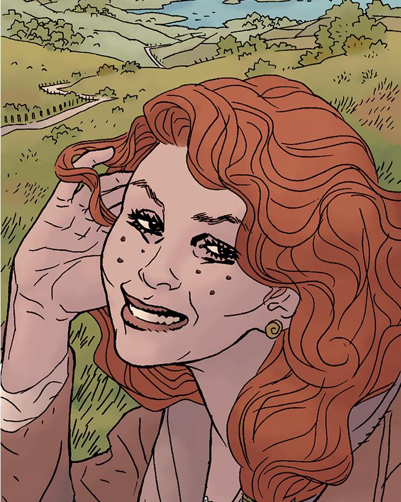

爱丽丝·莫娜汉Alice is a woman of Irish blood that Hellboy rescued as an infant.

When she was a baby, fairies kidnapped Alice to raise as their own, because they could no longer have children, as seen in "[The Corpse](/entry/The%20Corpse)." To rescue her, [Hellboy](/entry/Hellboy) had to take a corpse to an appropriate grave and dispatch with the last fomorian. Even after she was rescued, however, she continued to see the fairies, whom she claims to never have tried to take her again like before. Her mother sent her off to school out of worry upon discovering this, and when both her parents passed away, she returned home. Despite being in her early fifties, Alice looks remarkably young - a trait she attributes to spending so much time with the fairies.

After Queen Mab's murder by [Nimue](/entry/Nimue), the ghost of the old fairy queen passed her crown to the human born of the fae and humans. Alice appeared before [Abe Sapien](/entry/Abraham%20Sapien) in a beautiful fairy realm of England, explaining that she had taken the mantle as caretaker of the last refugee of fairies to escape the end of the world so that a piece of the Old World may live.

Abe wished to remain to escape his destiny, but Alice told him he could not stay. She encouraged him to stop running saying he must fulfill his destiny in the New World.