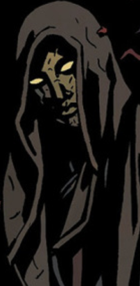

**Edward Grey** was a nineteenth century paranormal investigator. Aside from a handful of fleeting details, little is known about him, his motivations, and his capabilities. He is often seen in the company of [Dagda](/entry/Dagda), and on occasion [the Baba Yaga](/entry/Baba%20Yaga%20%28character%29). He has shown many times to have faith in [Hellboy](/entry/Hellboy) and his rejection of his so-called "destiny."

## History

### Early life

Edward Grey was born in September 16th, 1856, in West Sussex, England. He spent his childhood on the estate of Lord Robert Hastings, where his father worked as a game warden. When Grey turned twelve in the spring of 1869, a number of cows from Lord Hasting's herd were found slaughtered in the woods. Three children soon disappeared after, and the local men formed search parties. Grey, who suspected the real nature of the killer, tracked the predator to its lair in the Hasting family vault. The creature was one of Hasting's sons, who had apparently contracted the werewolf curse while at school in Paris. He had been secretly devouring the corpses in his family vault before his uncontrollable urges led him to killing cattle and children. Grey fought and killed the werewolf with a bullet blessed by a local priest.

Lord Hastings never attempted to conceal what his son had done, and had his son's body burned to ashes overseen by the local priest. Hastings repaid his debt to Grey by generously offering medical attention and having the local priest ensure the boy did not inherit the werewolf curse. A deep bond was developed between Grey and Hastings, as Grey was very impressed by the latter's kindness and nobility. Grey soon became a minor celebrity in West Sussex and was reported to have had numerous encounters with the supernatural.

### The Witchfinder

In 1876, Grey was recommended by Hastings in investigating the news of a haunting in the Tower of London. Grey traveled to London, where he confronted a bear-like creature believed to be the ghost of Lord Jeffreys. Although the details of Grey dealt with the creature remained uncertain, there hasn't been any further disturbance. Grey soon attracted fame and recognition from the public and inevitably the royal government. Queen Victoria herself wanted Grey to stay on as a special agent to the crown, dealing with occult matters. Grey accepted the queen's request.

In February 1879, Grey foiled a plot by a coven of witches to murder the queen. He had stopped them just in time, and the next month was knighted for "special services in the protection of Crown and Country."  In 1880, Sir Edward traveled to Utah on the trail of former H.B.R. member [Lord Adam Glaren](/entry/Lord%20Glaren). While in Utah he befriended a local cowboy [Morgan Kaler](/entry/Morgan%20Kaler) and his friend Isaac. Sir Edward and Kaler teamed up to stop [Eris](/entry/Eris), a witch who had formed a cult in the area. In August 1882, Sir Edward uncovered a plot by the visiting nobleman vampire [Vladimir Giurescu](/entry/Vladimir%20Giurescu) to establish a "secret empire" in England. Sir Edward wounded Giurescu and forced him to flee back to Romania. In 1884, Sir Edward discovered the Dutch warlock Epke Vrooman and pursued him, finally killing him near the French island of Saint-Sebastian.

From 1884 to 1889, Sir Edward Grey focused his attentions on the increasingly bizarre activities of the [Heliopic Brotherhood of Ra](/entry/Heliopic%20Brotherhood%20of%20Ra) and its chartered branches, the Knights of the Silver Star and the Knights of Abydos. In 1888, Sir Edward aided in the investigation of the Jack the Ripper killings, but his exact role in the case remains a mystery. A few months later, Sir Edward quit government service over Queen Victoria's decision to suppress the true identity of Jack the Ripper. Sir Edward established an independent "occult detective" practice in Whitechapel. He continued to worked as an occult detective in London from February 1889 to July 1908. In 1892, Sir Edward turned in the notorious witch Abigail Wodehouse over to Scotland Yard. He monitored the Heliopic Brotherhood of Ra closely before the closing of the Universal Temple in September 1893, and tracked their activities as they continued as an underground society.

In the twentieth century, Sir Edward investigated the strange rumors of the H.B.R.'s activities in Europe. Upon learning the Tunguska Explosion in June 30th, 1906, which believed to be caused by an H.B.R. ceremony, Sir Edwardy closed his London office and left England to Europe. Sir Edward resurfaced in New York City on April 13th, 1914 and opened his practice as a private occult detective there. In late February 1916, Sir Edward heard rumors of the H.B.R.'s branch, the Knights of the Silver Star, were holding meetings in Chicago. Sir Edward left New York for Chicago and was never heard from again.

It was later revealed that the H.B.R. was involved in the summoning of the Duke of Hell [Amdusias](/entry/Amdusias). They had managed to partially conjure him when Sir Edward appeared and executed all of them. Sir Edward managed to stop Amdusias' summoning, but was dragged back into Hell by the demon. Amdusias cursed Sir Edward with eternal life, tore his body to pieces, and then cast him into the river Acheron. 

Sir Edward was found by a multitude of unknown creatures native to Hell, who stitched him back into his full form. This process made him appear withered and corpse-like.

### Modern Day

 Nearly a century since his disappearance, Sir Edward Grey reappeared as a phantom-like being wearing a emotionless mask and attired in full body cloak, associating himself with the faerie king [Dagda](/entry/Dagda) and the witch [Baba Yaga](/entry/Baba%20Yaga%20%28character%29).

During the Giurescu Affair, Sir Edward, Dagda and the Baba Yaga were observing Hellboy's actions as he was seemingly killed by [Hecate](/entry/Hecate) and her "son," Vladimir Giurescu, somehow able to watch even as he was temporarily cast out of the normal world and into the realm of the [Ogdru Jahad](/entry/Ogdru%20Jahad). Of the three observers, it was Sir Edward who seemed the least surprised and the most pleased by Hellboy's decision to reject his destiny as the bringer of Ragna Rok and break off his horns. Sir Edward proclaimed Hellboy's actions to be "a miracle" and that in doing so he had "given birth to himself."

Sir Edward later appeared once again alongside Dagda during a meeting of the fae folk. Dagda and Sir Edward were observing Hellboy via a statue carved in his likeness that rested in a shallow pool of water. Several members of the meeting, namely [Gruagach](/entry/Gruagach) (who already held a grudge against Hellboy) were skeptical of Hellboy's ability to reject destiny. Sir Edward, true to his character, remained optimistic, replying to claims that Hellboy's fate had already been written that he was "rewriting it." Alongside the others, Sir Edward watched Hellboy as he escaped from the clutches of the Bog Roosh.

Sir Edward later visited and inquired the recently depowered and imprisoned Hecate on her origins, which she freely gave. During this conversation Hecate referred to herself as Sir Edward's "queen," a claim he flatly rejected. Hecate also claimed that it was Sir Edward's fate to find Hellboy after he falls in battle during an upcoming war of magic. After being told that Hellboy would also be his savior and destroyer while Hecate explains that he would commit atrocities to bring Hellboy back, Sir Edward left her sanctum without saying a word.

After Hellboy's death at the end of the war against the Queen of Blood, Sir Edward attempts to have Baba Yaga take him to Hellboy. She tries to persuade him to leave Hellboy to his fate, but relents and sends Sir Edward to the Abyss. There, Sir Edward defends Hellboy from a horde of demons before teleporting himself and Hellboy to when they are attacked by the revenge-driven [Eligos](/entry/Eligos). Here, he sets up a spell to trap and hopefully destroy Eligos, who quickly catches up to the two. Edward sends Hellboy away as he does battle with the demon.

After Hellboy is lost in the abyss, Edward recovers him through magic. He reveals the house they are in belonged to a warlock who had betrayed his masters, who then dragged his home into Hell. The warlock set up protection wards to keep any creature of Hell from entering the house; something Hellboy wonders what it makes him, to which Edward replies he was 'never a simple creature of Hell.' Edward then reveals his history to Hellboy and how he became as he was today. Edward then informs Hellboy that even though he still has the Right Hand of Doom, he'll find that there is nobody left alive who wants it, and that while he may have lost his old life, for the first time he was truly free.

Later, Edward converses with the spirit of the warlock who owned the house, [Angus Weir](/entry/Angus%20Weir), who tells him that he lied to Hellboy, to which Edward denies, stating that 'none left have the kind of ambition to use it.' The warlock chastizes him on letting Hellboy believe he is free when he is destined to do more horrible things; the first of which Edward says he agreed to bear the burden of in Hellboy's place when he pulled him from the abyss, and that Hellboy deserved to at least feel free for a short while.

## Powers and Abilities

Sir Edward Grey has been shown to be on good speaking terms with many of the magical creatures and citizens of the world, indicating that he himself has gained a few magical properties, if not more. This was confirmed in Hellboy in Hell, where he managed to deflect a depowered Eligos with an invocation. He is apparently a very skilled magic user; his powers include the ability to teleport, levitation, telekinesis, flame conjuration, and demon binding.  He also seems to have the ability to pull others from remote locations through mirrors.

Being active in the eighteen hundreds and surviving well past the new millennium, Sir Edward Grey seems to possess an extraordinary lifespan, well beyond standard human years. This is the result of the demon prince Amdusias' curse on him.

Being a well renown paranormal investigator, or at least a well renown former paranormal investigator, it is reasonable to believe that Sir Edward possesses a large amount of knowledge on the nature of the supernatural.

**Edward Grey, Sir** **Edward Grey, Sir** **Edward Grey, Sir** **Edward Grey, Sir** **Edward Grey, Sir** **Edward Grey, Sir** **Edward Grey, Sir** **Category:Witches**