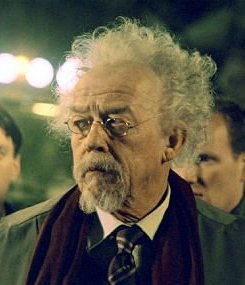

Professor **Trevor Bruttenholm** (pronounced /ˈbruːm/ "broom") was an expert of the occult, the first and former director of the [Bureau for Paranormal Research and Defense](/entry/Bureau%20for%20Paranormal%20Research%20and%20Defense), and the parental guardian of [Hellboy](/entry/Hellboy).

## History

Trevor Bruttenholm was born in 1916, in England. He graduated from Oxford University in 1943. A British academic well-versed in the supernatural, Trevor Bruttenholm was a member of the [British Paranormal Society](/entry/British%20Paranormal%20Society). He was an adviser to U.S. President Franklin D. Roosevelt when the Allies realized that Nazi leader Adolf Hitler was racing to use the occult to turn the tide of World War II.

### The Hellboy incident

In 1944, Bruttenholm was alerted by [Lady Cynthia Eden-Jones](/entry/Lady%20Cynthia%20Eden-Jones), whom she learned from her spirit guides, about a cataclysmic event that would soon take place at the ruins of a church in East Bromwich. Bruttenholm, in turn, informed the war department, and eventually a patrol of U.S. troops, led by Sergeant [George Whitman](/entry/George%20Whitman), joined Lady Cynthia, Bruttenholm, and noted occult scholar [Malcolm Frost](/entry/Malcolm%20Frost) at East Bromwich. The group arrived at the ruins on December 21, 1944, two days before the date when Lady Cynthia's guide had predicted that the event was to occur. At the same time, the Russian mystic [Grigori Rasputin](/entry/Grigori%20Rasputin) and a branch of the Nazi Occult societies were preparing to initiate [Project Ragna Rok](/entry/Project%20Ragna%20Rok). On December 23, at exactly the moment Rasputin had called upon the [Ogdru Jahad](/entry/Ogdru%20Jahad), a little demon-like creature appeared before Bruttenholm and his group. Seeing that there was more to the creature than its demonic appearance suggested, Bruttenholm named the creature Hellboy.

### The B.P.R.D.

After the U.S. apprehended Hellboy, Bruttenholm, along with a group of American occultists with the support of the U.S. government, founded the [Bureau for Paranormal Research and Defense](/entry/Bureau%20for%20Paranormal%20Research%20and%20Defense) and served as the Bureau's first director. At the same time, Bruttenholm continued to work closely with Hellboy. Instead of treating him as a monster or a dangerous experiment, Bruttenholm began to treat Hellboy like a human child, and, in 1946, officially adopted Hellboy.

From 1946 to 1952, Bruttenholm divided his time between leading field operations (including the discovery and neutralization of the remains of the Nazi doomsday project Vampir Sturm, and his encounter with the demon [Varvara](/entry/Varvara)) and tending to the growing Hellboy. He frequently traveled to Washington, D.C. to lobby for funding and government support for the B.P.R.D. Partly because of Bruttenholm's efforts, the United Nations granted Hellboy honorary human status on August 6, 1952. A week later, Bruttenholm promoted Hellboy to B.P.R.D. field agent.

Bruttenholm's tenure as director has been extremely resourceful and had resulted in the growth of the B.P.R.D. and the official recognition of its works by the United Nations. In September 1958, Bruttenholm resigned his directorship, remaining with the B.P.R.D. as an advisor and sometime field agent, which also enable him to have the opportunity to spending more time with Hellboy.

As Bruttenholm aged, he became increasingly engaged in private research involving the ancient Lemurian language. In the course of this research, Bruttenholm met and befriended the descendants of Elihu Cavendish, and, in 1992, the Cavendish brothers asked him to join them on an expedition to the Arctic circle. In November of that year, Bruttenholm bid Hellboy farewell and traveled with the Cavendish Expedition. Early in 1993, Bruttenholm and the expedition discovered the ruins of the Hyperborean temple Gorinium where Grigori Rasputin sat in stasis next to the unmoving figure of the Ogdru Hem creature, [Sadu-Hem](/entry/Sadu-Hem). Bruttenholm touched Rasputin, and the moment of contact not only awakened Rasputin and Sadu-Hem, but allowed Rasputin to see through Bruttenholm's mind - including the life and history of Hellboy in which Rasputin concluded that Hellboy was the key in freeing the Ogdru Jahad from their prisons. Sadu-Hem transformed the Cavendish brothers into frog creatures, the first of thousands of such beasts the Bureau would eventually face, while Bruttenholm was allowed to live, being used as a bait by Rasputin to trap Hellboy.

### Death

In May 1994, Bruttenholm (which the world had believed him and the Cavendish expedition to be dead after having been unheard for six months) suddenly resurfaced and summoned Hellboy to his Brooklyn Park home. Bruttenholm could only remember bits and pieces of what happened in the Arctic. Before he could explain himself to Hellboy, he was murdered by a frog monster. Hellboy would eventually avenged Bruttenholm's death by stopping Rasputin's plans to free the Ogdru Jahad and saw the mystic burn alive for his crime. He was 79 years old.

## Other media

### [*Hellboy* (2004)](/entry/Hellboy%20%282004%20film%29)

 In the film, Bruttenholm accompanies the team of American commandos to stop Rasputin from initiating Project Ragna Rok. He receives a bullet in the leg from [Karl Ruprecht Kroenen](/entry/Karl%20Ruprecht%20Kroenen) that causes him to limp for the rest of his life, but throws a hand grenade under the portal machine that both destroys the machine and maims Kroenen as he is attempting to retrieve it. When the infant Hellboy appears, Bruttenholm adopts him and dedicates himself to raising Hellboy as a human, despite his demonic origins. The film makes the father–son relationship between the two characters more explicit, with Hellboy always calling Bruttenholm "Father."

As the movie begins in the present, Bruttenholm discovers that he is dying of cancer, and selects the young agent [John Myers](/entry/John%20Myers) to serve as Hellboy's new liaison. He is killed by [Kroenen](http://hellboy.wikia.com/wiki/Karl_Ruprecht_Kroenen) as part of a plot to lure Hellboy to Rasputin's grave, where he can fulfill the purpose he was summoned to Earth for. Before he is killed, Rasputin taunts him, saying that Bruttenholm has effectively nurtured a creature with the power, and the destiny, to bring about the Apocalypse, and also shows him a vision of the post-apocalyptic remains of New York City, with the Ogdru Jahad looming overhead and Hellboy, with regenerated horns, standing in the center. Bruttenholm returns that he will always see Hellboy as his son, and respectfully accepts his fate and allows Kroenen to kill him.

When Hellboy is about to unlock the key that will release the Ogdru Jahad from their prison as Anung un Rama, Myers stops him by throwing him a rosary that belonged to Bruttenholm, a reminder that Bruttenholm raised him to choose his own path—upon which Hellboy tears away his re-grown horns and kills Rasputin rather than turn the final key.

### *[Hellboy II: The Golden Army](/entry/Hellboy_II__The_Golden_Army)*

Bruttenholm also makes a cameo appearance in the sequel film played again by Hurt. During the film's prologue, taking place in 1955, the middle-aged Bruttenholm is raising the young Hellboy in secret on a U.S. Air Force base in New Mexico. On Christmas Eve, Bruttenholm reads his "son" a story about the creation of the Golden Army. In the present, Hellboy wears his father's rosary beads on his wrist, like a bracelet.

The creators of the comic book have stated in interviews that Hurt's portrayal of Bruttenholm was uncanny, as though he had been the original model for the comics character.

### *[Hellboy: Blood and Iron](/entry/Hellboy__Blood_and_Iron)*

Trevor Bruttenholm also appeared in the straight-to-DVD animated film *Hellboy: Blood and Iron*, voiced as a young man by James Arnold Taylor, and as an elderly man by Hurt again.

In the film, a series of flashbacks show the young Bruttenholm traveling to Eastern Europe to combat Erzebet Andrushko, an evil vampiress who has been terrorizing Transylvania. He emerges victorious, though the only survivor of his team.

Sixty years later, he is still a member of the Bureau, though no longer Director of Field Operations. Experiencing recurring nightmares of Erzebet's resurrection, he suggests that the entire team be sent on an apparently trivial mission in the Hamptons, where Erzebet's disciples are indeed working to bring her back. Despite the dangerous creatures fought by the other members of the team, it is Bruttenholm who confronts Erzebet, alone, and manages, despite his age, to outwit and destroy her again.

de:Trevor Bruttenholm

**Category:B.P.R.D. agent** **Category:Humans** **Category:Deceased Characters** **Category:Occultists** **Category:Male Characters** **Category:Characters (2004–2008 film franchise)** **Category:Hellboy characters** **Category:Hellboy Animated Characters**