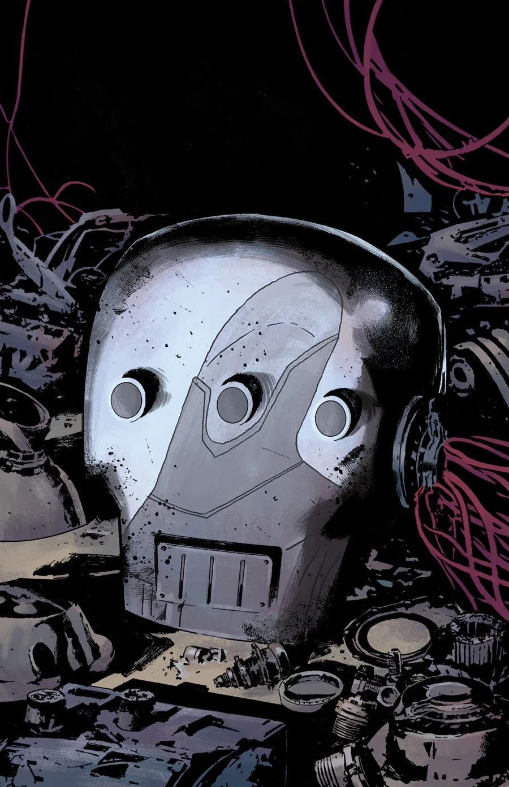
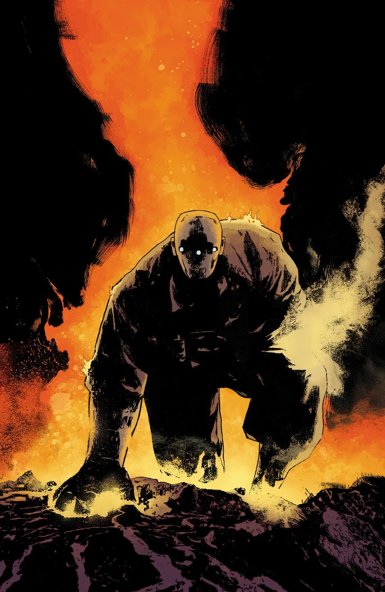

《现代普罗米修斯》（Modern Prometheus）是一部两期完结的支线，由胡利安·托蒂诺·特德斯科（Julián Totino Tedesco）作画。

## 剧情简介

### 第一部

[约翰](/entry/Johann_Kraus)对[重锤装甲](/entry/Vril_Energy_Suit)（Sledgehammer armor）的痴迷，将他引上了一段离奇的回溯之旅，揭开了"厄庇墨透斯计划"（Project Epimetheus）的起源。

### 第二部

约翰迷失在了重锤计划的记忆之中……他能否及时找回自我、重新掌控装甲，救下[超自然调查防御署](/entry/Bureau_for_Paranormal_Research_and_Defense)（BPRD）？

## 画廊

\#1

\#2

**Category:Story** **Category:B.P.R.D. story** **Category:B.P.R.D.: Hell on Earth story**
