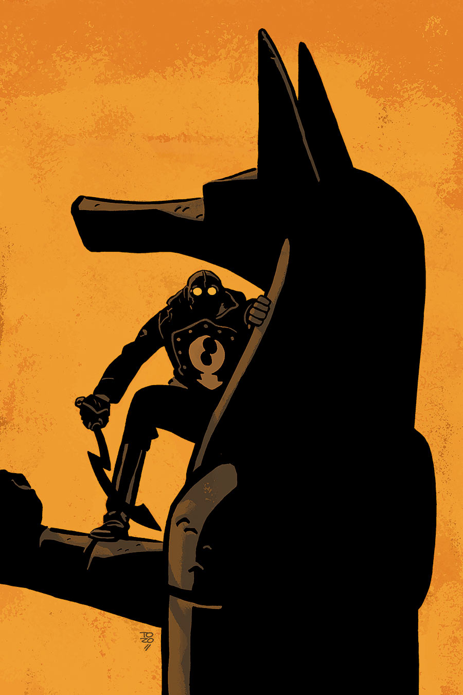

The story takes place in the middle of [Lobster Johnson's](/entry/Lobster%20Johnson) career as a crime fighter in the 1930s.

## Publication History

This one-shot will be published in December 2015, featuring a cover by Tonči Zonjić.

## Synopsis

Murder interrupts the opening of a new exhibit at the Metropolitan Museum. Lobster Johnson investigates to find out what makes a blown-glass sculpture worth killing for.

## Gallery

<File:Lobster_Johnson-The_Glass_Mantis.jpg%7CCover>

! colspan = 3 | [ Vol. 6 A Chain Forged in Life](/entry/TPB)

**Glass Mantis, The** **Glass Mantis, The**