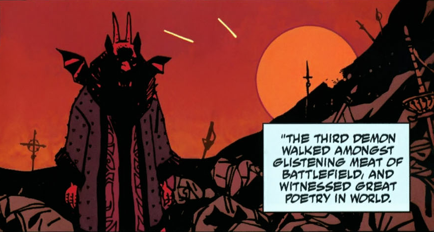

**Varvara** (also known as Yomyael) is a demon who has taken the form of a young Russian girl. She is the former director of the [Special Sciences Service](/entry/Special%20Sciences%20Service).

## History

Yomyael was part of a trinity of demons (also including Beleth and Sytry) that had aided the Asiatic people in battle "for as long as men had placed faith in the dark behind stars." The trinity was discovered and summoned by Peter the Great's advisors to help him turn the tides against the Swedes in the Great Northern War. The demons granted Peter's wishes, but they came with a price. The first demon would take the lives of all of Peter's future sons, so that his name would not live on; the second demon would take his heart, so he would be filled with cruelty and bring only pain to anyone he came in contact with; and the third demon, Yomyael, would take his soul. As the first two demons took what Peter owed, Yomyael walked through the battlefield and was so captivated by the brutality brought out by humans, he decided to stay in the mortal world, thus abandoning the Peter's soul, which was also his passage home.

Yomyael

For many years Yomyael wandered the earth, always changing its appearance, and in time he came to an understanding of humanity. Centuries later, the demon had assumed the shape of a young Russian girl, calling herself Varvara, and aligned herself with the Soviet Union, eventually becoming head of the Russian [Special Sciences Service](/entry/Special%20Sciences%20Service).

### Allying with Trevor Bruttenholm

In 1946, Varvara was stationed in Soviet-occupied Berlin, gathering occult objects and keeping secret prisoners affiliated with the Nazi paranormal experiments for questioning. It was then that Varvara first encountered Professor [Trevor Bruttenholm](/entry/Trevor%20Bruttenholm), who sought for any information related to the "[Hellboy](/entry/Hellboy%20%28character%29) Incident". Varvara was already aware that the demon (Hellboy) was under the professor's care. However, Varvara declined to share any information until she and her organization had made a truce with Bruttenholm that would be related to their common goal regarding Project Vampir Sturm. Their alliance led to the successful foiling of an attempt by [Herman von Klempt](/entry/Herman%20von%20Klempt) to launch a rocket loaded with vampires at the United States. In the aftermath, Varvara was impressed by Bruttenholm and has since then she considered him her favorite human.

In 1947, Varvara appeared at the New Mexico Air Force base where the [B.P.R.D.](/entry/Bureau%20for%20Paranormal%20Research%20and%20Defense) was then stationed to discuss the recent killings of ex-Nazis with Professor Bruttenholm, which they both knew to be the work of [Baron Konig](/entry/Baron%20Konig). 

In 1952, Varvara approached [Malcolm Frost](/entry/Malcolm%20Frost), who was planning to kill Professor Bruttenholm in order to gain access to eliminating Hellboy, and threatened him from ever harming Bruttenholm after she murdered Frost's underling [Robert Amsel](/entry/Robert%20Amsel) via spontaneous combustion.[1]

### Imprisonment

At some point after Varvara's multiple meetings with Professor Bruttenholm regarding the vampire activity in Europe, Varvara was overthrown as Director of the Special Sciences Service. Tired of working in constant fear of her explosive temper and violent way of handling things, a coup was arranged by most of the members of the department to incapacitate Varvara. After months of planning, they brought a medium to a radio station outpost where she recorded a carefully researched incantation done hundreds of miles away from Varvara and then broadcast it to her, weakening her and allowing the S.S.S. to overthrow the demon. This lead to her current situation, being magically imprisoned within a glass case in the office of [Iosif Nichayko](/entry/Iosif%20Nichayko), who has since become the new Director of the S.S.S. Recently Varvara attempted to make a deal with a group of lesser demons who had escaped from Hell, but so far their attempts to free her have been unsuccessful.

### [*B.P.R.D.: Hell on Earth*](/entry/Hell_on_Earth_(story_cycle)))

After the arrival of one of the [Ogdru Jahad](/entry/Ogdru%20Jahad), seeing the situation hopeless, Iosif reluctantly frees Varvara with the hopes that the demon would turn her attention on the dragon, though at the cost of his life.

Varvara, however, invites Iosif on a journey to Hell. There she takes him to the abandoned city of [Pandemonium](/entry/Pandemonium) where the corpse of [Satan](/entry/Satan) lies. Taking the dagger that killed the former King of Hell, Varvara releases the seal to free the imprisoned [Watchers](/entry/Watchers) that supported the great city of Hell.

Back on Earth, she and Iosif watched in awe as several Watchers erupt from the Earth and battle the Ogdru Jahad. Though Iosif is hopeful that the fallen angels might defeat the monster, Varvara informs him that the Watchers may not have the power they previously possessed before they were imprisoned and whoever wins will not bold well for the world. Turning her attention to her former captor, she stabs the undead Russian, shattering his soul to pieces and making him less of a ghost and unable to die.

After the Watchers are defeated by the dragon, she watched in amusement of [Johann Kraus's](/entry/Johann%20Kraus) efforts to fight the creature. Much to her surprise, the vril-empowered medium destroyed the Ogdru Jahad, ending its threat to the Earth.

Varvara's last appearance during *Hell on Earth* was in the old headquarters of the B.P.R.D. in Connecticut. She mused to herself that her efforts to stall the apocalypse were useless and how one small little ghost had turned the tide when she had failed. She lamented that she misses Professor Trevor Bruttenholm, stating he was always her favorite, and wondered to herself who will entertain her now.

## References

<references/>

**Category:Russians** **Category:Demons** **Category:Female Characters**

[1] *[Hellboy and the B.P.R.D 1952](/entry/1952)*