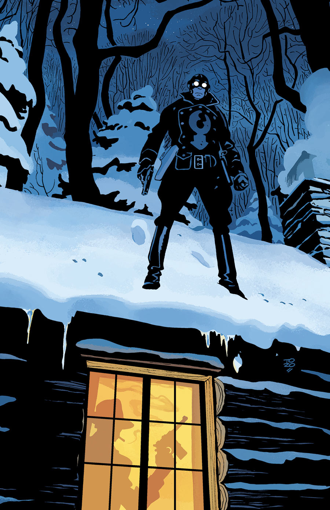

The story takes place in the middle of [the Lobster's](/entry/The%20Lobster) career as a crime fighter in the 1930s.

## Publication History

This one-shot will be published in July 2015, featuring a cover by Tonči Zonjić.

## Synopsis

Santa is in trouble! Santa was taken hostage after witnessing a hostile robbery and the death of a man. Hidden away in a mountain cabin, will the Lobster be able to find Santa and save Christmas?

## Gallery

<File:A> Chain Forged in Life.jpg|Cover

! colspan = 1 | [ Vol. 5 The Pirate's Ghost and Metal Men of Midtown](/entry/TPB) ! colspan = 2 | [ Vol. 6 A Chain Forged in Life](/entry/TPB)

**Chain Forged in Life, A** **Chain Forged in Life, A**