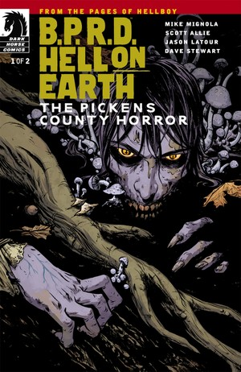
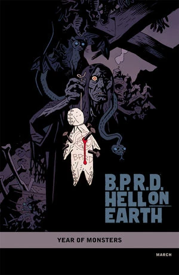

***《皮肯斯郡恐怖故事》***（The Pickens County Horror）是一部两期限定连载，于 2012 年 3 月至 4 月间出版。

## 出版历史

这是《[人间炼狱](/entry/Hell_on_Earth_(story_cycle))》故事环的第六个篇章，但属于支线故事，情节并不接续《[漫长的死亡](/entry/The_Long_Death)》。各期封面由[贝姬·克鲁南](/entry/Becky_Cloonan)（Becky Cloonan）绘制，第 1 期另附有一款[迈克·米格诺拉](/entry/Mike_Mignola)绘制的“[怪兽之年](/entry/Year_of_Monsters)”（Year of Monsters）变体封面。

## 剧情简介

### 第一部

当世界一步步坠入地狱之际，一个隐居乡野的吸血鬼家族藏身于他们南方哥特式的老宅中。宅子被浓雾与真菌状的恐怖之物笼罩，而他们已准备就绪，要给贸然闯入的超自然调查防御署小队制造一场浩劫。

### 第二部

一个与世隔绝的吸血鬼家族，再加上一片致命的迷雾，造就了我们的英雄们所面对过的最惨重的任务之一。

## 画廊

 \#1

 \#1 变体封面

**Category:Story** **Category:B.P.R.D. story** **Category:B.P.R.D.: Hell on Earth story** **Category:Vampires**
