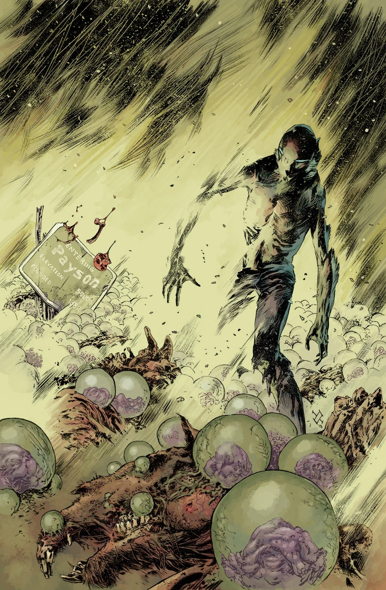
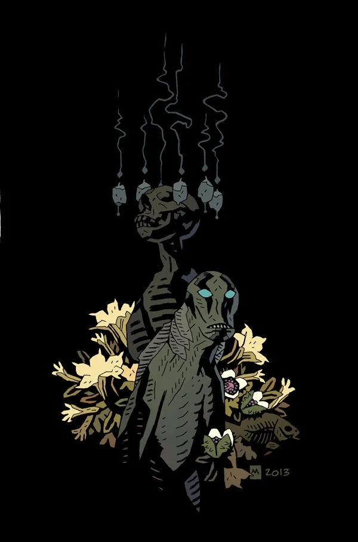
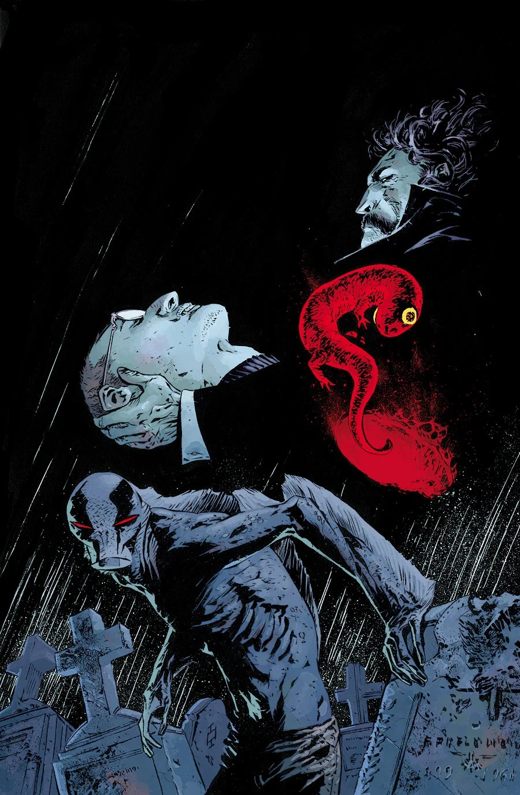
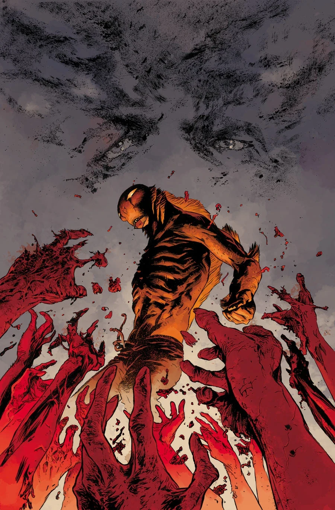

《**直至最后一人**》（To the Last Man）是一个共三话的故事线，于 2014 年 1 月至 3 月连载，作画为马克斯·菲乌马拉（Max Fiumara）。

## 剧情简介

### 第一部

[亚伯](/entry/Abraham_Sapien)来到亚利桑那的一座小镇躲避末日浩劫，小镇却已被一群似曾相识的混混侵占——但更迫在眉睫的麻烦，是一片田野里密密麻麻的怪异怪物，它们像麦子一样从死者身上破土而出！

### 第二部

亚伯刚从一个洛夫克拉夫特式的威胁手中救下亚利桑那的一座小镇，一个新的杀手便扬言要吞噬最后的幸存者！

### 第三部

当丧尸群威胁着亚利桑那的一座小镇时，一名疯狂的死灵法师在怪物横行的西雅图废墟之上崛起。

## 画廊

迈克·米格诺拉（Mike Mignola）变体封面

