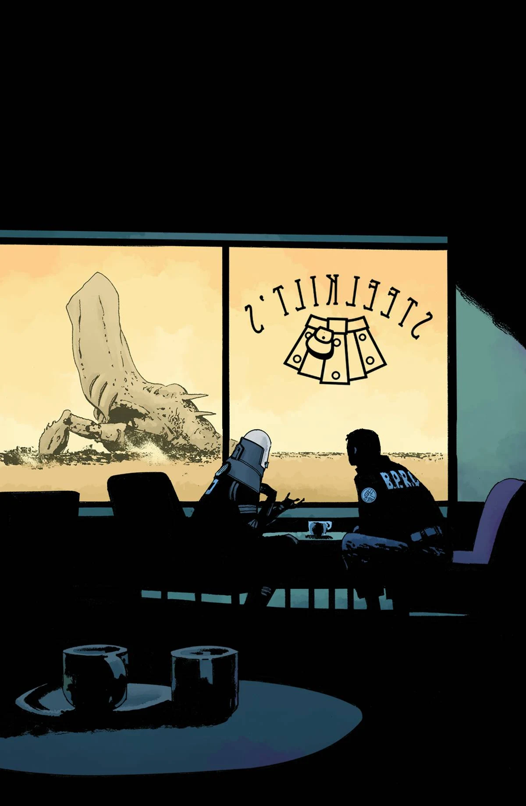

《研磨人生》（Grind）是一部单期完结的支线故事，由[泰勒·克鲁克](/entry/Tyler_Crook)执笔作画。它是整个系列中评价最高的故事之一。

## 剧情简介

尽管[奥格德鲁·赫姆](/entry/Ogdru_Hem)已经逼近城郊，圣达菲的生活仍在继续。但当[超自然调查防御署](/entry/Bureau_for_Paranormal_Research_and_Defense)（B.P.R.D.）赶到镇上时，对至少一个人来说已经太晚了……而遭殃的，恐怕还远不止他一个！

## 画廊

\#1

**Category:Story** **Category:B.P.R.D. story** **Category:B.P.R.D.: Hell on Earth story**
