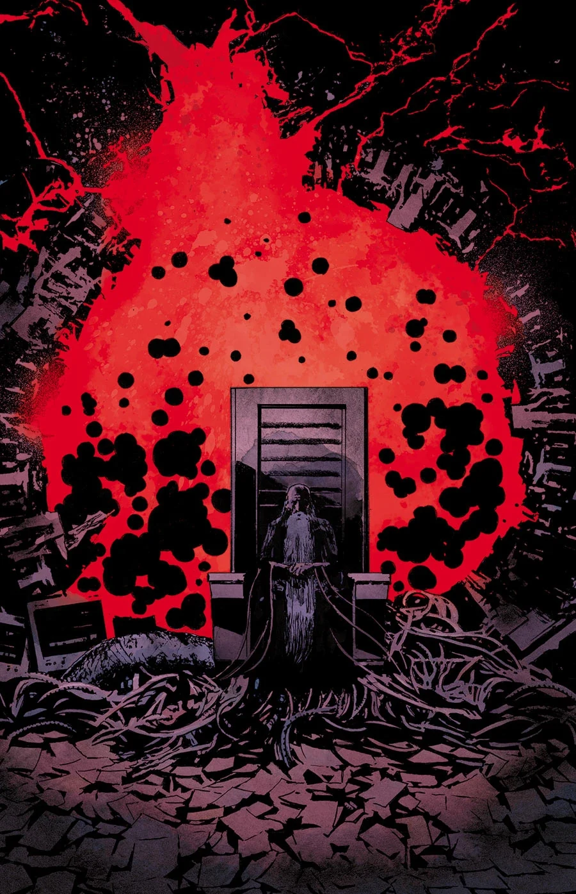
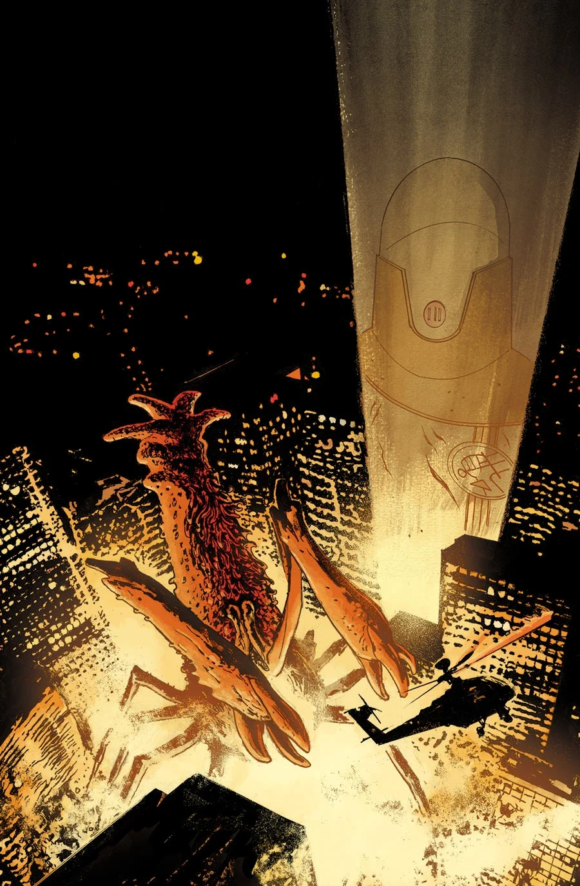

《破裂的方程》（The Broken Equation）是一部两期完结的支线，[约翰·克劳斯](/entry/Johann_Kraus)与[伊诺斯探员](/entry/Russell_Enos)前往日本，由乔·奎里奥（Joe Querio）作画。

## 剧情简介

### 第一部

[约翰](/entry/Johann_Kraus)远赴日本迎战巨型怪物，可他在那里发现的东西却更加令人不安——一个没有大脑的男人一直在画画……而这些画讲述了一个骇人的故事。

### 第二部

一头[超自然调查防御署](/entry/Bureau_for_Paranormal_Research_and_Defense)（B.P.R.D.）前所未见的巨型怪物，为争夺日本的统治权而与[奥格德鲁·赫姆](/entry/Ogdru_Hem)展开大战！

## 画廊

封面由[劳伦斯·坎贝尔](/entry/Laurence_Campbell)绘制。

\#1

\#2

**Category:Story** **Category:B.P.R.D. story** **Category:B.P.R.D.: Hell on Earth story**
