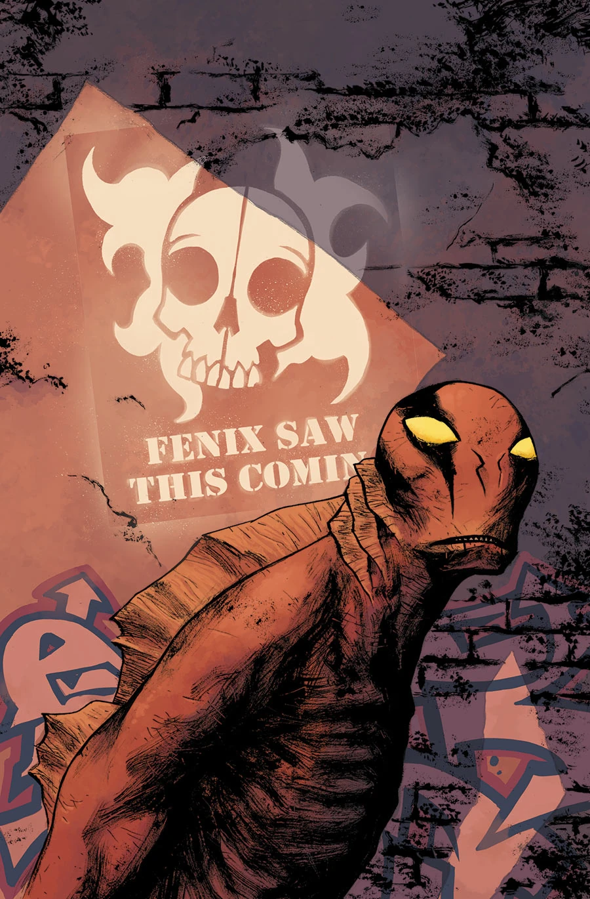
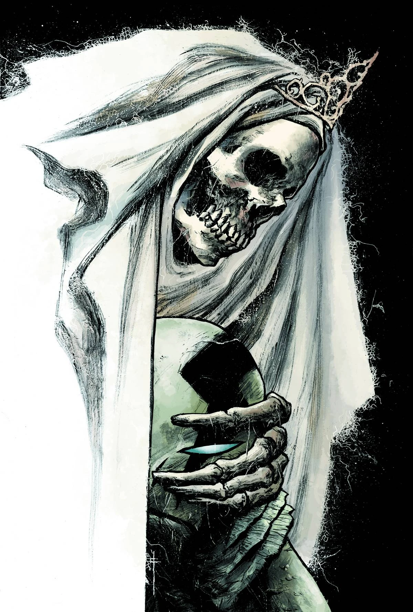

《**神圣领域**》（Sacred Places）是一个全新故事线，由塞巴斯蒂安·菲乌马拉（Sebastián Fiumara）担任绘画。

## 剧情简介

### 第一部

亚伯回到了菲尼克斯（Fenix）开枪击中他的地方，而随着一种神秘气体开始从地下渗出，事态急转直下。在一支奉命将他制服的小队的追捕下，他接连撞上了两个截然不同的末日邪教——其中一个竟然将亚伯奉为神祇！

### 第二部

人们认为亚伯·萨皮恩的蜕变意味着他与那些正在占领世界的怪物有所关联。如今，亚伯回到了他中枪、也是他蜕变开始的那座小镇，向一群古怪的幸存者寻求庇护。

## 画廊

