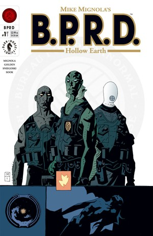
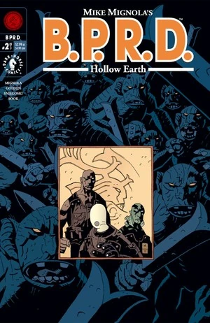
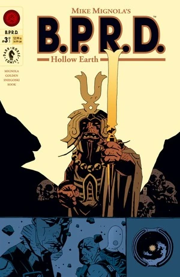

在***《空心地球》***（Hollow Earth）中，[丽兹·舍曼](/entry/Elizabeth_Sherman)离开 [B.P.R.D.](/entry/B.P.R.D.) 寻求内心的平静，却遭俘虏。[亚伯·塞皮恩](/entry/Abe_Sapien)、[凯特·考瑞根](/entry/Kate_Corrigan)、[罗杰](/entry/Roger)和新成员[约翰·克劳斯](/entry/Johann_Kraus)前往北极营救她。

## 出版历史

在[地狱男爵](/entry/Hellboy)于《[征服之虫](/entry/Conqueror_Worm_%28story%29)》结尾离开 [B.P.R.D.](/entry/B.P.R.D.) 之后，[迈克·米格诺拉](/entry/Mike_Mignola)决定让防御署的故事以独立漫画系列延续下去。

该故事以三期限定连载形式于 2002 年 1 月、4 月、7 月出版，后于 2003 年 1 月收录进平装合订本《B.P.R.D.：空心地球及其他故事》（*[B.P.R.D.: Hollow Earth & Other Stories](/entry/Trade_Collections)*）。

## 剧情简介

### 第一部分

[丽兹·舍曼](/entry/Elizabeth_Sherman)离开 [B.P.R.D.](/entry/B.P.R.D.)，前往阿加尔塔（Agartha）——一座位于北极圈以北乌拉尔山脉中的神殿，寻求控制自身火焰的帮助。

在康涅狄格州的 B.P.R.D. 总部，[凯特·考瑞根](/entry/Kate_Corrigan)会见了新成员[约翰·克劳斯](/entry/Johann_Kraus)。他说想见[地狱男爵](/entry/Hellboy)，却被告知地狱男爵正在休假（即《[征服之虫](/entry/Conqueror_Worm_%28story%29)》中的情节）。[汤姆·曼宁](/entry/Thomas_Manning)与凯特交谈，担心其他队员也会相继离开。

回到阿加尔塔，丽兹发现地板上裂开一道大缝，便去告诉僧侣。他们说事情正在处理中。

凯特拜访[亚伯·塞皮恩](/entry/Abe_Sapien)，向他讲述约翰的来历：他本是一名实体通灵者，一场灾难摧毁了他的肉体，使他成为一个灵体外质的投影。当晚，丽兹的幻象出现在亚伯面前，请求他去救她。

凯特、亚伯、[罗杰](/entry/Roger)和约翰前往阿加尔塔寻找丽兹。他们进去后发现所有僧侣都已遇害。他们找到了丽兹，但她已没有呼吸。约翰说她没有死，而是某种意义上"空"了。亚伯在废墟中发现了[一只红色小生物](/entry/Servants_of_the_Left_Hand)的尸体。

### 第二部分

罗杰吸收了那只生物的一部分能量，得知是这些生物抓走了丽兹，也得知了它们的所在。亚伯、罗杰和约翰沿着地板上的一道大裂缝下行，希望找回丽兹的灵魂。

行进途中，约翰问起地狱男爵离开后大家过得如何。两人都说很艰难，亚伯讲起自己初到 B.P.R.D. 的日子，那时地狱男爵主动与他结交为友。

他们停下休息时，一群生物从天花板落下发动袭击。约翰设法把它们吓退，三人继续前行。他们经过古老机器的废墟，看到其中一些看起来像是正在被修复。又有更多生物和一头巨蟾般的野兽拦住了他们。

### 第三部分

丽兹的灵魂被地底生物囚禁，她回忆起自己小时候初到 B.P.R.D. 的那一天——当时是地狱男爵帮她承受失去家人的痛苦。

三人在生物的追赶下奔逃，亚伯扔出一枚手雷阻止追兵。他们匆匆前行，来到囚禁丽兹灵魂的装置前。约翰和罗杰判断应该能解救她，就在此时，生物们的[首领](/entry/King_of_Fear_%28character%29)向他们发起攻击。首领告诉臣民，他们将利用创造者的机器占领地表世界。亚伯开枪击中首领，罗杰砸毁机器、救出丽兹。洞穴坍塌，四人夺路而逃。受伤的首领连同他的一些机器一起坠入了更深处的地底。

四人在苏格兰回到地表，被凯特·考瑞根接走。丽兹决定重新加入 B.P.R.D.。

## 故事年表

故事本身并未点明发生时间，但其他故事提供了一些线索。

在《[恐惧之王](/entry/King_of_Fear_%28story%29)》第 1 期中，显示这些生物在 2001 年袭击了[丽兹·舍曼](/entry/Elizabeth_Sherman)和阿加尔塔。但这似乎与其他信息相矛盾（在平装合订本中被改为 2002 年）。

故事强烈暗示小队在袭击后不久便前往阿加尔塔。然而根据《[通灵师](/entry/The_Ectoplasmic_Man)》，[约翰·克劳斯](/entry/Johann_Kraus)直到 2002 年 2 月才成为灵体外质投影。此外，假设 [B.P.R.D. (teaser)](/entry/B.P.R.D._%28teaser%29)发生在《空心地球》主线之前，那么约翰直到事故至少七个月后才加入 B.P.R.D.，最早也就是 2002 年 9 月。

因此，《空心地球》要么如《恐惧之王》第 1 期所述发生在 2001 年，要么如《通灵师》所暗示的发生在 2002 年。

无论如何，相对的时间顺序是清晰的：

- [丽兹·舍曼](/entry/Elizabeth_Sherman)最后一次出现是在 1997 年的《[近乎巨人](/entry/Almost_Colossus)》故事中
- 丽兹·舍曼在主线故事的两年前（即 1999 或 2000 年）离开 B.P.R.D. 并前往阿加尔塔
- [地狱男爵](/entry/Hellboy)在《[征服之虫](/entry/Conqueror_Worm_%28story%29)》事件后于 2000 年离开 B.P.R.D.（此事发生在丽兹离开之后，《空心地球》第 1 期[亚伯·塞皮恩](/entry/Abe_Sapien)与[凯特·考瑞根](/entry/Kate_Corrigan)的对话中有述）
- 阿加尔塔遇袭、B.P.R.D. 于 2001 或 2002 年前往营救丽兹·舍曼

## 内容

### 角色

#### [超自然调查防御署](/entry/Bureau_for_Paranormal_Research_and_Defense)（B.P.R.D.）

- [丽兹·舍曼](/entry/Elizabeth_Sherman)
- [凯瑟琳·考瑞根](/entry/Kate_Corrigan)
- [约翰·克劳斯](/entry/Johann_Kraus)
- [地狱男爵](/entry/Hellboy_%28character%29)（回忆）
- [汤姆·曼宁](/entry/Thomas_Manning)
- [亚伯拉罕·塞皮恩](/entry/Abraham_Sapien)
- [罗杰](/entry/Roger)
- 科布医生（Doctor Cobb，回忆）
- 罗德尔医生（Doctor Roddel，回忆）
- [特雷弗·布鲁滕霍尔姆](/entry/Trevor_Bruttenholm)（回忆）
- 其他职员

#### 其他

- 阿加尔塔居民
  - 盖亨大师（Master Gheghen）
  - 其他僧侣
- 各类[左手之仆](/entry/Servants_of_the_Left_Hand)
- [恐惧之王](/entry/King_of_Fear_%28character%29)
- [女巫](/entry/Witches)
  - [赫卡忒](/entry/Hecate)（仅被提及，以"Heca-Emem-Ra"和"黑暗女神"之名）
- [极北族人](/entry/Hyperboreans)
  - [托特](/entry/Thoth)（仅被提及）
- [奥格德鲁·贾哈德](/entry/Ogdru_Jahad)（仅被提及）
- [奥格德鲁·赫姆](/entry/Ogdru_Hem)（被引用）
- 成都事件遇难者（回忆）

### 地点

- [俄罗斯](/entry/Russia)
  - 阿加尔塔（北极圈以北的乌拉尔山脉）
- 美国
  - [B.P.R.D.](/entry/Bureau_for_Paranormal_Research_and_Defense) 总部（康涅狄格州费尔菲尔德）
- 奥地利（回忆）
- 德国（回忆）
  - 克劳斯宅邸（海德堡）（回忆）
  - [B.P.R.D.](/entry/Bureau_for_Paranormal_Research_and_Defense)设施（回忆）
- 地底洞穴系统
- 苏格兰高地

### 重要物品

- 各类[极北族](/entry/Hyperboreans)器物
  - 剑
  - 战争机器
  - 生产机器
  - 能量汲取装置
- [纳粹](/entry/%3ACategory%3ANazi)潜艇

## 画廊

封面作者：[Mike Mignola](/entry/Mike_Mignola)。

**Category:Story** **Category:B.P.R.D. story** **Category:B.P.R.D.: Plague of Frogs story**
