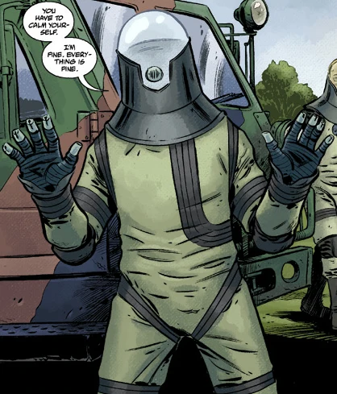
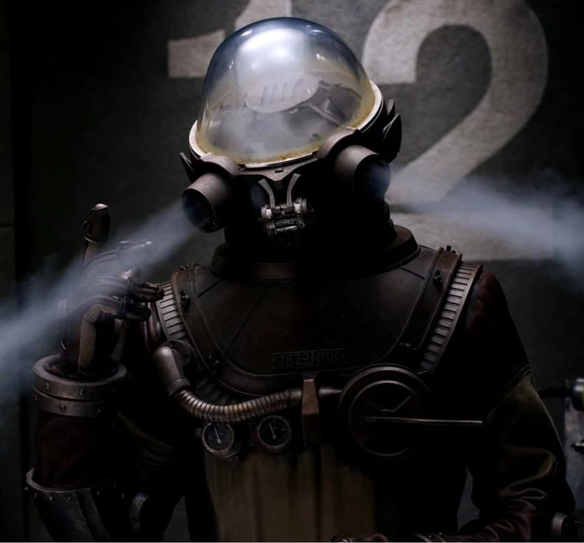

## History

**Johann Kraus** was born in Stuttgart, Germany, in 1946. He began to be aware of his psychic abilities when he was ten years old, when he started to see people that others could not and slowly realized that these were ghosts. Johann was frustrated that he could not communicate with the ghosts and this frustration eventually led to him studying spiritualism under an elderly German woman named Anneliese Stiener. Through Stiener, Kraus met many other spiritualists and was exposed to a variety of occult studies. Ultimately he did not like the direction of the group and severed his ties with his mentor. He then taught himself to communicate with the dead, and eventually mastered the ability to send his own ectoplasmic form out of his body and into the etheric plane. In 1971, Kraus opened a small office in Munich, where he established himself as a well-respected medium before relocating to the town of Heidelberg.

### The Chengdou disaster

In February 2002, in Chengdou, China, a warehouse containing occult artifacts seized by the Chinese government was broken into. The thief unwittingly opened a small Jade figurine, releasing a massive burst of psychic energy, killing everyone within a hundred miles, and sending a shockwave across the etheric plane. At that time Kraus was hosting a séance in Heidelberg for the family of the late Heinrich Wagner. The spirit of a recently deceased Chinese boy reached through the etheric plane, asking Johann for help from the Chengdou disaster. The shockwave conducted through the boy, then through Krauss, killing the entire Wagner family and destroying Johann Kraus's body.

### [B.P.R.D.](/entry/Bureau%20for%20Paranormal%20Research%20and%20Defense)

His ectoplasmic form having survived his body's incineration, and knowing he would soon dissipate without a physical body, Kraus sought the best paranormal minds on the planet for help: the B.P.R.D.. At first, his ectoplasmic form was contained within a transparent tank apparatus originally developed by the B.P.R.D. for other purposes. Eventually the technology was scaled down into a more specialized containment suit. Kate Corrigan had said of Kraus that, "He's not dead. He just doesn't have a body anymore."

After the loss of Hellboy, Kraus was tasked to replenish the Bureau's pool of 'enhanced talents'. Kraus soon proved himself an invaluable member of the team. His psychic abilities are greater than ever, due to his non-corporeal condition (similar to a musician's hearing improving after the loss of his eyesight). Where once he could speak with the dead, now he can grant them temporary physical form.

Johann Kraus is an accomplished scholar in occult lore and, since he no longer requires rest, works constantly. As of the *Garden of Souls* storyline, he was helping to research and organize the mountains of files culled from the sub-basement of the Bureau's new base in the Colorado mountains.

## Powers and Abilities

Even before the destruction of his body, Johann Kraus was a gifted and experienced medium, possessing the ability to both communicate with spirits, and project his own ectoplasmic form out from the confines of his flesh. Being reduced to a soul within a containment suit has not lessened either of these abilities; in many ways Kraus has become even more effective at what he does thanks to his condition.

In his current state Kraus can grant ghosts temporary physical forms to allow them to talk with non-mediums. His lack of a body means that he does not need to eat, drink, sleep, or breathe. He also has greater resistance to adverse conditions, such as weather, thanks to his containment suit.

Like the film, Johann in the comics has shown signs of body possession powers, where he was able to take possession of any form lacking a soul. When Kraus's suit was damaged, he temporarily inhabited the body of a dead dog and at a latter date he possessed agent [Enos](/entry/Enos) only seconds after he died, with enough control to talk and use a grenade launcher through the corpse.

Kraus has also demonstrated many useful non-supernatural talents, including good interpersonal, organizational skills and his ability to speak fluent German and 'rusty' Japanese has proved useful in the past. Kraus is well liked by those around him, and is considered very reliable.

Kraus's primary weakness is his dependence on his containment suit. Without it his ectoplasmic form would dissipate; left without a host body or a containment suit for too long, Kraus's ectoplasm runs the risk of dissipating itself entirely. This situation can occur even with minor damage to the suit.

## Allies and Enemies

### Allies:

- [Hellboy](/entry/Hellboy):
- [Liz Sherman](/entry/Liz%20Sherman):
- [Abraham Sapien](/entry/Abraham%20Sapien):
- Tom Manning:
- [Kate Corrigan](/entry/Kate%20Corrigan):
- [Panya](/entry/Panya):

### Enemies:

## Film

### [Hellboy II: The Golden Army](/entry/Hellboy_II__The_Golden_Army)

As a result of [Hellboy's](/entry/Hellboy%20%28character%29) public exposure to the world, Washington sent Kraus to take over management of field operations. Following the information obtained from a dead tooth fairy Kraus reanimated, he located the Troll Market. Stalking a troll to gain entrance, Kraus and Hellboy had a disagreement over how to convince the troll to reveal the Troll Market's entrance. When Hellboy's violent methods failed to extract the way to open the entrance, Kraus used his ectoplasmic form to possess the locking mechanism and unlocked the door. Once inside, Kraus tried in vain to question two trolls and their tumor, but Hellboy punched the information out of them.

Later, in the showers at B.P.R.D. headquarters, Kraus informed Hellboy of his greatest weakness: his temper, which ignited Hellboy's anger. With a quick punch Hellboy accidentally shattered Kraus's suit helmet. In his ectoplasmic form, Kraus took possession of the wall of lockers to comedically beat Hellboy with the doors.

After [Nuada](/entry/Nuada) kidnapped his [sister](/entry/Nuala) from the B.P.R.D., and left Hellboy mortally wounded, the B.P.R.D. was determined to locate the Golden Army. Upon discovering a map, Kraus tracked the location to Northern Ireland. When Kraus ordered the team to travel there without Hellboy, [Liz Sherman](/entry/Liz%20Sherman) snapped at Kraus, saying he had lost his humanity. Hearing this, Kraus had a change of heart, remembering how he had also know love with a woman before losing her (and his physical body) in a mishap. Showing a bag containing his and his beloved's wedding rings, he joined Sherman, Hellboy and [Abe Sapien](/entry/Abe%20Sapien) on an unauthorized mission to find the Golden Army. During the battle, Kraus possessed one of the Golden Soldiers to attack the others, until the machine was sliced in half by another.

After the battle ended with the deaths of both Nuada and Nuala, Kraus resigned from the B.P.R.D., along with the other agents.

## Differences With the Comic version

In the film Johann Krauss lost his body in (presumably) an attempt to reclaim his dead wife (he told Abe and Liz that he would tell them the story at a later date,). Also, unlike in the comics, Johann is able to keep his ectoplasmic form together outside of his containment suit, and can also possess machines by leaving his suit and entering them. While never directly stated it is implied that the movie version of Kraus had history with [Kroenen](/entry/Karl%20Ruprecht%20Kroenen), further more 'Krauss' is spelt with a double 's' in the film, opposed to the spelling in the comics with just one 's'.

de:Johann Kraus

**Category:Hellboy II: The Golden Army** **Category:Hellboy II: The Golden Army characters** **Category:B.P.R.D. agent**